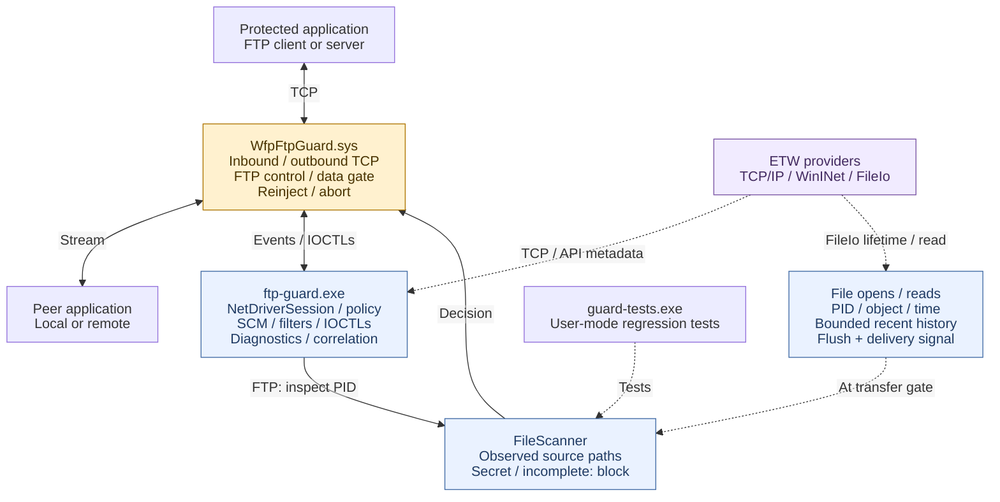

# WFP FTP Guard PoC

Windows x64 lab PoC for on-demand file inspection during FTP transfers. It covers
client uploads and remote pulls from a local FTP server, on arbitrary TCP ports.
WFP holds traffic while the console scans observed source paths for `secret` in
the filename or raw content (case-insensitive). It uses file-open/read evidence,
without AFA or an application allow list. Explicit FTPS is recognized before the
TLS upgrade; later data-flow enforcement uses conservative process/peer and file
I/O correlation. TLS is not decrypted. See the coverage limits below.

## Binaries

| Output | Role |
| --- | --- |
| `Debug/ftp-guard.exe` | Elevated console, driver loader, temporary WFP filters, ETW consumer, file policy and diagnostics. |
| `driver/WfpFtpGuard.sys` | WFP callouts: identify inbound/outbound flows, recognize FTP, correlate data flows, hold/reinject traffic and enforce decisions. It does not scan files or decrypt TLS. |
| `Debug/ftp-traffic.exe` | Synthetic client/server for controlled protocol tests; it does not perform real file transfers. |
| `Debug/guard-tests.exe` | Unit/regression runner; no live driver or ETW session. |
| `Debug/file-scanner.lib` | Static library linked into the console and unit runner; no separate deployment. |

Paths are relative to the CMake build folder. Deploy the matching console and
`.sys` together. `sign-driver` also produces a public test certificate; it does
not export the private key or change VM trust/boot settings. Test signing must
already be available on the lab VM. `NetDriverSession`, `NetEventKind`, `NetEvent`,
`NetDecision` and `NetStatus` name the network-driver interface.

## Design



Blue boxes are components of the console process. Dashed arrows carry evidence
or test relationships. File policy runs in user mode; WFP enforces its result.

## Classes and binary ownership

`Console` coordinates the file-policy decision, and `Driver` enforces it on the
connection. File enumeration and content scanning run in user mode. For static
classes such as `Console`, `Driver`, and `Diagnostics`, the binary column
identifies where the code runs; no class instance is created.

| Class | What it does | Binary that owns/uses it |
| --- | --- | --- |
| **`Console`** - `console/main.cpp` | Application entry point and coordinator. Parses options, starts the driver session and ETW monitor, processes driver events, requests file inspection, sends allow/block decisions, and handles shutdown. | `ftp-guard.exe` |
| **`NetDriverSession`** | Owns the console's connection to the driver. Loads the `.sys` through Windows services, installs temporary WFP filters, opens the driver device, exchanges IOCTL messages, and drains/unloads everything during cleanup. | `ftp-guard.exe` |
| **`Driver`** - `driver/driver.cpp` | Kernel-side implementation. Registers WFP callouts, associates connections with processes, inspects TCP stream bytes, holds commands pending inspection, reinjects allowed data, and aborts blocked flows. Also manages queues, timeouts, injection completion and connection teardown. | `WfpFtpGuard.sys` |
| **`FtpProbe`** | Recognizes the initial plaintext FTP exchange from greeting and command bytes. Handles fragmented input and returns `Unknown`, `Ftp`, or `Other`. It uses a bounded parser without dynamic allocation, so it can run inside the driver. | `WfpFtpGuard.sys` - one per tracked flow; `guard-tests.exe` - parser tests |
| **`NetFtpTransferProbe`** | Watches `STOR`/`APPE`/`STOU`, `RETR`, and `AUTH TLS`/`AUTH SSL`. Tracks the requested transfer direction and stops parsing after the TLS request. | `WfpFtpGuard.sys` - one per tracked flow; `guard-tests.exe` |
| **`NetTransferGate`** | Determines whether the local client/server is a file sender. Explicit FTPS candidates gate outgoing indications because encrypted commands hide transfer direction. Retained grants are allowed only for plaintext data connections. Zero-length FIN does not trigger scanning. | `WfpFtpGuard.sys`, `ftp-guard.exe` and `guard-tests.exe` |
| **`FileScanner`** | Checks process creation time, reopens observed source paths, checks filenames, and scans content with independent offsets. Returns clear, secret-name, secret-content, or incomplete. Reuses positive scans only when the process, flow, file identity, metadata and NTFS change-journal record still match. Its older all-handle scan remains available to regression tests; live transfers use observed source paths. | `ftp-guard.exe` and `guard-tests.exe`, through `file-scanner.lib` |
| **`SecretMatcher`** | Searches content chunks for case-insensitive `secret` byte patterns in ASCII/UTF-8 and UTF-16 LE/BE. Retains partial matches between chunks, so a match can cross a read boundary. It performs matching only; `FileScanner` opens and reads files. | `ftp-guard.exe` and `guard-tests.exe` |
| **`EtwMonitor`** | Owns ETW sessions/threads. Collects TCP metadata, optional WinINet intent, and FileIo create/read/close events. Supplies opened paths at upload-command gates and read paths at data gates. Flushes the trace and checks delivery completeness. | `ftp-guard.exe` |
| **`NetFileActivityCache`** | Stores up to 1,024 distinct PID/path observations. Coalesces repeated activity into the latest observation. Returns paths for the requested PID, observed since the connection began and within the last 30 seconds. It stores evidence, rather than keeping file handles alive. | `ftp-guard.exe` - owned by `EtwMonitor`; `guard-tests.exe` - cache tests |
| **`NetFileReadCache`** | Maps up to 4,096 live file objects to their owning PID/path. Records reads in a separate 1,024-record, 30-second history. Handles object reuse/close and reports eviction. A read is evidence of file activity, not proof of a particular transfer. | `ftp-guard.exe` - owned by `EtwMonitor`; `guard-tests.exe` |
| **`NetTraceProgress`** | Synchronizes ETW delivery using a mutex, condition variable, consumed-buffer counter and completion flag. Inspection waits for the required buffer count, consumer shutdown, or timeout. Inspection remains serial. | `ftp-guard.exe` - owned by each ETW session; `guard-tests.exe` - synchronization tests |
| **`Diagnostics`** | Formats connection/application details, converts strings and addresses, and writes synchronized console messages. It produces the application blobs visible in the screenshots. | `ftp-guard.exe` |
| **`WinHandle`** | Move-only owner of a Windows `HANDLE`. Automatically closes process, file, token and event handles when their owners leave scope. | `ftp-guard.exe` and `guard-tests.exe` |

The test executables contain three additional classes:

| Class | What it does | Binary that owns/uses it |
| --- | --- | --- |
| **`Traffic`** - `tests/traffic.cpp` | Implements `ftp-traffic.exe`: the synthetic client and minimal loopback server used for protocol, fragmentation, IPv6, HTTP and controlled open-file tests. | `ftp-traffic.exe` |
| **`Traffic::Socket`** | Private socket owner that automatically calls `closesocket`. | `ftp-traffic.exe` |
| **`Tests`** - `tests/unit.cpp` | Runs `guard-tests.exe`: parser, matcher, cache, synchronization and real Windows file-handle regression tests. | `guard-tests.exe` |
| **`FtpUploadProbe`** | Earlier upload-only parser retained for regression tests. The live driver now uses `NetFtpTransferProbe`. | `guard-tests.exe` |

`file-scanner.lib` is a static library: its code becomes part of the consuming
executable. Classes used by multiple binaries have independent instances in each
process.

The shared protocol types are data records:

- **`NetEventKind`** identifies flow, inspection, allow, block, error and closed-flow notifications.
- **`NetEvent`** carries process identity, endpoints, role/TLS/data flags, control-flow correlation, file-evidence time and command-verb evidence.
- **`NetDecision`** carries allow/block and an optional source-verified grant for one plaintext data connection (ABI version 3).
- **`NetStatus`** carries driver counters and operating state.

For an ordinary `ftp.exe` upload, the interaction is:

1. `Driver` uses `FtpProbe` to identify FTP and `NetFtpTransferProbe` to catch `STOR`.
2. `Console` receives the inspection request through `NetDriverSession`.
3. `EtwMonitor`, `NetTraceProgress` and `NetFileActivityCache` supply the recent-file evidence.
4. `FileScanner` checks observed paths, using `SecretMatcher` for content.
5. `Console` sends the decision through `NetDriverSession`; `Driver` releases or aborts the flow, and the console reports the outcome.
6. Outgoing data receives fresh read-based inspection. A clear plaintext source verdict releases that data connection; a later transfer opens a new one and is checked again. FTPS keeps inspecting later outgoing indications, so a public certificate read cannot authorize a subsequent upload.

For a server-side pull, incoming `RETR` reaches the server so it can open the
source. The driver holds its outgoing data; FileIo read evidence selects paths
for inspection. Active-mode data can be outbound even though control is inbound.
Explicit FTPS retains the application role after `AUTH TLS`/`AUTH SSL`, but the
encrypted `RETR`/`STOR` commands and negotiated data ports are unavailable.

## Run and modes

After [building and signing](TEST_RESULTS.md#build-and-test-instructions), run elevated:

```powershell
.\build\Debug\ftp-guard.exe --driver .\build\driver\WfpFtpGuard.sys --app C:\Windows\System32\ftp.exe
# Protect a local server instead:
.\build\Debug\ftp-guard.exe --driver .\build\driver\WfpFtpGuard.sys --app "C:\Program Files\SFTPGo\sftpgo.exe"
```

Omit `--app` to cover all applications; it otherwise selects the full executable
path. `--seconds N` sets a run limit; `--stop-event Local\name` supports orderly
external-controller shutdown. Ctrl+C/normal exit removes filters and
unloads the driver; stopping aborts tracked flows. One console may own the driver.

| Capability | `--etw-only` | `--no-etw` | Default combined |
| --- | --- | --- | --- |
| TCP PID/endpoints on any port | Trace candidates | WFP flows | Both, correlated by PID + full tuple |
| Plaintext FTP classification | No generic classifier; WinINet API intent if emitted | WFP byte probe | WFP byte probe |
| Hold commands / block flows | No | Yes | Yes |
| On-demand source-file policy | No | Required evidence is incomplete; transfer gates block | Bounded FileIo open/read history |
| Local server pulls / explicit FTPS candidates | Telemetry only | No complete file evidence | Correlated data-flow inspection, subject to limits |

TCP/WinINet ETW has no payload and cannot generally distinguish FTP from SFTP.
WinINet FTP events depend on the client/provider and may be absent. ETW-only is
telemetry, without file inspection or enforcement. Combined mode adds independent
network observations and recent file paths; a driver FTP event is still required
before file policy runs. ETW is file evidence here, without AFA; it is not the
FTP classifier or the blocking mechanism.

An upload source can be closed between handle snapshots. Combined mode handles
this timing gap by rechecking `STOR`/`APPE`/`STOU` and inspecting recent paths. It explicitly flushes
ETW, then waits on a condition variable for consumed buffers, with a four-second
deadline and shutdown notification. A delayed consumer triggers one conditional
reflush against the original buffer target. There is no fixed sleep in that wait.
Reported trace loss, delivery timeout or scanner failure blocks conservatively
as `inspection-incomplete`. With ETW disabled/unavailable, transfer gates block
because source evidence is incomplete. Unrelated open handles do not substitute
for a source-file observation.

## Key limits

- Covers newly established inbound/outbound IPv4/IPv6 TCP, using bounded application
  control-byte heuristics. TCP establishment/greeting can precede identification.
  Existing connections, unusual/slow starts and protocol
  ambiguity remain outside reliable coverage.
- SFTP and implicit FTPS are not inspected as FTP. Encrypted outer tunnel bytes
  cannot be classified as FTP; the inner application stream may still be visible
  before VPN encryption (see [coexistence](#kdf-vpn-and-wfp-coexistence)). Explicit
  `AUTH TLS`/`AUTH SSL` can be recognized before encryption. Data-flow association
  uses the same process and peer, not decrypted port negotiation. Parallel sessions,
  helpers, alternate data peers and unrelated TCP traffic can defeat or confuse it.
  Network file payloads are not directly scanned.

  Regarding SFTP - the key limitation is encryption: a network filter can
  recognize SSH, but the request that specifically identifies SFTP travels
  inside the encrypted session, so we cannot reliably distinguish SFTP from
  regular SSH packets.
- Raw file matching covers ASCII/UTF-8 and UTF-16 LE/BE patterns, without document
  parsing, archive unpacking or decryption. Only the filename is checked, excluding
  parent folders. Protected/unreadable/network files can cause conservative blocks.
- Explicit FTPS coverage is conditional. Unattributed outgoing indications pass
  for TLS-handshake compatibility; cached, mapped or memory-generated transfers
  without observed reads can therefore escape file inspection. The log reports
  `[COVERAGE]` without claiming a content verdict. This is not generic FTPS DLP
  or a no-leak guarantee. Implicit FTPS remains outside FTP qualification.
- A positive plaintext source verdict is scoped to one data connection, assuming ordinary
  FTP stream mode with a new data connection per transfer. Reused data connections,
  subsequent source changes and alternative transfer modes need further work.
- File reads are not atomic. Recent paths are reopened and
  may have changed, disappeared or come from unsuccessful open attempts. Missing,
  expired or evicted events can miss files; unrelated open/recent files can block
  a transfer. Plain FTP data without an observed source read blocks as incomplete.
  Recent evidence does not prove an exact file-to-transfer mapping.
- Blocking file content does not prevent a client or server from creating an
  empty destination entry. Control commands and TLS handshakes can precede a block.
- Positive source verdicts are cached for at most 30 seconds, with at most 64
  entries. The scanner briefly excludes new writers/replacement while checking
  and scanning that same file object. Active writers or unavailable NTFS USN
  evidence force a full scan. These short sharing leases can affect new writers.
  New source paths still require inspection; FTPS has no permanent data-flow grant.
- Bounds: 64 tracked flows, 16 MiB queued plus in-flight bytes per flow, 512-byte probe input per
  indication, 3-second initial probe, 15-second driver decision timeout and
  8-second file-scan budget. File-object and evidence eviction blocks conservatively.
  Capacity/allocation failures can leave flows untracked;
  unclassified traffic is allowed. Serial inspection, native ETW flush and file I/O
  can delay other flows or overrun a budget. This is a lab PoC, without production
  throughput, stability or evasion guarantees.

Diagnostics include application path/PID/session/endpoints, FTP command verb,
matched filename/rule and accepted driver outcome. `DRIVER CLOSED` retains known
transport-teardown status/context separately from policy blocks; other injection
failures remain errors. An allow/close event alone does not prove an upload.
Logs contain paths and should be sanitized before sharing.

## KDF, VPN, and WFP coexistence

WFP supports multiple inspection providers; installing Cisco KDF (the Secure
Client socket interceptor) does not exclusively reserve network interception.
An allow from another provider is not automatically an exemption from DLP
blocking; WFP supports callout vetoes. However, registration alone does not
guarantee callback delivery, plaintext visibility, correct process attribution,
or enforcement. See Microsoft's [filter arbitration model](https://learn.microsoft.com/en-us/windows/win32/fwp/filter-arbitration).

| Situation | Effect on FTP inspection |
| --- | --- |
| VPN encapsulates ordinary application TCP below the stream layer | The inner plaintext FTP stream should remain visible before tunnel encryption. Microsoft identifies TCP stream layers as [compatible with Windows IPsec](https://learn.microsoft.com/en-us/windows-hardware/drivers/network/developing-ipsec-compatible-callout-drivers); other VPN implementations require validation. |
| KDF or another component redirects through a local proxy | The application-to-proxy and proxy-to-server connections are separate. Inspecting the wrong connection can attribute traffic to the proxy and break file correlation; preserve the original application and destination context. See [WFP redirection](https://learn.microsoft.com/en-us/windows-hardware/drivers/network/using-bind-or-connect-redirection). |
| An earlier stream callout holds, modifies, or drops data | Stream inspection follows a [waterfall](https://learn.microsoft.com/en-us/windows-hardware/drivers/network/stream-inspection): downstream callouts inspect released/reinjected data, but permanently blocked segments do not reach them. |

Cisco documents configurable socket-interceptor WFP sublayer weights specifically
for coexistence with other WFP drivers and TCP redirection
([CSCwo25750](https://www.cisco.com/c/en/us/td/docs/security/vpn_client/anyconnect/Cisco-Secure-Client-5/release/notes/release-notes-cisco-secure-client-5-1.html)).
Build and testing documentation: [TEST_RESULTS.md](TEST_RESULTS.md).
The WFP design follows Microsoft's [stream editing sample](https://github.com/microsoft/Windows-driver-samples/tree/main/network/trans/stmedit)
and [stream inspection contract](https://learn.microsoft.com/en-us/windows-hardware/drivers/network/stream-inspection).
