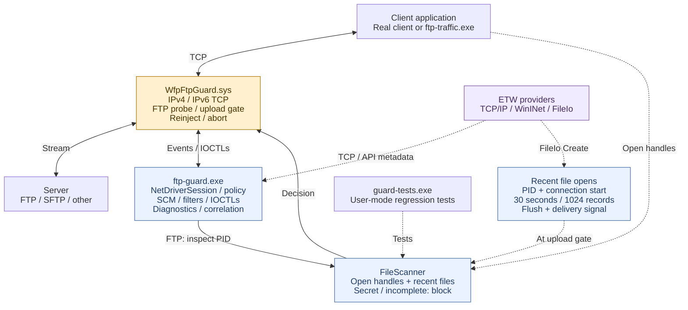

# WFP FTP Guard PoC

Windows x64 lab PoC that recognizes plaintext FTP on any TCP port and blocks a
confirmed FTP flow when the client has a file whose name or raw content contains
`secret` (case-insensitive substring). It scans open disk-file handles; default
combined mode also checks bounded ETW history of files opened since connection
start at each recognized upload command. The file need not be the upload source.

## Binaries

| Output | Role |
| --- | --- |
| `Debug/ftp-guard.exe` | Elevated console, driver loader, temporary WFP filters, ETW consumer, file policy and diagnostics. |
| `driver/WfpFtpGuard.sys` | WFP callouts: identify the application/flow, recognize FTP bytes, hold/reinject commands and enforce decisions. It does not scan files. |
| `Debug/ftp-traffic.exe` | Synthetic client/server for controlled protocol tests; it does not perform real file transfers. |
| `Debug/guard-tests.exe` | Unit/regression runner; no live driver or ETW session. |
| `Debug/file-scanner.lib` | Static library linked into the console and unit runner; no separate deployment. |

Paths are relative to the CMake build folder. Deploy the matching console and
`.sys` together. `sign-driver` also produces a public test certificate; it does
not export the private key or change VM trust/boot settings. Test signing must
already be available on the lab VM. `NetDriverSession`, `NetEventKind`, `NetEvent`,
`NetDecision` and `NetStatus` name the network-driver interface.

## Design



Blue boxes are components of the console process. Dashed arrows carry evidence
or test relationships. File policy runs in user mode; WFP enforces its result.

## Run and modes

After [building and signing](TEST_RESULTS.md#build-and-test-instructions), run elevated:

```powershell
.\build\Debug\ftp-guard.exe --driver .\build\driver\WfpFtpGuard.sys --app C:\Windows\System32\ftp.exe
```

Omit `--app` to cover all applications; it otherwise selects the full executable
path. `--seconds N` sets a run limit. Ctrl+C/normal exit removes filters and
unloads the driver; stopping aborts tracked flows. One console may own the driver.

| Capability | `--etw-only` | `--no-etw` | Default combined |
| --- | --- | --- | --- |
| TCP PID/endpoints on any port | Trace candidates | WFP flows | Both, correlated by PID + full tuple |
| Plaintext FTP classification | No generic classifier; WinINet API intent if emitted | WFP byte probe | WFP byte probe |
| Hold commands / block flows | No | Yes | Yes |
| Open-handle file policy | No | Yes | Yes |
| Recently opened, now closed files at upload gates | No | No | Bounded FileIo history |

TCP/WinINet ETW has no payload and cannot generally distinguish FTP from SFTP.
WinINet FTP events depend on the client/provider and may be absent. ETW-only is
telemetry, without file inspection or enforcement. Combined mode adds independent
network observations and recent file paths; a driver FTP event is still required
before file policy runs.

Windows `ftp.exe` briefly opens its source before `STOR`, closes that probe handle,
and reopens it after server acceptance. Combined mode covers this tested gap by
rechecking `STOR`/`APPE`/`STOU` and inspecting recent paths. It explicitly flushes
ETW, then waits on a condition variable for consumed buffers, with a two-second
deadline and shutdown notification. There is no fixed sleep in that wait.
Reported trace loss, delivery timeout or scanner failure blocks conservatively
as `inspection-incomplete`. With ETW disabled/unavailable, enforcement continues
with narrower open-handle coverage and can miss this native-client source.

## Key limits

- Covers newly established outbound IPv4/IPv6 TCP, using bounded application
  control-byte heuristics. TCP establishment/greeting can precede identification.
  Existing connections, inbound-initiated flows, unusual/slow starts and protocol
  ambiguity remain outside reliable coverage.
- SFTP, implicit FTPS and encrypted tunnels are not inspected as FTP. Explicit
  `AUTH TLS` can be recognized before encryption; later encrypted commands cannot.
  Control/data channels are not linked, and network file payloads are not scanned.
- Raw file matching covers ASCII/UTF-8 and UTF-16 LE/BE patterns, without document
  parsing, archive unpacking or decryption. Only the filename is checked, excluding
  parent folders. Protected/unreadable/network files can cause conservative blocks.
- Handle snapshots and file reads are not atomic. Recent paths are reopened and
  may have changed, disappeared or come from unsuccessful open attempts. Missing,
  expired or evicted events can miss files; unrelated open/recent files can block
  a transfer. Recent evidence does not prove a handle remains open or prove which
  file is being uploaded.
- Bounds: 64 tracked flows, 256 KiB queued bytes per flow, 512-byte probe input per
  indication, 3-second initial probe, 15-second driver decision timeout and
  8-second file-scan budget. Capacity/allocation failures can leave flows untracked;
  unclassified traffic is allowed. Serial inspection, native ETW flush and file I/O
  can delay other flows or overrun a budget. This is a lab PoC, without production
  throughput, stability or evasion guarantees.

Diagnostics include application path/PID/session/endpoints, FTP command verb,
matched filename/rule and accepted driver outcome. `DRIVER CLOSED` retains known
transport-teardown status/context separately from policy blocks; other injection
failures remain errors. An allow/close event alone does not prove an upload.
Logs contain paths and should be sanitized before sharing.

See [TEST_RESULTS.md](TEST_RESULTS.md) for real end-to-end results, separate
synthetic results, build/reproduction instructions and detailed test scope.
The WFP design follows Microsoft's [stream editing sample](https://github.com/microsoft/Windows-driver-samples/tree/main/network/trans/stmedit)
and [stream inspection contract](https://learn.microsoft.com/en-us/windows-hardware/drivers/network/stream-inspection).
