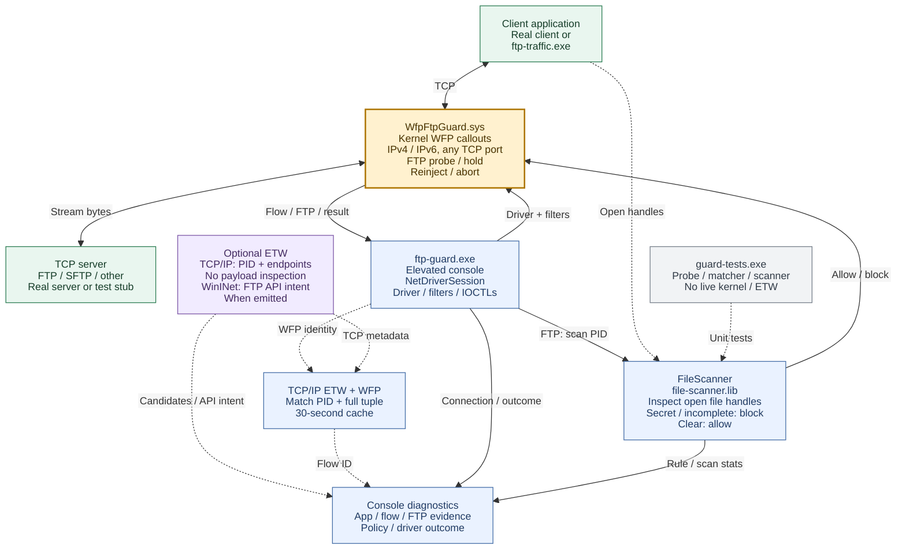

# WFP FTP Guard Windows proof of concept

This standalone Windows x64 CMake solution recognizes plaintext FTP control
traffic on arbitrary TCP ports. A WFP kernel callout holds a recognized FTP
command while an elevated console examines the originating application's
currently open disk-file handles. It aborts the flow if any such file has
`secret` in its filename or raw content, ignoring ASCII case. The file need not
be the one being uploaded. Matching is by substring, not whole word; the filename
check excludes parent directory names. ASCII/UTF-8 and UTF-16 LE/BE byte patterns
are covered.

The console prints a short application block for each connection, FTP evidence
without credentials or command arguments, the matched file and rule, and the
driver's resulting allow/block event. It starts the driver through SCM, installs
temporary WFP filters, and drains/unloads the driver on normal exit or Ctrl+C.

## Design overview



Solid arrows show network/control flow; dashed arrows show observations,
inspection dependencies, or test relationships. Blue boxes are components of
the same `ftp-guard.exe` process. The file-policy decision is made in the console
and enforced by the driver. ETW has no path into that
decision: `--etw-only` runs the trace/diagnostic path without the driver or file
scan, while `--no-etw` retains the driver, console, and file-policy path.
`ftp-traffic.exe` can supply synthetic traffic on either side; real transfers
require a real client/server. Unit tests exercise shared code without loading
the kernel driver.

## Built binaries and their roles

Paths assume `cmake -B build` and the Debug configuration. Replace `Debug` with
the selected configuration for user-mode outputs.

| Output | Role | Limits of that binary |
| --- | --- | --- |
| `build\Debug\ftp-guard.exe` | Main console, driver loader, policy engine, and ETW consumer. Installs temporary WFP filters, receives flow events, scans process file handles, sends decisions, and prints diagnostics. | Cannot intercept/block streams without the driver. In `--etw-only` mode it provides telemetry only. It is not an FTP client/server. |
| `build\driver\WfpFtpGuard.sys` | WFP kernel callout. Captures outbound TCP flow ownership/endpoints, recognizes initial FTP control bytes, holds commands, reinjects permitted data, and aborts blocked flows. | Does not enumerate or scan files. The console supplies filters, file-policy decisions, and readable output; loading the `.sys` alone is not the complete solution. |
| `build\Debug\ftp-traffic.exe` | Controlled loopback client and minimal test server. Exercises raw Winsock/WinINet FTP handshakes, fragmentation, IPv4/IPv6, HTTP control cases, and files held open during a connection. | A synthetic test tool, not a real FTP file-transfer server, SFTP implementation, or monitor. A successful handshake does not prove a file upload. |
| `build\Debug\guard-tests.exe` | Unit/regression runner for the shared FTP probe, secret matcher, and file scanner, including real Windows file/device handles. CTest invokes it as `guard-unit`. | Does not load the driver or validate live kernel interception, ETW delivery, or actual server transfers. |
| `build\Debug\file-scanner.lib` | Static file-scanner library linked into `ftp-guard.exe` and `guard-tests.exe`. | Not a separate process, DLL, service, or driver to deploy. |

`ftp-driver` and `sign-driver` are CMake targets, not executables. The signing
target also writes `build\driver\WfpFtpGuard-Test.cer`, a public certificate;
the signing private key is not exported. `.pdb`, `.obj`, and other compiler/linker
outputs support building/debugging and are not additional agents to run.

Enforcement needs `ftp-guard.exe` and its matching `.sys` on the lab VM. ETW-only
operation needs only `ftp-guard.exe`. The traffic generator and unit runner are
test tools. SFTPGo and external clients such as curl are not built or installed
by this solution.

## Build

Use MSVC 2022 x64 and an installed Windows SDK/WDK. The default WDK is 10.0.26100.0;
override `WDK_ROOT` or `WDK_VERSION` at configuration if needed. No downloaded
libraries or NuGet packages are required.

```powershell
cmake -S . -B build -G "Visual Studio 17 2022" -A x64
cmake --build build --config Debug --parallel 4
ctest --test-dir build -C Debug --output-on-failure
cmake --build build --config Debug --target sign-driver
```

The driver is `build\driver\WfpFtpGuard.sys`. User programs are in `build\Debug`.
`sign-driver` creates a dedicated, non-exportable test-signing key in the build
user's certificate store and exports only its public `.cer`. An already
test-signing-enabled lab VM can load this embedded-signature driver without
installing the certificate into Root or TrustedPublisher. No trust-store or boot
configuration changes were needed on W11Test. Production signing is outside this
PoC.

Build from a non-elevated development prompt; run the monitor elevated. The
signing target does not enable test mode, change boot settings, or install the
certificate into a trust store. Non-Windows, non-MSVC, and non-x64 builds are
explicitly rejected by this standalone project.

## Run and compare modes

```powershell
# Elevated console, from the repository root; scope the first run to the test client.
.\build\Debug\ftp-guard.exe --driver .\build\driver\WfpFtpGuard.sys --app .\build\Debug\ftp-traffic.exe
```

`--app` selects an executable path, not a PID or only a filename. Omit it to
monitor all newly established outbound TCP connections. Connections that predate
the WFP filters are not inspected. `--seconds N` stops after N seconds; zero or
omission runs until Ctrl+C. `--no-etw` disables ETW while retaining the console
and driver: the console still performs the file scan and policy decision.

| Capability | ETW only | WFP plus console, no ETW | Combined default |
| --- | --- | --- | --- |
| Observe TCP PID and IPv4/IPv6 endpoints on arbitrary ports | Supported trace events | Tracked outbound flows | Both sources |
| Recognize FTP from stream bytes | No | Bounded WFP probe | Same WFP probe |
| Observe WinINet FTP API intent | If the provider emits it | No | If available; logged separately |
| Scan open files and apply the `secret` policy | No | Console performs the scan | Same policy |
| Hold commands and block the flow | No | Driver enforces the decision | Same enforcement |
| Link TCP/IP ETW observations to WFP flow IDs | No | No | Best effort |

Only one console may own the driver. Normal cleanup drains/aborts tracked flows;
stopping the PoC is not a transparent handoff of existing connections. A forcibly
terminated console cannot execute its SCM cleanup; the device cleanup callback
drains interception, but recovering the
service may require elevated `sc.exe stop WfpFtpGuardPoc` followed by
`sc.exe delete WfpFtpGuardPoc`.

## ETW-only capabilities and limitations

```powershell
.\build\Debug\ftp-guard.exe --etw-only --app .\build\Debug\ftp-traffic.exe --seconds 30
```

The console creates its own real-time TCP/IP system-trace session and a separate
WinINet provider session. It does not take over the existing NT Kernel Logger.
TCP connect events provide PID and IPv4/IPv6 endpoints on arbitrary ports, but
contain no application payload and are explicitly labeled candidates. WinINet
`InternetConnect` event 103 contains a service field: `FTP` identifies an FTP
session for applications using that API, including on nonstandard ports. Other
FTP stacks, such as libcurl, do not necessarily emit WinINet events.
The WinINet signal represents FTP API intent, not inspected network bytes or
proof that login/transfer succeeded. This is best-effort telemetry: the WinINet
FTP client tested on W11Test emitted TCP connection events but no FTP-specific
WinINet service event. ETW-only mode
therefore reports candidates on that system, rather than claiming to qualify
all FTP traffic. Driver stream inspection supplies the confirmed classification.

ETW-only mode does not load the driver, scan file handles, hold commands, or
block connections. TCP events alone cannot distinguish FTP from SFTP or other
application protocols, even on port 21. Failed attempts that never produce a
supported connect event may not appear. Provider availability, event schemas,
buffering, and delivery vary; reported event loss is printed when a trace stops.
Run this mode elevated. Startup fails if the TCP/IP trace cannot start, and
diagnostics report which provider sessions are available.

Process details are queried when events are consumed. Image/path/session details
can be unavailable after process exit or when access is denied. In ETW-only mode,
`--app` filtering depends on resolving the current process image, so delayed
events from short-lived processes can be omitted. Trace sessions are system-wide;
aggregate TCP/WinINet event counters can include other applications even when
displayed connection records are filtered by `--app`.

## What ETW and WFP offer together

Default operation provides both independent connection telemetry and stream
classification with enforcement. WFP reports a flow ID, PID, and endpoints;
on recognizing FTP it holds the command while the console scans open files and
returns a decision. ETW adds connection observations and WinINet API intent when
available, without participating in the allow/block decision.

TCP/IP ETW observations are joined to WFP flow IDs by PID, address family, both
addresses, and both ports. A cache retains at most 1,024 observations for about
30 seconds and accepts either arrival order. TCP events can still correlate
after process exit even when the image path can no longer be queried. Buffering,
loss, eviction, and PID/tuple reuse can cause missing or ambiguous matches; this
is diagnostic correlation, not an independent identity/security guarantee.
WinINet FTP API events are logged separately and are not assigned a WFP flow ID
by this correlation code.

Combining the sources does not expand encrypted-protocol coverage or the file
scanner's scope. ETW never turns a candidate/API event into an FTP block or
substitutes for a missing driver event. WFP enforcement can continue if ETW is
unavailable. A driver load failure does not silently fall back to ETW-only mode.

Connection blobs include the source, PID, executable name/path, Windows session,
endpoints, and WFP flow ID when available. `[FTP CONFIRMED]` means the byte probe
matched its heuristic, not that a transfer succeeded. `[ALLOW]`/`[BLOCK]` report
the console's rule and whether the decision was accepted; driver allow/block
events report its result. `inspection-incomplete` is not a secret match, and
`[DRIVER ERROR]` is not evidence of one. Allowing a flow does not prove successful
authentication/upload. Diagnostics omit FTP arguments and file content, but
contain application paths and matched filenames; sanitize logs before sharing.

## Controlled traffic

Run `ftp-traffic.exe --server --port 2121` in one console. It implements only the
small FTP handshake needed for tests, bound to loopback; it is not a file server.
Run the following from the directory containing the client and prepared fixture
files. The content-match fixture must actually contain `secret` in its content.

```powershell
.\ftp-traffic.exe --port 2121 --file .\public.txt --expect allowed
.\ftp-traffic.exe --port 2121 --file .\secret-name.txt --expect blocked
.\ftp-traffic.exe --port 2121 --file .\public-with-sensitive-content.txt --expect blocked
.\ftp-traffic.exe --port 2121 --fragment --file .\public.txt --expect allowed
.\ftp-traffic.exe --port 2121 --wininet --expect allowed
```

`--ipv6` selects `::1` for both server and client. A separate `--server --http`
instance and `--http` client exercise non-FTP traffic, including on port 21.
`--close-file` closes the file before connecting. Clients also verify that the
inspector did not alter the original file handle's seek position.
Test clients linger for 1.5 seconds after their result so that their image details
remain queryable while ETW buffers flush.

`tests\Invoke-LiveTests.ps1` reproduces the 15-case lab matrix on W11Test, using
binaries in `C:\dev\WfpFtpGuard-Poc` and writing fixtures and logs beneath
`C:\dev\tmp-scripts`. Run it from an elevated PowerShell session and leave that
session open until it finishes. It verifies normal driver unload and exercises
ETW-only mode after the driver stops. See `TEST_RESULTS.md` for measured results.

`TEST_RESULTS.md` records earlier validation, including historical source and
deployment paths. It is not a fresh test of every later change. Copied real
SFTPGo results exposed false FTP blocks from valid non-disk handles; the fix
passed the 3,651-assertion regression suite on DEV-11x64. The updated driver and
console have not yet been live-retested against SFTPGo. Use a real server/client
and compare transferred bytes to validate uploads; the synthetic tool does not
do that. Unit success does not establish kernel/ETW coverage or production
readiness.

## WFP driver capabilities and limitations

* ALE flow-established callouts capture the application PID and the connection
  tuple; stream callouts inspect reassembled application control headers, rather
  than guessing from IP/TCP headers or port 21. FTP is an application protocol.
  Coverage is newly established outbound IPv4/IPv6 TCP; inbound-initiated flows,
  UDP, and connections already established before monitoring are outside scope.
  TCP establishment and the server greeting can precede FTP identification, so
  this does not reject the original TCP SYN based on FTP.
* `USER`/`PASS` and other ambiguous commands require a valid `220` greeting.
  Distinctive commands such as `EPSV`, `PASV`, `SYST`, or `AUTH TLS` can identify
  an FTP attempt directly. Split greetings and commands are accumulated. This is
  a bounded protocol heuristic, not a complete FTP grammar or a cryptographic
  proof that a peer is an FTP server.
  It examines the initial client line and bounded greeting, not every command
  throughout a session. Unusual/slow starts, long lines, protocol switching,
  or protocols sharing command vocabulary can be missed or misclassified.
* Every tracked stream remains in out-of-band mode for its lifetime. Indications
  are cloned and absorbed, then reinjected in order after authorization. A
  recognized FTP command is not forwarded while the file check is pending.
  This also adds overhead and a reinjection dependency to tracked non-FTP flows.
* The driver does not inspect files: the elevated console supplies that policy
  decision. Device access is restricted to administrators and SYSTEM. A missing
  decision for recognized FTP is blocked after the timeout, without consulting
  ETW. Loading the driver alone does not install the console's dynamic filters.
* Bounds: 64 simultaneously tracked flows, 256 KiB queued stream data per flow,
  512-byte initial control lines, a 3-second initial command window and a
  15-second driver decision timeout. Flows above tracking capacity, or whose
  context cannot be allocated/associated, can pass without inspection. Traffic
  still unclassified after the probe timeout is allowed. Allocation/queue
  failures in a tracked stream can instead drop a connection. The control-event
  queue is limited to 256 entries. Resource exhaustion therefore offers neither
  guaranteed coverage nor availability.
* Plaintext FTP control is covered; implicit FTPS/TLS, encrypted tunnels and
  standalone FTP data channels cannot be qualified from these headers. Explicit
  `AUTH TLS` can be recognized before encryption. SFTP is a separate SSH-based
  protocol outside this FTP file policy, including on port 21; its encrypted
  content is not inspected. Control/data channels are not linked into a transfer
  model, and transferred network content is not scanned for `secret`.

### File-policy capabilities and limitations in the console

* File enumeration uses dynamically resolved `NtQuerySystemInformation` with
  `SystemExtendedHandleInformation`, keeping full-width PIDs/handles.
  The native snapshot ABI is internal and can change with Windows versions.
* Duplicated file handles identify the actual open objects. Content is read
  through `ReOpenFile` with independent overlapped offsets; application seek
  positions are preserved. Process creation time is checked to prevent PID reuse
  from associating a flow with another process.
* Local disk files are content-scanned. Directories, pipes/sockets, and valid
  non-disk device handles are skipped. `FILE_TYPE_UNKNOWN` with a successful
  `GetFileType` call is not itself a scanner failure. Raw matching does not parse
  document formats, unpack archives, decrypt content, scan process memory, or
  perform general Unicode normalization.
* Unreadable files, unsupported network-file content, scanner failures or an
  expired scan budget deny confirmed FTP conservatively. `inspection-incomplete`
  is reported separately from an actual secret match. Ordinary non-FTP traffic
  is not subjected to file scanning.
* The default scan budget is 8 seconds. Native API calls and waiting for I/O
  cancellation can overrun a user-mode budget. This console handles scans
  serially, so a slow scan can delay other flows until their driver timeouts.
* The snapshot is taken when the console handles the first FTP detection; the
  handle snapshot and content reads are not atomic. Later opens/changes are not
  continuously monitored. Files closed before the snapshot and memory-only
  content are outside scope. An unrelated open file can cause an FTP block even
  if that file is never uploaded. This is a lab PoC without production throughput,
  stability, or adversarial-evasion guarantees.

## Microsoft references

The clone/absorb/reinject design follows Microsoft's
[stream editing sample](https://github.com/microsoft/Windows-driver-samples/tree/main/network/trans/stmedit)
and [stream inspection contract](https://learn.microsoft.com/en-us/windows-hardware/drivers/network/stream-inspection).
See also [FwpsCloneStreamData0](https://learn.microsoft.com/en-us/windows-hardware/drivers/ddi/fwpsk/nf-fwpsk-fwpsclonestreamdata0),
[FwpsStreamInjectAsync0](https://learn.microsoft.com/en-us/windows-hardware/drivers/ddi/fwpsk/nf-fwpsk-fwpsstreaminjectasync0),
[system ETW sessions](https://learn.microsoft.com/en-us/windows/win32/etw/configuring-and-starting-a-systemtraceprovider-session),
[InternetConnectW](https://learn.microsoft.com/en-us/windows/win32/api/wininet/nf-wininet-internetconnectw),
and [ReOpenFile](https://learn.microsoft.com/en-us/windows/win32/api/winbase/nf-winbase-reopenfile).
