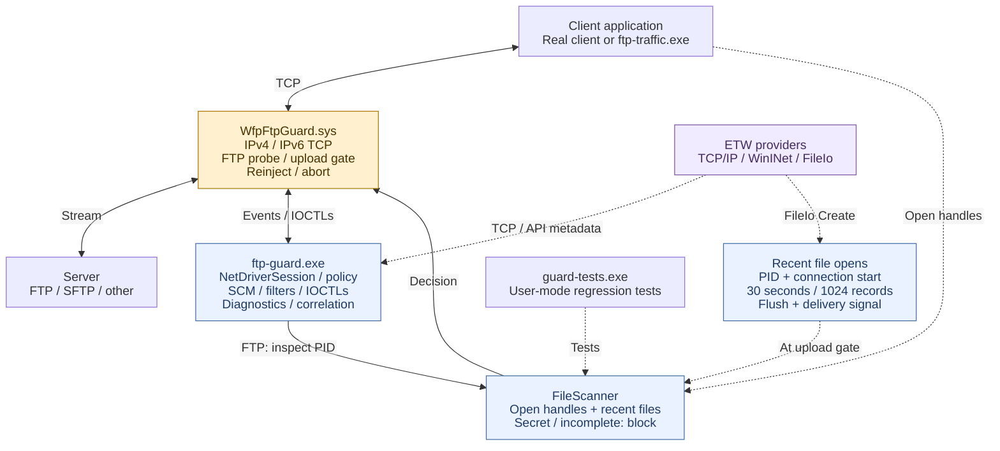

# WFP FTP Guard PoC

Windows x64 lab PoC that recognizes plaintext FTP on any TCP port and blocks a
confirmed FTP flow when the client has a file whose name or raw content contains
`secret` (case-insensitive substring). It scans open disk-file handles; default
combined mode also checks bounded ETW history of files opened since connection
start at each recognized upload command. The file need not be the upload source.

## Binaries

| Output | Role |
| --- | --- |
| `Debug/ftp-guard.exe` | Elevated console, driver loader, temporary WFP filters, ETW consumer, file policy and diagnostics. |
| `driver/WfpFtpGuard.sys` | WFP callouts: identify the application/flow, recognize FTP bytes, hold/reinject commands and enforce decisions. It does not scan files. |
| `Debug/ftp-traffic.exe` | Synthetic client/server for controlled protocol tests; it does not perform real file transfers. |
| `Debug/guard-tests.exe` | Unit/regression runner; no live driver or ETW session. |
| `Debug/file-scanner.lib` | Static library linked into the console and unit runner; no separate deployment. |

Paths are relative to the CMake build folder. Deploy the matching console and
`.sys` together. `sign-driver` also produces a public test certificate; it does
not export the private key or change VM trust/boot settings. Test signing must
already be available on the lab VM. `NetDriverSession`, `NetEventKind`, `NetEvent`,
`NetDecision` and `NetStatus` name the network-driver interface.

## Design



Blue boxes are components of the console process. Dashed arrows carry evidence
or test relationships. File policy runs in user mode; WFP enforces its result.

## Classes and binary ownership

`Console` coordinates the file-policy decision, and `Driver` enforces it on the
connection. File enumeration and content scanning run in user mode. For static
classes such as `Console`, `Driver`, and `Diagnostics`, the binary column
identifies where the code runs; no class instance is created.

| Class | What it does | Binary that owns/uses it |
| --- | --- | --- |
| **`Console`** - `console/main.cpp` | Application entry point and coordinator. Parses options, starts the driver session and ETW monitor, processes driver events, requests file inspection, sends allow/block decisions, and handles shutdown. | `ftp-guard.exe` |
| **`NetDriverSession`** | Owns the console's connection to the driver. Loads the `.sys` through Windows services, installs temporary WFP filters, opens the driver device, exchanges IOCTL messages, and drains/unloads everything during cleanup. | `ftp-guard.exe` |
| **`Driver`** - `driver/driver.cpp` | Kernel-side implementation. Registers WFP callouts, associates connections with processes, inspects TCP stream bytes, holds commands pending inspection, reinjects allowed data, and aborts blocked flows. Also manages queues, timeouts, injection completion and connection teardown. | `WfpFtpGuard.sys` |
| **`FtpProbe`** | Recognizes the initial plaintext FTP exchange from greeting and command bytes. Handles fragmented input and returns `Unknown`, `Ftp`, or `Other`. It uses a bounded parser without dynamic allocation, so it can run inside the driver. | `WfpFtpGuard.sys` - one per tracked flow; `guard-tests.exe` - parser tests |
| **`FtpUploadProbe`** | Watches subsequent commands on a confirmed FTP connection. Detects `STOR`, `APPE`, and `STOU` so an earlier allow does not authorize every later upload. Reuses `FtpProbe`'s command parsing and stops plaintext inspection after `AUTH TLS`. | `WfpFtpGuard.sys` - one per tracked flow; `guard-tests.exe` - parser tests |
| **`FileScanner`** | Examines the originating process's open disk-file handles and supplied recent-file paths. Checks process creation time to guard against PID reuse, checks filenames, reads content with independent offsets, and returns a clear, secret-name, secret-content, or incomplete result. | `ftp-guard.exe` and `guard-tests.exe`, through `file-scanner.lib` |
| **`SecretMatcher`** | Searches content chunks for case-insensitive `secret` byte patterns in ASCII/UTF-8 and UTF-16 LE/BE. Retains partial matches between chunks, so a match can cross a read boundary. It performs matching only; `FileScanner` opens and reads files. | `ftp-guard.exe` and `guard-tests.exe` |
| **`EtwMonitor`** | Owns the ETW sessions and consumer threads. Collects TCP connection metadata, optional WinINet FTP intent, and file-open events. Correlates TCP observations with WFP flows and supplies recent-file evidence at upload gates. It also flushes the trace and checks delivery completeness. | `ftp-guard.exe` |
| **`NetFileActivityCache`** | Stores up to 1,024 file-open records. Returns deduplicated paths for the requested PID, opened since the connection began and within the last 30 seconds. It stores evidence of opens, rather than keeping file handles alive. | `ftp-guard.exe` - owned by `EtwMonitor`; `guard-tests.exe` - cache tests |
| **`NetTraceProgress`** | Synchronizes ETW delivery using a mutex, condition variable, consumed-buffer counter and completion flag. Inspection waits for the required buffer count, consumer shutdown, or timeout. This replaces the guessed fixed sleep; inspection remains serial. | `ftp-guard.exe` - owned by each ETW session; `guard-tests.exe` - synchronization tests |
| **`Diagnostics`** | Formats connection/application details, converts strings and addresses, and writes synchronized console messages. It produces the application blobs visible in the screenshots. | `ftp-guard.exe` |
| **`WinHandle`** | Move-only owner of a Windows `HANDLE`. Automatically closes process, file, token and event handles when their owners leave scope. | `ftp-guard.exe` and `guard-tests.exe` |

The test executables contain three additional classes:

| Class | What it does | Binary that owns/uses it |
| --- | --- | --- |
| **`Traffic`** - `tests/traffic.cpp` | Implements `ftp-traffic.exe`: the synthetic client and minimal loopback server used for protocol, fragmentation, IPv6, HTTP and controlled open-file tests. | `ftp-traffic.exe` |
| **`Traffic::Socket`** | Private socket owner that automatically calls `closesocket`. | `ftp-traffic.exe` |
| **`Tests`** - `tests/unit.cpp` | Runs `guard-tests.exe`: parser, matcher, cache, synchronization and real Windows file-handle regression tests. | `guard-tests.exe` |

`file-scanner.lib` is a static library: its code becomes part of the consuming
executable. Classes used by multiple binaries have independent instances in each
process.

The shared protocol types are data records:

- **`NetEventKind`** identifies flow, inspection, allow, block, error and closed-flow notifications.
- **`NetEvent`** carries a notification, process identity, endpoints and command evidence.
- **`NetDecision`** carries the console's allow/block reply for a flow.
- **`NetStatus`** carries driver counters and operating state.

For an ordinary `ftp.exe` upload, the interaction is:

1. `Driver` uses `FtpProbe` to identify FTP and `FtpUploadProbe` to catch `STOR`.
2. `Console` receives the inspection request through `NetDriverSession`.
3. `EtwMonitor`, `NetTraceProgress` and `NetFileActivityCache` supply the recent-file evidence.
4. `FileScanner` checks current handles and recent paths, using `SecretMatcher` for content.
5. `Console` sends the decision through `NetDriverSession`; `Driver` releases or aborts the flow, and the console reports the outcome.

## Run and modes

After [building and signing](TEST_RESULTS.md#build-and-test-instructions), run elevated:

```powershell
.\build\Debug\ftp-guard.exe --driver .\build\driver\WfpFtpGuard.sys --app C:\Windows\System32\ftp.exe
```

Omit `--app` to cover all applications; it otherwise selects the full executable
path. `--seconds N` sets a run limit. Ctrl+C/normal exit removes filters and
unloads the driver; stopping aborts tracked flows. One console may own the driver.

| Capability | `--etw-only` | `--no-etw` | Default combined |
| --- | --- | --- | --- |
| TCP PID/endpoints on any port | Trace candidates | WFP flows | Both, correlated by PID + full tuple |
| Plaintext FTP classification | No generic classifier; WinINet API intent if emitted | WFP byte probe | WFP byte probe |
| Hold commands / block flows | No | Yes | Yes |
| Open-handle file policy | No | Yes | Yes |
| Recently opened, now closed files at upload gates | No | No | Bounded FileIo history |

TCP/WinINet ETW has no payload and cannot generally distinguish FTP from SFTP.
WinINet FTP events depend on the client/provider and may be absent. ETW-only is
telemetry, without file inspection or enforcement. Combined mode adds independent
network observations and recent file paths; a driver FTP event is still required
before file policy runs.

Windows `ftp.exe` briefly opens its source before `STOR`, closes that probe handle,
and reopens it after server acceptance. Combined mode covers this tested gap by
rechecking `STOR`/`APPE`/`STOU` and inspecting recent paths. It explicitly flushes
ETW, then waits on a condition variable for consumed buffers, with a two-second
deadline and shutdown notification. There is no fixed sleep in that wait.
Reported trace loss, delivery timeout or scanner failure blocks conservatively
as `inspection-incomplete`. With ETW disabled/unavailable, enforcement continues
with narrower open-handle coverage and can miss this native-client source.

## Key limits

- Covers newly established outbound IPv4/IPv6 TCP, using bounded application
  control-byte heuristics. TCP establishment/greeting can precede identification.
  Existing connections, inbound-initiated flows, unusual/slow starts and protocol
  ambiguity remain outside reliable coverage.
- SFTP and implicit FTPS are not inspected as FTP. Encrypted outer tunnel bytes
  cannot be classified as FTP; the inner application stream may still be visible
  before VPN encryption (see [coexistence](#kdf-vpn-and-wfp-coexistence)). Explicit
  `AUTH TLS` can be recognized before encryption; later encrypted commands cannot.
  Control/data channels are not linked, and network file payloads are not scanned.

  Regarding SFTP - the key limitation is encryption: a network filter can
  recognize SSH, but the request that specifically identifies SFTP travels
  inside the encrypted session, so we cannot reliably distinguish SFTP from
  regular SSH packets.
- Raw file matching covers ASCII/UTF-8 and UTF-16 LE/BE patterns, without document
  parsing, archive unpacking or decryption. Only the filename is checked, excluding
  parent folders. Protected/unreadable/network files can cause conservative blocks.
- Handle snapshots and file reads are not atomic. Recent paths are reopened and
  may have changed, disappeared or come from unsuccessful open attempts. Missing,
  expired or evicted events can miss files; unrelated open/recent files can block
  a transfer. Recent evidence does not prove a handle remains open or prove which
  file is being uploaded.
- Bounds: 64 tracked flows, 256 KiB queued bytes per flow, 512-byte probe input per
  indication, 3-second initial probe, 15-second driver decision timeout and
  8-second file-scan budget. Capacity/allocation failures can leave flows untracked;
  unclassified traffic is allowed. Serial inspection, native ETW flush and file I/O
  can delay other flows or overrun a budget. This is a lab PoC, without production
  throughput, stability or evasion guarantees.

Diagnostics include application path/PID/session/endpoints, FTP command verb,
matched filename/rule and accepted driver outcome. `DRIVER CLOSED` retains known
transport-teardown status/context separately from policy blocks; other injection
failures remain errors. An allow/close event alone does not prove an upload.
Logs contain paths and should be sanitized before sharing.

## KDF, VPN, and WFP coexistence

WFP supports multiple inspection providers; installing Cisco KDF (the Secure
Client socket interceptor) does not exclusively reserve network interception.
An allow from another provider is not automatically an exemption from DLP
blocking; WFP supports callout vetoes. However, registration alone does not
guarantee callback delivery, plaintext visibility, correct process attribution,
or enforcement. See Microsoft's [filter arbitration model](https://learn.microsoft.com/en-us/windows/win32/fwp/filter-arbitration).

| Situation | Effect on FTP inspection |
| --- | --- |
| VPN encapsulates ordinary application TCP below the stream layer | The inner plaintext FTP stream should remain visible before tunnel encryption. Microsoft identifies TCP stream layers as [compatible with Windows IPsec](https://learn.microsoft.com/en-us/windows-hardware/drivers/network/developing-ipsec-compatible-callout-drivers); other VPN implementations require validation. |
| KDF or another component redirects through a local proxy | The application-to-proxy and proxy-to-server connections are separate. Inspecting the wrong connection can attribute traffic to the proxy and break file correlation; preserve the original application and destination context. See [WFP redirection](https://learn.microsoft.com/en-us/windows-hardware/drivers/network/using-bind-or-connect-redirection). |
| An earlier stream callout holds, modifies, or drops data | Stream inspection follows a [waterfall](https://learn.microsoft.com/en-us/windows-hardware/drivers/network/stream-inspection): downstream callouts inspect released/reinjected data, but permanently blocked segments do not reach them. |

Cisco documents configurable socket-interceptor WFP sublayer weights specifically
for coexistence with other WFP drivers and TCP redirection
([CSCwo25750](https://www.cisco.com/c/en/us/td/docs/security/vpn_client/anyconnect/Cisco-Secure-Client-5/release/notes/release-notes-cisco-secure-client-5-1.html)).
The PoC's chosen ordering has not been qualified against KDF.

**Current PoC concern:** [FlowClassify](driver/driver.cpp) returns when
`FWPS_RIGHT_ACTION_WRITE` is absent, before associating its flow context.
Because stream callouts use `FWP_CALLOUT_FLAG_CONDITIONAL_ON_FLOW`, skipping that
association can leave the connection uninspected. This is a potential coexistence
blind spot to investigate, not a demonstrated KDF failure or a completed fix.

Compatibility validation must inspect installed providers/layers/sublayer weights
and repeat real FTP allow/block tests with KDF loaded: VPN disconnected/connected,
applicable split/full tunnel and proxy modes, IPv4/IPv6, and reconnects. Require
correct originating-process attribution and no uploaded destination file for
blocked cases; seeing a callback alone is insufficient. Existing
[live FTP results](TEST_RESULTS.md) do not establish KDF/VPN compatibility.

See [TEST_RESULTS.md](TEST_RESULTS.md) for real end-to-end results, separate
synthetic results, build/reproduction instructions and detailed test scope.
The WFP design follows Microsoft's [stream editing sample](https://github.com/microsoft/Windows-driver-samples/tree/main/network/trans/stmedit)
and [stream inspection contract](https://learn.microsoft.com/en-us/windows-hardware/drivers/network/stream-inspection).
