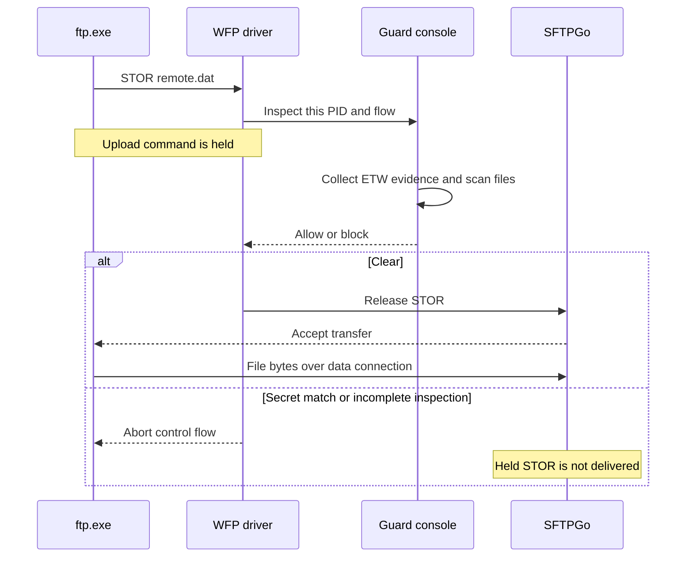

# Test results and reproduction

Latest live validation: **2026-11-04, America/Edmonton** (2026-11-05 UTC), on **W11Test**.
Source: `C:\dev\sbg-poc\cloudsec-wfp-ftp-guard-poc` on DEV-11x64.
These results cover the new on-demand client/server path. No AFA is used.

## Current real end-to-end FTP and explicit FTPS testing

**123/123 final live checks passed.** The primary transfer suite is **72 matrix
checks plus 40 repeated explicit FTPS checks**. Six further checks produced live
console captures. Four monitor-off baselines and one missing-evidence check also
passed. All final PoC runs unloaded normally and had no `DRIVER ERROR` diagnostic.

These are actual file transfers against **SFTPGo 2.7.6**. The PoC's synthetic
`ftp-traffic.exe` tool was not used for these FTP/FTPS transfers.

| Group | Passed | Verification |
| --- | ---: | --- |
| Debug matrix | 36/36 | Public receiver hashes match; sensitive receiver bytes are zero |
| Release matrix | 36/36 | Same cases and receiver checks |
| Repeated explicit FTPS | 40/40 | Ten repetitions of server/client public and secret-content cases |
| Live capture runs | 6/6 | Real transfer decisions captured using the supplied Windows UI helper |
| Missing file evidence | 1/1 | `--no-etw` blocks public FTP data as `inspection-incomplete` |
| PoC-off baselines | 4/4 | Sensitive synthetic files really upload/download over FTP and FTPS when enforcement is absent |

### Environment and matrix

W11Test runs Windows `10.0.26300`. SFTPGo listens on loopback **21 and 49237**,
with passive ports **50000–50020**. Plain FTP and optional explicit FTPS share
those listeners. SFTP remains configured on 2022; it was not part of this run.

All clients run on W11Test. Loopback simulates the remote client/server.
Actual external-host, VPN, KDF and IPv6 paths were not qualified in this revision.

Each matrix row tests public content, a `secret` filename, and mixed-case
`SeCrEt` content. The content marker crosses the scanner's 64 KiB read boundary.

| Protected local application | Client | Protocol/data protection | Data mode | Port | Debug | Release |
| --- | --- | --- | --- | ---: | ---: | ---: |
| SFTPGo server | Windows `ftp.exe` | Plain FTP | Active | 21 | 3/3 | 3/3 |
| SFTPGo server | Windows curl | Plain FTP | Passive | 49237 | 3/3 | 3/3 |
| SFTPGo server | Windows curl | Explicit FTPS, `PROT P` | Passive | 21 | 3/3 | 3/3 |
| SFTPGo server | Windows curl | Explicit FTPS, `PROT P` | Active | 49237 | 3/3 | 3/3 |
| Windows `ftp.exe` client | Windows `ftp.exe` | Plain FTP upload | Active | 21 | 3/3 | 3/3 |
| Windows curl client | Windows curl | Plain FTP upload | Passive | 49237 | 3/3 | 3/3 |
| Windows curl client | Windows curl | Explicit FTPS upload, `PROT P` | Passive | 21 | 3/3 | 3/3 |
| Windows curl client | Windows curl | Explicit FTPS upload, `PROT P` | Active | 49237 | 3/3 | 3/3 |
| SFTPGo server | Windows curl | Explicit FTPS, `PROT C` | Passive | 49237 | 3/3 | 3/3 |
| Windows curl client | Windows curl | Explicit FTPS upload, `PROT C` | Passive | 49237 | 3/3 | 3/3 |
| SFTPGo server | `System.Net.FtpWebRequest` | Explicit FTPS, `PROT P` | Passive | 21 | 3/3 | 3/3 |

Three additional cases per build verify sensitive data beginning with `220 `: server plain FTP pull, client plain FTP upload, and explicit FTPS clear-data pull. The prefix must not be mistaken for a new control greeting.

Native FTP is the unmodified Microsoft `ftp.exe`, version `10.0.26100.8115`.
Curl is the Windows `8.21.0` build using Schannel. Curl's `AUTH SSL` compatibility
path negotiates TLS. The independent `FtpWebRequest.EnableSsl` cases exercise
`AUTH TLS`. [Microsoft's API contract](https://learn.microsoft.com/en-us/dotnet/api/system.net.ftpwebrequest.enablessl).

Curl requires the configured lab certificate with `--cacert`; `--insecure` is
not used. Revocation checks are disabled for this self-signed lab certificate.
The .NET test pins the exact lab certificate in its own process. It also checks
name and validity dates, then restores its prior callback. Neither method adds
a machine-trusted root.

For server-pull cases, WFP attributes the protected connection to **sftpgo.exe**.
The remote/simulated client is recorded separately. For uploads, the protected
application is **ftp.exe** or **curl.exe**. Connection initiator and logical FTP
role are separate: an active-mode server opens an outbound data connection.

### What the current implementation does

1. Associate inbound/outbound TCP flows with their owning process.
2. Recognize clear FTP commands, including `AUTH TLS` and `AUTH SSL`, without a port rule.
3. Record `STOR`/`APPE`/`STOU` and `RETR` direction while control remains clear.
4. Let a server receive `RETR` so it can open/read its source.
5. Hold outgoing indications on a process/peer-correlated data connection.
6. Flush FileIo evidence and wait for consumer delivery using a condition variable.
7. Reopen observed source paths, validate the process instance, and apply the filename/content matcher.
8. Release allowed traffic or abort a denied flow.

Client upload-command gates use recent opens. Data gates use reads associated
with file-object lifetimes. Close removes the object mapping, while bounded
recent evidence remains available. This avoids treating every long-lived server
handle as a transfer source.

A verified **plaintext** source can authorize its single-file data connection.
FTPS keeps checking later outgoing indications. A public certificate read during
a TLS handshake cannot authorize later encrypted file data.

The driver does **not decrypt TLS**. After explicit upgrade, commands and data-port
negotiation are hidden. Data association and file selection are conservative
correlations, not proof that particular file bytes belong to a particular socket.

### Receiver-side assertions

An allowed transfer requires client completion and an independent SHA-256 match
at the receiver. A sensitive transfer requires an accepted secret-name/content
decision matching the intended source path, plus **zero receiver bytes**.
Destination files may be absent or empty. Neither state is inferred from an FTP
exit code: native `ftp.exe` can return zero after a failed command.

The monitor-off baselines transfer sensitive synthetic content successfully in
both directions. This distinguishes enforcement from broken credentials,
permissions, TLS setup or server availability. No customer files were used.

### Regressions found and fixed

| Finding | Correction |
| --- | --- |
| Outbound-only flow handling missed hosted-server control connections | Track both directions and retain the local client/server role |
| `AUTH SSL` requests bypassed explicit FTPS recognition | Recognize both TLS-upgrade spellings and stop clear-command parsing |
| All-handle scans matched `secret` inside a Windows resource file | Select recently opened/read source paths; preserve all-handle scanning only for legacy tests |
| A public FTPS download was truncated after repeated trace waits | Add a bounded conditional reflush; retain a verified plaintext grant only for its data connection |
| A TLS certificate read prematurely authorized later encrypted file data | Forbid retained grants on FTPS in both console policy and driver validation |
| File payload beginning with `220 ` resembled a control greeting | Pending sender-role/TLS context keeps it on the data inspection path |
| A peer reset after a blocked FTPS transfer was logged as a driver failure | Report terminal reset/disconnect statuses as `DRIVER CLOSED`, preserving the original status/context |

The unsupported curl test option used during discovery was removed. Final curl
tests use supported options. The .NET cases independently verify `AUTH TLS`.

## Build and unit validation

CMake Debug/Release builds, CTest and driver signing passed on DEV-11x64 under a
**non-elevated** user token. Compiler warnings are errors.
`guard-tests.exe` passed **4,527 assertions, zero failures**.

OpenCppCoverage measured the final user-testable parser/cache/scanner code:

| File | Covered/tool-mapped lines | Line coverage |
| --- | ---: | ---: |
| `common/ftp_probe.hpp` | 97/97 | 100% |
| `common/ftp_transfer.hpp` | 39/39 | 100% |
| `common/file_activity.hpp` | 37/38 | 97.4% |
| `console/file_scanner.cpp` | 152/167 | 91.0% |

The read-cache miss/owner/reuse/close/eviction paths are tested. Its sole
uncovered mapped line is a loop-closing brace. Defensive native-API error paths
in the older scanner remain partly uncovered. These figures do not claim full
kernel, loader or ETW-decoder code coverage; those components were exercised live.

The CMake kernel target is shared by Debug/Release user-mode configurations.
Both live matrices use the same signed `.sys`; the console executables differ.
Deploy matching **ABI version 3** binaries together.

| Tested output | SHA-256 |
| --- | --- |
| `WfpFtpGuard.sys` | `514283F7721F41D067BDEACB6F4EB465D4550D6FEA8787C547AF5E74A99116A3` |
| Debug `ftp-guard.exe` | `DAB2E99881A8ED65D60FB13B54152D62464DB95A1E5D0E94C8126A34EE38048A` |
| Release `ftp-guard.exe` | `E468BC6C6BB7328781045BBB57FE69F024C78EAD740AE5177F83D530ED7C275F` |

## Build and test instructions

Build the standalone PoC from a non-elevated development prompt on DEV-11x64:

```powershell
cd C:\dev\sbg-poc\cloudsec-wfp-ftp-guard-poc
cmake -S . -B build -G "Visual Studio 17 2022" -A x64
cmake --build build --config Debug --parallel 4
ctest --test-dir build -C Debug --output-on-failure
cmake --build build --config Release --parallel 4
ctest --test-dir build -C Release --output-on-failure
cmake --build build --config Debug --target sign-driver
```

Prerequisites are MSVC x64 and SDK/WDK `10.0.26100.0`. The live lab must already
support test-signed drivers. No boot setting or machine certificate store was
changed for these tests. [Microsoft's test-signing behavior](https://learn.microsoft.com/en-us/windows-hardware/drivers/install/the-testsigning-boot-configuration-option).

On W11Test, deploy the matching `Debug`/`Release` folders and `driver` folder
under an owned temporary directory. The real-transfer harness reads the existing
local SFTPGo account file at `C:\Users\qauser\Downloads\SFTPGo-root-credentials.txt`.
It sends credentials through client stdin or an in-process API. It does not put
the password on a command line or in evidence.

```powershell
.\tests\Invoke-TransferTests.ps1 -BinaryRoot C:\dev\tmp-scripts\ftp-lab-binaries -WorkRoot C:\dev\tmp-scripts\ftp-lab-work -ResultRoot C:\dev\tests\fresh-run-Debug -Configuration Debug
```

Use a fresh results folder for each run. Repeat with `-Configuration Release`.
`-CaseFilter '07,09,19,21' -Repeat 10` reproduces the FTPS repeat set.
`-CaseFilter '01' -NoEtw -ExpectIncomplete` checks missing-evidence blocking.
The harness requires hostname `W11Test` and validates its temporary/result roots.
Its .NET TLS pin is test-local and is restored after each request.

For captures, run `tests/Show-LiveOutput.ps1` in the signed-in user's desktop.
Pass the same state path through `-LiveViewState` to the harness, with
`-CaptureHelper` pointing to the supplied Windows UI helper. The driver loader
stays elevated in Session 0. The viewer and screenshot agent run without
elevation and display live, unmodified loader output. Remove owned runtime
directories after testing; keep sanitized reports only.

## Evidence and interpretation

Final W11Test results:

`C:\dev\tests\ftp-server-ftps-20261105001205Z-latest-results`

`summary.json` contains the aggregate. `cases.json` contains per-case outcomes.
`environment.json` and `fixtures.json` record binary versions/hashes and fixture
hashes. Group folders retain sanitized console logs and summaries.

| Capture | Live scenario |
| --- | --- |
| `Screenshots/01-live.png` | Server-side plain FTP public pull, native `ftp.exe` |
| `Screenshots/03-live.png` | Server-side plain FTP content block, native `ftp.exe` |
| `Screenshots/07-live.png` | Server-side explicit FTPS public pull |
| `Screenshots/09-live.png` | Server-side explicit FTPS content block |
| `Screenshots/13-live.png` | Native `ftp.exe` public upload |
| `Screenshots/15-live.png` | Native `ftp.exe` content block |

These are captures of a live output viewer, not reconstructed transcripts.
The supplied Windows UI helper captured the actual viewer window while each
transfer ran. The viewer caption identifies the real client and protected role.

The evidence was checked for the account password and irrelevant script names.
It contains no credentials or payload files. Source fixtures, deployed PoC
binaries, helper/viewer processes, temporary tasks and transient scripts are
removed after collection. SFTPGo, its TLS configuration, the previously requested
account file, and sanitized results remain.

### Coverage boundaries

- Qualification is limited to the tested regular local-file paths and clients.
  Source paths are reopened; contents can change between application reads and inspection.
- Process/peer correlation can confuse parallel sessions or unrelated traffic.
  Alternate data peers, helper processes and proxying need additional work.
- FTPS indications without observed reads pass for handshake compatibility.
  Cached, pre-opened, mapped or memory-only sources may therefore escape inspection.
  **This is conditional FTPS coverage, without a generic no-leak guarantee.**
- Incidental reads can become candidates. File-I/O correlation does not prove
  an exact file-to-stream mapping, even for clear FTP.
- Plain FTP data without observed source evidence blocks as incomplete.
  Trace loss, cache eviction, delivery timeout and read failures also block conservatively.
- Bounded buffers, probe timeouts and untracked-flow capacity remain PoC limits.
  Plaintext retained grants assume a separate data connection per stream-mode transfer.
- Implicit FTPS and SFTP qualification/decryption are outside scope.
  No new KDF/VPN coexistence or IPv6 claim follows from loopback tests.

## Historical evidence

[HISTORICAL_TEST_RESULTS.md](HISTORICAL_TEST_RESULTS.md) preserves the previous CAL
real-server results and the older synthetic handshake matrix. They apply to
earlier revisions and are not validation of the current implementation.

The following earlier explanation is retained verbatim. It describes the
2026-11-03 CAL build. In the current implementation, initial FTP recognition is
diagnostic; later command/data gates trigger source-path inspection.

### What happens during ftp.exe client interactions with SFTPGo

**The PoC allows the FTP session to start, then pauses recognized FTP commands to inspect the client’s local files. An initial allow does not authorize every later upload.**

In our tests, `ftp.exe` connected to SFTPGo’s **plain FTP listener**, on port **21 or 49237**. FTP uses a control connection for commands/replies and a separate data connection for file bytes. The tests used active mode, where SFTPGo connects back to the client for data transfer. [FTP specification](https://www.rfc-editor.org/rfc/rfc959)

1. **`ftp.exe` opens the control connection.**

   `Driver` records the application PID, executable path and connection endpoints. SFTPGo sends its greeting. At TCP establishment, the PoC has not yet identified the application protocol.

2. **The initial FTP command triggers the first inspection.**

   In the recorded native-client runs, `FtpProbe` recognized **`OPTS`**. The driver held that command and notified `Console`.

   At this point, ordinary `ftp.exe` had not opened the upload source. The scan found no secret file, so the console returned **ALLOW**, and the driver released the command.

3. **Login and transfer setup proceed.**

   The client authenticates using `USER`/`PASS`. Our test selected binary transfer mode. The session then remains available for upload commands.

4. **A `put` causes a fresh upload inspection.**

   For example:

   ```text
   put quarterly.txt remote.dat
   ```

   `put` selects a local file and a remote filename. On the FTP connection, the client requests storage using **`STOR remote.dat`**. `FtpUploadProbe` detects that command and the driver holds it before delivering it to SFTPGo. [Windows `ftp put`](https://learn.microsoft.com/en-us/windows-server/administration/windows-commands/ftp-put)

5. **The console checks the local files.**

   There is a significant native-client detail: `ftp.exe` briefly opens its source before `STOR`, closes that probe handle, and reopens it after server acceptance. An instantaneous handle scan at `STOR` can therefore miss it.

   Combined mode handles the tested gap by flushing ETW, waiting for buffer delivery through `NetTraceProgress`, and obtaining recent file-open paths from `NetFileActivityCache`. `FileScanner` checks both current handles and those recent paths. It checks filenames and uses `SecretMatcher` to inspect local file content.



6. **The decision determines whether the upload proceeds.**

   If clear, SFTPGo receives `STOR` and the transfer proceeds. If a secret filename/content matches—or inspection is incomplete—the driver aborts the control flow. In the denied tests, the destination file was absent.

The same-session test makes the behavior particularly clear. **Flow 9, PID 4684** followed this progression:

```text
OPTS  → ALLOW
STOR  → ALLOW   — public upload; server-side hash matched
STOR  → BLOCK   — quarterly.txt matched secret-content; destination absent
```

The PoC identifies FTP from control-stream bytes and evaluates the **local files**. It does not search the transferred network payload for `secret`. An unrelated open or recently opened file can also cause a block.
