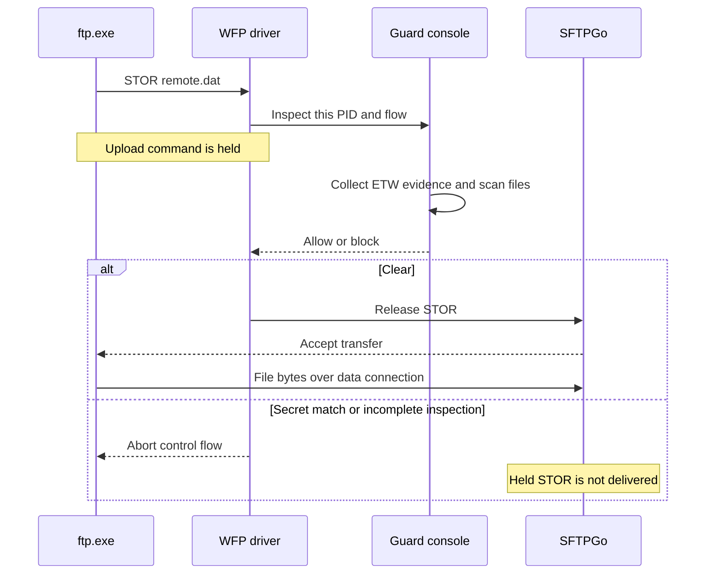

# Test results and reproduction

Final real-server validation: **2026-11-03 UTC, CAL-DVMT1-test**.
Source: `C:\dev\sbg-poc\cloudsec-wfp-ftp-guard-poc` on DEV-11x64.
The real transfers below are the primary end-to-end result. Historical synthetic
handshakes are reported separately and do not substitute for file uploads.

## Real end-to-end FTP testing

**Passed: 11/11 Windows FTP checks, 10/10 independent FTP/SFTP checks, and
80/80 monitored SFTP teardown uploads.** Final runs had no driver error or
inspection-incomplete diagnostics and unloaded normally.

Server: SFTPGo 2.7.6, plain FTP on loopback ports **21 and 49237**, SFTP on
**2022**. The SFTP negative control also temporarily served SFTP on port **21**;
the original server configuration was restored. One virtual transfer account
was used. All payloads were synthetic fixtures.

The native client was the unmodified Microsoft-signed
`C:\Windows\System32\ftp.exe`, version **10.0.26100.8115**, valid signature.
Its SHA-256 was
`F8CA342AAA8496E009907FA12FEFF11578123326945CC1AD665057DF67981405`.
The independent client was curl 8.23.0 with SFTP support.

### Ordinary Windows FTP uploads

These five monitored checks use the native client's natural source-handle
lifetime, without a pre-held-handle fixture:

| Check | Port | Verified result |
| --- | ---: | --- |
| Public upload | 21 | Allowed; server bytes matched source SHA-256 |
| Local filename contains `secret` | 21 | Filename rule; driver block; destination absent |
| Local content contains mixed-case `SeCrEt` | 49237 | Content rule; driver block; destination absent |
| Public upload on a nonstandard port | 49237 | Allowed; server bytes matched source SHA-256 |
| Public upload, then secret-content upload in the same FTP session | 21 | First upload hash matched; second blocked with no destination |

Two monitor-off baselines first verified public FTP on 21 and sensitive-content
FTP on 49237 could actually authenticate/upload. Four additional **controlled
open-handle** checks used the same genuine client: public files on both ports
were allowed, and name/content matches were blocked. Those fixtures duplicate a
real file handle into the spawned client before connecting; they validate the
open-handle rule and are distinct from the ordinary transfers above.

Windows FTP uses active-mode data transfers here. Remote destination names were
ordinary test identifiers, so the local source's filename/content, not a marker
in the network destination name, explained each block. Server-side existence
and SHA-256 determined transfer success. Native FTP exit code alone was not used:
it can return zero after failed commands.

Native run: `C:\dev\tests\20261103-061421Z` on CAL-DVMT1-test.
Seven genuine console captures show allow/block decisions, ordinary secret-file
uploads, same-session reinspection, ETW correlation and final unload.

```text
[DRIVER SUMMARY] ftp_inspections=17 blocked_flows=5 allowed_decisions=12
[ETW SUMMARY] tcp_connections=15 wininet_ftp=0 correlated=9 wininet_events=78 wininet_connections=1 file_opens=229
```

The 17 inspections include initial FTP recognition and later upload-command
rechecks; they are not 17 distinct connections. Nine native control flows
correlated by PID and full tuple. Aggregate ETW counters can include other
applications; the WinINet FTP-intent count remained zero.

### What happens during ftp.exe client interactions with SFTPGo

**The PoC allows the FTP session to start, then pauses recognized FTP commands to inspect the client’s local files. An initial allow does not authorize every later upload.**

In our tests, `ftp.exe` connected to SFTPGo’s **plain FTP listener**, on port **21 or 49237**. FTP uses a control connection for commands/replies and a separate data connection for file bytes. The tests used active mode, where SFTPGo connects back to the client for data transfer. [FTP specification](https://www.rfc-editor.org/rfc/rfc959)

1. **`ftp.exe` opens the control connection.**

   `Driver` records the application PID, executable path and connection endpoints. SFTPGo sends its greeting. At TCP establishment, the PoC has not yet identified the application protocol.

2. **The initial FTP command triggers the first inspection.**

   In the recorded native-client runs, `FtpProbe` recognized **`OPTS`**. The driver held that command and notified `Console`.

   At this point, ordinary `ftp.exe` had not opened the upload source. The scan found no secret file, so the console returned **ALLOW**, and the driver released the command.

3. **Login and transfer setup proceed.**

   The client authenticates using `USER`/`PASS`. Our test selected binary transfer mode. The session then remains available for upload commands.

4. **A `put` causes a fresh upload inspection.**

   For example:

   ```text
   put quarterly.txt remote.dat
   ```

   `put` selects a local file and a remote filename. On the FTP connection, the client requests storage using **`STOR remote.dat`**. `FtpUploadProbe` detects that command and the driver holds it before delivering it to SFTPGo. [Windows `ftp put`](https://learn.microsoft.com/en-us/windows-server/administration/windows-commands/ftp-put)

5. **The console checks the local files.**

   There is a significant native-client detail: `ftp.exe` briefly opens its source before `STOR`, closes that probe handle, and reopens it after server acceptance. An instantaneous handle scan at `STOR` can therefore miss it.

   Combined mode handles the tested gap by flushing ETW, waiting for buffer delivery through `NetTraceProgress`, and obtaining recent file-open paths from `NetFileActivityCache`. `FileScanner` checks both current handles and those recent paths. It checks filenames and uses `SecretMatcher` to inspect local file content.



6. **The decision determines whether the upload proceeds.**

   If clear, SFTPGo receives `STOR` and the transfer proceeds. If a secret filename/content matches—or inspection is incomplete—the driver aborts the control flow. In the denied tests, the destination file was absent.

The same-session test makes the behavior particularly clear. **Flow 9, PID 4684** followed this progression:

```text
OPTS  → ALLOW
STOR  → ALLOW   — public upload; server-side hash matched
STOR  → BLOCK   — quarterly.txt matched secret-content; destination absent
```

The PoC identifies FTP from control-stream bytes and evaluates the **local files**. It does not search the transferred network payload for `secret`. An unrelated open or recently opened file can also cause a block.

### Independent real FTP/SFTP checks

| Check group | Cases | Verified result |
| --- | ---: | --- |
| Monitor-off FTP/SFTP login and upload | 2 | Server-side SHA-256 matched |
| FTP public files on 21 and 49237 | 2 | Allowed; hashes matched |
| FTP secret filename on 21 / secret content on 49237 | 2 | Correct rule and driver block; destination absent |
| SFTP public / secret-name / secret-content files on 2022 | 3 | Uploaded intact; no FTP classification or policy block |
| SFTP secret-name file on port 21 | 1 | Uploaded intact; no FTP classification or policy block |

Run: `C:\dev\tests\20261103-061545Z`. Six console captures and per-case
PID/rule/hash evidence are retained. Driver errors: **0**.

```text
[DRIVER SUMMARY] ftp_inspections=6 blocked_flows=2 allowed_decisions=4
[ETW SUMMARY] tcp_connections=11 wininet_ftp=0 correlated=10 wininet_events=0 wininet_connections=0 file_opens=307
```

### Repeated SFTP teardown checks

Run: `C:\dev\tests\20261103-061241Z`.
**80 fresh curl processes, 80 WFP-observed connections, 80 matching server-side
uploads; zero FTP classifications, policy blocks or driver errors.** The monitor
unloaded normally. Terminal closed-flow records retain their NTSTATUS/context
separately; they are not counted as secret-file blocks or proof of transfer.

### Fixes established by real testing

The original native run passed only **8/10**: ordinary secret filename/content
uploads escaped the initial open-handle snapshot. Adding upload-command
reinspection alone passed **8/11** and still missed both source cases and the
same-session second upload. Tracing showed that native FTP briefly opens the
source before `STOR`, closes that handle, and reopens it after the command gate.

The final default combined mode checks recognized `STOR`/`APPE`/`STOU` commands
and includes bounded recent FileIo evidence for that PID since connection start.
The ordinary denied uploads specifically reported `file_evidence=recent-file-open`
with the expected local fixture. This deliberately extends coverage beyond an
instantaneous open-handle rule. `--no-etw` does not close that handle-lifetime gap.

A guessed `Sleep(1250)` was replaced by explicit ETW flush and a condition-variable
wait for delivered buffers, with a bounded timeout and consumer-stop notification.
The final native run reached each flushed-buffer target in **734-1,016 ms**;
this is measured delivery/flush latency, not a programmed fixed delay.

Independent testing also exposed false error/block diagnostics after completed
SFTP transfers. The driver now tracks disconnects and separates narrowly identified
terminal injection outcomes from policy decisions, including originating-process
exit/PID replacement. Other failures remain errors. The final bytes and complete
monitoring coverage were checked independently of those diagnostics.

Earlier runs, including failures, remain under timestamped `C:\dev\tests` folders.
In particular, `20261103-054516Z` preserves the 9/10 run with a teardown diagnostic;
`20261103-055250Z`, `20261103-055724Z` and `20261103-060705Z` preserve earlier teardown failures.
`20261103-060105Z` records an insufficient monitor duration: its last 22 uploads
were unobserved and were not counted as monitored passes. Final runs supersede
these outcomes without rewriting them.

## Build and unit validation

CMake configure, Debug build, CTest and `sign-driver` succeeded under a
**non-elevated** DEV-11x64 user token. Visual Studio 2022 / MSVC 19.44,
x64 SDK/WDK 10.0.26100.0, warnings treated as errors.
`guard-tests.exe`: **4,017 assertions, zero failures**, on DEV and CAL.

Measured OpenCppCoverage executable-line coverage:

| Production file | Covered / measured lines | Coverage |
| --- | ---: | ---: |
| `common/ftp_probe.hpp` | 90 / 90 | 100% |
| `common/secret_matcher.hpp` | 25 / 25 | 100% |
| `common/file_activity.hpp` | 13 / 13 | 100% |
| `common/trace_progress.hpp` | 20 / 20 | 100% |
| `console/file_scanner.cpp` | 145 / 160 | 90.6% |

The recent-file cache tests cover PID/connection/time boundaries, expiry,
deduplication and eviction. Synchronization tests cover early notifications,
partial progress, timeout and shutdown. Scanner tests include closed source
paths, NT disk paths, missing files and scan deadlines. Defensive native API
failure paths remain partly uncovered. These measurements do **not** claim unit
coverage of the kernel driver, loader or ETW decoder; real runs exercise those
components within the stated test scope.

Tested package SHA-256:
`911D60F50A55F2FDC487581419A5A885A20374B3AC6CDD8B11D57EA7E54086D7`.
Tested driver SHA-256:
`E6CDC5B4C671DD8C127564836B494BDE70E8258C85BB211CFC1AFABC86F70D0C`.
Tested console SHA-256:
`334BD5E2BB7DCDA5511CEFCBFF4FA9EB0735BDE3D64603319F3196E89938009B`.
Each result folder includes the matching binary manifest. No Git commit or push
was performed by this session.

## Evidence and retained state

Results include `results.json`, `summary.md`, sanitized `console.txt`, SHA-256
manifests, server upload records for the main matrices, and the 13 final captures.
The last main matrix also contains the post-run cleanup verification and session
index. SFTPGo and the separately requested Downloads account file are preserved;
temporary test tools, uploaded fixtures, authentication wrappers, tasks and the
PoC deployment are removed after evidence review.

## Build and test instructions

Source on DEV-11x64: `C:\dev\sbg-poc\cloudsec-wfp-ftp-guard-poc`.
Use a non-elevated MSVC 2022 x64 prompt with Windows SDK/WDK 10.0.26100.0;
`WDK_ROOT` and `WDK_VERSION` are CMake overrides. No NuGet libraries are needed.

```powershell
cmake -S . -B build -G "Visual Studio 17 2022" -A x64
cmake --build build --config Debug --parallel 4
ctest --test-dir build -C Debug --output-on-failure
cmake --build build --config Debug --target sign-driver
```

The actual validation build is `out\native-ftp-20261103`. The driver uses the
WDK kernel compiler/linker; user-mode targets use C++20 and `/W4 /WX`.
`sign-driver` keeps its test-signing private key non-exportable in the build
user's certificate store and exports a public `.cer`. The lab VM must already
support test-signed drivers. These runs changed no test-VM boot settings or
certificate trust stores. Deploy the matching console/driver pair; the appended
closed-flow event retains the existing protocol layout/version. The interface
uses `NetEventKind`, `NetEvent`, `NetDecision`, `NetStatus` and `NetDriverSession`.

### Real Windows FTP reproduction

Use SFTPGo with plain FTP on loopback ports 21 and 49237, SFTP on loopback 2022,
and a writable transfer account. Its virtual home on CAL-DVMT1-test is
`C:\dev\SFTPGoData\root`. Prepare synthetic fixtures: a public file, a file named
`secret-plan.txt` with public bytes, and `quarterly.txt` containing mixed-case
`SeCrEt`. Give the uploads ordinary remote names so the local filename/content
is the reason for a decision.

1. With the monitor off, upload public and sensitive-content fixtures and verify
   the server-side SHA-256. This checks authentication and transfer permissions.
2. Start the monitor elevated before starting a fresh native client:

   ```powershell
   .\build\Debug\ftp-guard.exe --driver .\build\driver\WfpFtpGuard.sys --app C:\Windows\System32\ftp.exe
   C:\Windows\System32\ftp.exe -n -i
   ```

3. At the FTP prompt, use `open 127.0.0.1 21`, `user root`, enter the password at
   its prompt, then `binary` and `put public.txt public.dat`. Repeat with the
   name/content fixtures and port 49237. Reconnect after a denied flow. Also test
   a public upload followed by the content fixture in the same FTP session.
4. An allowed upload must exist in the server home with the source SHA-256.
   A denied upload must have no destination file, the expected filename/content
   rule naming the source, an accepted decision, and a driver block event.
   Native `ftp.exe` can exit zero after a failed command; exit status alone is
   insufficient. A diagnostic allow/close event alone is also insufficient.
5. Keep ordinary uploads separate from controlled pre-held-handle tests. The
   additional controlled cases duplicate a real fixture handle into the spawned
   client before connection; they validate the instantaneous handle rule and
   are not substitutes for natural client behavior.

For independent FTP/SFTP comparison, use a curl build listing SFTP support in
`curl --version`; the Windows inbox curl may lack it. Examples with interactive
password entry:

```powershell
curl.exe --user root --upload-file public.txt ftp://127.0.0.1:21/public.dat
curl.exe --user root --knownhosts verified_known_hosts --upload-file secret-plan.txt sftp://127.0.0.1:2022/control.dat
```

Verify the local SFTP server key for the known-hosts file. The port-21 SFTP
negative control temporarily moves FTP off that port and binds SFTP there;
restore the exact original SFTPGo configuration afterward. Secret-name/content
SFTP uploads should remain unclassified as FTP and retain matching bytes.

The teardown regression uses a fresh curl process per SFTP upload and requires
both a WFP connection record for every PID and matching server bytes. Include
late diagnostics through normal monitor unload when grading a run. A client
success cannot hide a later driver block/error; an upload after monitoring has
expired cannot count as a monitored pass.

The console captures use the supplied desktop helper on CAL's active desktop.
They display live console stdout and separately labeled `[TEST]` assertions,
without replay or image editing. Published evidence excludes credentials,
automation filenames/command lines, support source and raw authentication output.
The temporary tools, authentication wrappers, uploaded fixtures, tasks and PoC
service are removed after capture; only sanitized timestamped results and the
configured SFTPGo server/account remain. The separately requested Downloads
credential file is preserved.

### Synthetic protocol reproduction

`ftp-traffic.exe` is a minimal loopback handshake tool, not an upload client/server.
Start a matching server and run clients from their fixture directory:

```powershell
.\ftp-traffic.exe --server --port 2121
.\ftp-traffic.exe --port 2121 --file .\public.txt --expect allowed
.\ftp-traffic.exe --port 2121 --file .\secret-name.txt --expect blocked
.\ftp-traffic.exe --port 2121 --file .\public-with-sensitive-content.txt --expect blocked
.\ftp-traffic.exe --port 2121 --fragment --file .\public.txt --expect allowed
.\ftp-traffic.exe --port 2121 --wininet --expect allowed
```

The content fixture must contain `secret`. `--ipv6` selects `::1` on both sides;
`--server --http`/`--http` provide HTTP controls. `--close-file` closes the fixture
before connection. Clients check that inspection preserves the original seek
position and linger briefly for process diagnostics. The repository's
`tests/Invoke-LiveTests.ps1` reproduces the historical 15-case W11Test matrix;
it is restricted to that hostname and the documented lab paths.

If the console was forcibly terminated, its normal SCM cleanup cannot run.
Before another lab run, recover the PoC service with elevated
`sc.exe stop WfpFtpGuardPoc` and `sc.exe delete WfpFtpGuardPoc` as needed.

## Scope and interpretation

The real transfers below are the primary end-to-end evidence. The historical
synthetic matrix adds protocol edge cases; it does not establish successful
file transfer. Real IPv6 transfers, implicit/explicit FTPS payload protection,
APPE/STOU transfers, production load and adversarial evasion were not validated
by the real-server matrices. APPE/STOU parsing and fragmentation are unit-tested;
IPv6 and encoding/read-boundary cases have historical synthetic coverage.

Classification is a bounded plaintext FTP heuristic, not a complete grammar.
A driver event is required for file policy. ETW-only TCP events are candidates;
the tested clients emitted no FTP-specific WinINet intent event. The correlation
cache uses PID and the full connection tuple, accepts either arrival order, and
is bounded to 1,024 observations/30 seconds. Loss, delayed image lookup after
process exit, eviction and tuple/PID reuse can reduce or confuse diagnostic
correlation. Provider/schema failures may omit evidence.

The recent-file cache is a separate 1,024-record/30-second bound, filtered by PID
and connection start time. It extends the original open-handle policy to recent
open attempts, including now closed files. Paths are reopened, so results can
reflect replacement, rename/delete/sharing races or failed open attempts. It is
not continuous file protection and does not prove which file is being uploaded.
The console still scans current handles first, verifies process creation time,
and uses independent file offsets. Valid non-disk handles are skipped; unreadable
or unsupported file content is conservatively incomplete. Native snapshot ABI,
file I/O/cancellation and serial inspections remain platform/latency limits.

The ETW delivery gate explicitly flushes the trace, then waits on a condition
variable for the consumed-buffer count. It handles notification before waiting,
partial progress, spurious wakes and consumer shutdown; its two-second timeout
fails closed. This remains a bounded wait on the serial inspection thread, not
a fully asynchronous policy engine. Native flush calls and file reads can take
time. It replaces a guessed fixed delay; it does not make ETW lossless.

Known terminal reinjection outcomes are logged as `DRIVER CLOSED` with the
original status/context, separately from policy blocks. This includes a
synchronous missing flow, invalid state after FIN/abort, or invalid state after
verified originating-process exit/PID replacement. Other failures remain
errors. Earlier teardown errors and incomplete monitoring coverage are retained
in the run history rather than counted as successful final checks.

References: Microsoft's [FileIo Create event](https://learn.microsoft.com/en-us/windows/win32/etw/fileio-create),
[ControlTrace](https://learn.microsoft.com/en-us/windows/win32/api/evntrace/nf-evntrace-controltracew),
[buffer callbacks](https://learn.microsoft.com/en-us/windows/win32/api/evntrace/nc-evntrace-pevent_trace_buffer_callbacka),
[stream reinjection](https://learn.microsoft.com/en-us/windows-hardware/drivers/ddi/fwpsk/nf-fwpsk-fwpsstreaminjectasync0),
and [Windows FTP commands](https://learn.microsoft.com/en-us/windows-server/administration/windows-commands/ftp).

## Historical synthetic FTP tests (2026-11-02)

This W11Test matrix used the PoC traffic tool, not actual file uploads. Its
paths, hashes and assertion counts are historical; the 15-case matrix was not
rerun for the current build. The harness now accepts both old and current
summary field names; those parser checks passed separately.

Validated on 2026-11-02, including the `NetDriverSession` rename and the
`NetEvent`, `NetDecision`, and `NetStatus` protocol struct names. These naming
changes preserve the IOCTL layout and version.

Source: `C:\dev\test-pub\WfpFtpGuard` on DEV-11x64.
Deployment: `C:\dev\WfpFtpGuard-Poc` on W11Test.

### Build and unit tests

The CMake configure, Debug build, CTest run, and `sign-driver` target succeeded
under a non-elevated DEV-11x64 user token. Toolchain: Visual Studio 2022,
MSVC 19.44, x64, Windows SDK/WDK 10.0.26100.0. Compiler warnings are errors.

`guard-tests.exe` passed **3,649 assertions, zero failures** on both DEV-11x64
and W11Test after the naming changes.

OpenCppCoverage measured the following production files. Their implementations
were unchanged by the final naming changes.

| File | Covered executable lines | Line coverage |
| --- | ---: | ---: |
| `common/ftp_probe.hpp` | 66 / 66 | 100% |
| `common/secret_matcher.hpp` | 25 / 25 | 100% |
| `console/file_scanner.cpp` | 125 / 140 | 89.3% |

This is 216 / 231 measured lines (93.5%). Defensive native API failure paths
remain partly uncovered. These measurements do not claim coverage of the kernel
driver, loader, or ETW implementation; those components were exercised live.

### Synthetic live handshake matrix

The final run completed all 15 cases on W11Test:

| Case | Expected and observed result |
| --- | --- |
| No open file | FTP allowed |
| Public file open | FTP allowed |
| Filename contains `secret` | FTP blocked |
| Content contains mixed-case `secret`, port 49237 | FTP blocked |
| UTF-16 LE content | FTP blocked |
| UTF-16 BE content | FTP blocked |
| Marker across a 64 KiB read boundary | FTP blocked |
| Fragmented command, public file | FTP allowed |
| Fragmented command, secret filename | FTP blocked |
| Secret file handle closed before connection | FTP allowed |
| IPv6, public file | FTP allowed |
| IPv6, secret filename | FTP blocked |
| HTTP on port 21, secret file open | HTTP allowed |
| FTP on port 21, secret file open | FTP blocked |
| ETW-only WinINet FTP client | Connection observed; driver absent |

The traffic clients also verified that inspection preserved their original
file-handle seek positions. The high-port and port-21 FTP server logs contained
zero received commands for the denied cases, confirming that the held command
was not forwarded before blocking.

Final console summaries:

```text
[DRIVER SUMMARY] ftp=13 blocked=8 allowed=5
[ETW SUMMARY] tcp_connections=14 wininet_ftp=0 correlated=14 wininet_events=0 wininet_connections=0
```

All 14 driver-observed connections, including the HTTP control case, correlated
with TCP/IP ETW by PID and the full connection tuple. Connection diagnostics
included the application image, full path, PID, session, endpoints, and flow ID.
Block diagnostics identified the matching filename and filename/content rule.

ETW-only mode observed TCP connection metadata, but the tested WinINet FTP client
emitted no FTP-specific WinINet event on this VM. Thus ETW-only operation cannot
be presented as generic FTP classification. Plaintext FTP confirmation came from
the driver's stream inspection; encrypted control traffic remains outside scope.

### Final state and evidence

Run directory on W11Test:
`C:\dev\tmp-scripts\wfp-live-20261102-120622`.
`wfp-live-state.json` and `wfp-final-verification.json` are in
`C:\dev\tmp-scripts`.

The console stopped normally. Final verification found no PoC driver service,
test fixture processes, or PoC ETW sessions. No certificate was imported into
W11Test's LocalMachine Root or TrustedPublisher stores, and no boot setting was
changed. The VM's existing test-signing configuration was used. The temporary
non-elevated build task on DEV-11x64 was removed after the final build.

SHA-256 of the tested `driver/WfpFtpGuard.sys`:

```text
8BB26F2D58780B1F482D067C920AAA544944D998A3E30266EFF64A9395F8B249
```

The binary package includes a per-file SHA-256 manifest. The checked-in-style
test harness is `tests/Invoke-LiveTests.ps1`; it is deliberately restricted to
W11Test and the documented lab paths. No Git commit or push was performed.
