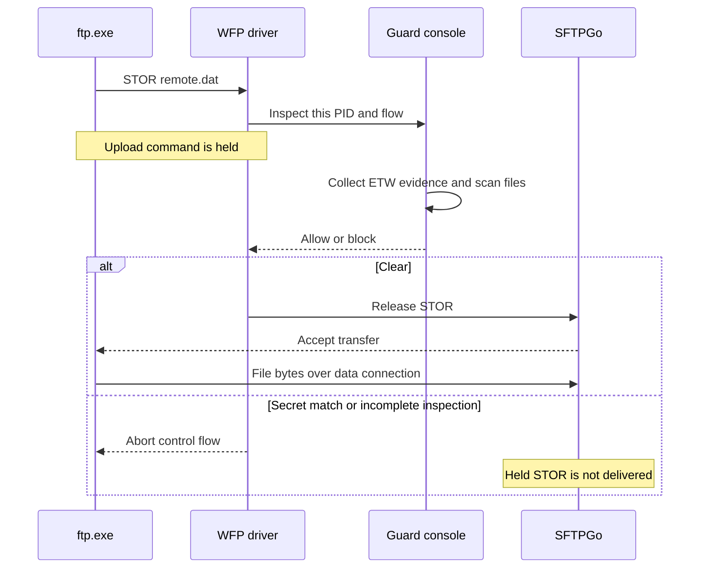

# Test results and reproduction

Latest validation: **corrective end-to-end tests on W11Test, 2026-11-05 UTC**.
Source: C:\dev\sbg-poc\cloudsec-wfp-ftp-guard-poc on DEV-11x64.

## Large-file live validation

**The corrected build passes the reference-client FTP/explicit-FTPS matrix.
Windows curl/Schannel still has an FTPS-upload completion compatibility failure.**
The latter remains a failed test, even when its receiver hash matches.
It is not included in the reference-client pass count.

All live transfers and driver loading ran exclusively on **W11Test**. DEV-11x64
was used for source changes, non-elevated CMake builds and user-mode unit tests.
Traffic used loopback against the existing SFTPGo service. This simulates a
remote client pulling files from a protected local server.

### Fixes made after the earlier large-file run

| Finding | Correction |
| --- | --- |
| Large content scans exceeded the scan budget | Skip impossible starts with bounded vector comparisons. Avoid repeated searches over the same suffix on dense near-matches. Keep partial ASCII and UTF-16 matches across chunks. Differential, alignment and protected-page regressions cover the optimized matcher. |
| Repeated reads exhausted recent-file history | Coalesce repeated PID/path observations. Distinct-path eviction remains observable and conservative. |
| File-evidence delivery repeatedly stalled | Use shared ETW producer buffering for the file session. Retain explicit flush, consumed-buffer condition-variable barriers, loss checks and bounded waits. Ignore the scanner's own file events before decoding. |
| FTPS rescanned whole files on successive indications | Keep a bounded positive-scan cache. Check process instance, flow, canonical path, file identity, size, write/change times and NTFS USN before reuse. New paths still require inspection. |
| A replacement race could pair one file's verdict with another file's identity | Scan the same sharing-protected object whose identity is cached. Incompatible writers and unsupported change-journal evidence fall back to full scanning. |
| Public streams stalled or truncated during reinjection | Submit reinjection asynchronously. Account for queued and in-flight bytes together. Retain flow/segment ownership through completion, preserve direction ordering, fence FIN behind preceding injections, and drain callbacks during teardown. |
| Incoming TLS records waited behind outgoing file policy | Drain the receive queue promptly, independently of the sending verdict. Both directions retain clone/block/reinject processing throughout a tracked flow. |
| FTPS client errors could be confused with successful delivery | Require both client exit 0 and a matching receiver SHA-256 for an allowed transfer. Record the selected curl version/backend and binary hash. Keep Windows curl compatibility results separate. |

These changes do not decrypt TLS. They do not add AFA or an application allow list.

### Final-build results

| Group | Passed / checks |
| --- | ---: |
| Debug-100MiB | 12 / 12 |
| Debug-100MiB-dense | 12 / 12 |
| Debug-1024MiB | 12 / 12 |
| Debug-1024MiB-dense | 12 / 12 |
| Debug-small | 36 / 36 |
| Final-Baselines | 12 / 12 |
| Lifecycle-and-reuse | 3 / 3 |
| Missing-file-evidence | 4 / 4 |
| Release-100MiB | 36 / 36 |
| Release-100MiB-dense | 12 / 12 |
| Release-1024MiB | 36 / 36 |
| Release-1024MiB-dense | 12 / 12 |
| Release-small | 36 / 36 |
| Repeated-1GiB-FTP-pulls | 6 / 6 |
| Repeated-1GiB-FTPS | 4 / 4 |
| Screenshots | 10 / 10 |
| Windows-curl-compatibility | 5 / 6 |

The reference curl client is the official **8.23.0 / LibreSSL 4.4.0** Windows
build. Native **Windows ftp.exe** remains the active-mode plain-FTP client.
The full matrix also includes the existing .NET explicit-FTPS download cases.
The Windows-supplied curl **8.21.0 / Schannel** is tested separately below.
The temporary reference client is removed from W11Test after collection.

The full Release matrices exercise plain FTP, protected-data explicit FTPS,
and TLS control with plaintext data. They cover client uploads and local-server
pulls, active/passive data connections, and control ports **21 and 49237**.
The larger Debug matrices cover the four core client/server FTP/FTPS paths.
The same signed driver is used with both console configurations.

### Large files and receiver assertions

Files are fully written **100 MiB (104,857,600-byte)** and
**1 GiB (1,073,741,824-byte)** fixtures. Filler public files contain ASCII P bytes.
Sensitive-name fixtures have public content. Sensitive-content fixtures have a
neutral name and mixed-case SeCrEt near EOF. Some also begin with a misleading
220-style data header.

The content marker starts three bytes before the final 64 KiB boundary, at
offset **104,792,061** or **1,073,676,285**. The scanner must carry its match
across that boundary. Receiver size, existence and SHA-256 are recorded per case.

Additional dense fixtures interleave many S starts, SecreX near-matches and
UTF-16-like S/zero bytes. They contain no marker unless the intentional late
marker is inserted. These checks guard against a fast path that works only for
uniform filler. The core matrix repeats them in both builds and at both sizes.

| Sensitive fixture population | Checks | Absent | Empty | Non-empty |
| --- | ---: | ---: | ---: | ---: |
| 100 MiB, filler | 33 | 17 | 16 | 0 |
| 100 MiB, dense | 16 | 8 | 8 | 0 |
| 1024 MiB, filler | 33 | 17 | 16 | 0 |
| 1024 MiB, dense | 16 | 8 | 8 | 0 |
| 1 GiB screenshot checks | 6 | 3 | 3 | 0 |

An allow requires client completion and an exact receiver hash match. A sensitive
pass requires an accepted secret-name/content verdict for the intended source
and zero receiver file bytes. An incomplete scan does not count as detection.
Missing-ETW checks deliberately require the separate inspection-incomplete rule.

**Zero receiver bytes can mean an absent or empty destination.** A client or
server may create an empty destination before policy blocks the transfer.
FTP control commands, TLS handshakes and metadata can already have crossed the
network. These are receiver-file assertions, not packet-capture proof of zero
network traffic or a guarantee that no destination entry was created.

### Public-transfer timings

| Release public case | Size | Pattern | Client time | Receiver hash |
| --- | ---: | --- | ---: | --- |
| FTP server (ftp.exe) | 100 MiB | filler | 0.44 s | Matched |
| FTP client (ftp.exe) | 100 MiB | filler | 1.66 s | Matched |
| FTPS server (curl.exe) | 100 MiB | filler | 2.76 s | Matched |
| FTPS client (curl.exe) | 100 MiB | filler | 3.66 s | Matched |
| FTP server (ftp.exe) | 100 MiB | dense | 0.75 s | Matched |
| FTP client (ftp.exe) | 100 MiB | dense | 1.68 s | Matched |
| FTPS server (curl.exe) | 100 MiB | dense | 3.20 s | Matched |
| FTPS client (curl.exe) | 100 MiB | dense | 2.99 s | Matched |
| FTP server (ftp.exe) | 1024 MiB | filler | 2.51 s | Matched |
| FTP client (ftp.exe) | 1024 MiB | filler | 17.21 s | Matched |
| FTPS server (curl.exe) | 1024 MiB | filler | 27.72 s | Matched |
| FTPS client (curl.exe) | 1024 MiB | filler | 35.49 s | Matched |
| FTP server (ftp.exe) | 1024 MiB | dense | 2.54 s | Matched |
| FTP client (ftp.exe) | 1024 MiB | dense | 14.53 s | Matched |
| FTPS server (curl.exe) | 1024 MiB | dense | 30.25 s | Matched |
| FTPS client (curl.exe) | 1024 MiB | dense | 34.33 s | Matched |

Timings are observations from this lab. They are not production throughput
guarantees. FTPS still checks fresh file evidence on outgoing indications.
A cache hit avoids another content scan; it does not bypass the ETW delivery
barrier, source selection, process verification or the scan deadline.

### Windows curl compatibility results

The final Windows curl check passed **5/6**. Downloads passed. Failed upload checks: **1**. The failure was curl exit 18 / SEC_E_CONTEXT_EXPIRED after writing a complete, matching 100 MiB receiver file. No secret policy block was involved. A matching file does not turn this completion failure into a successful allow.

Changing the TLS version and disabling curl's session cache did not resolve the
error in exploratory checks. Repeated PoC-off uploads completed successfully.
The separate LibreSSL client completed the guarded transfers. This narrows the
interoperability problem but does not establish its exact root cause. The PoC
changes traffic timing, so this report does not attribute the failure solely to
curl or solely to the driver.

Curl FTPS downloads use --ignore-content-length to read through TLS EOF.
This also resolved the earlier PoC-off download completion/reset symptom in a
controlled check. Receiver hashes and client success remain mandatory.
Certificate and hostname checks remain enabled against the configured lab CA.

### Additional regressions and screenshots

- **Missing file evidence:** 4/4 checks block as inspection-incomplete with ETW disabled.
- **Active-transfer teardown:** both public transfers drain and unload after an intentional stop. Partial receiver files and client failure are expected in these shutdown tests.
- **Same FTPS control session:** a public upload succeeds, followed by an accepted sensitive-content block for a newly read file. The second receiver has zero file bytes.
- **Screenshots:** 10/10 additional 1 GiB checks pass. Six use native ftp.exe; four use the reference curl client for explicit FTPS.

The screenshot group contains genuine console-window captures from W11Test,
made with the supplied Windows UI helper. A live viewer displays the elevated
loader's actual output. Captions identify the transfer client and protected role.
The saved console transcript and receiver assertions accompany each capture.
Screenshots are not substitutes for the receiver/hash assertions.

### Build and coverage

The standalone CMake solution builds in Debug and Release on DEV-11x64 from a
non-elevated interactive task. CTest passes **15,909 assertions** in each
configuration. Signing and whitespace checks also pass.

| Instrumented component | Executed source lines |
| --- | ---: |
| SecretMatcher | 54/54 |
| NetTransferGate and transfer parser | 39/39 |
| File-activity history | 42/43 |
| FileScanner implementation | 197/213 |
| FileScanner header | 2/2 |

This is user-mode line coverage. It is not 100% branch coverage or instrumented
kernel-driver coverage. Remaining native error paths are not claimed as tested.
Live transfer and intentional-unload checks validate the kernel paths exercised.

| Tested binary | SHA-256 |
| --- | --- |
| Debug/ftp-guard.exe | `02FADFD3F356052FA69212C46440BC5F8FD9F9595040452AB84B6F0EB89C0DFA` |
| Release/ftp-guard.exe | `DAB5F1FFFCAD65CE90544698D60DE93FCDBA5307A7A19A437257EFE6803F5C24` |
| driver/WfpFtpGuard.sys | `CFB65A015A4EF2FCE3AEC45FF35CFED7CF0E179DE47A2EC4442C1A4D783B39ED` |

### Evidence, cleanup and remaining scope

Sanitized results, transcripts, screenshots and aggregate records are retained
on W11Test under **C:\dev\tests\ftp-large-fix-20261105T022830Z**.
Final-build results are in the Final folder. Earlier candidates and failures are
kept separately, with their own hashes. They are not merged into final pass counts.
Credentials and unrelated implementation-script names are excluded.

Cleanup is verified: no PoC driver service, owned helper/viewer processes, temporary tasks, transient files, transfer fixtures or PoC ETW sessions remain. SFTPGo is running. Its existing configuration and the explicitly requested account file are preserved. Only sanitized evidence remains from this run.

This run does not qualify an external peer, KDF/VPN coexistence, IPv6, concurrent
sessions, arbitrary document formats, mutable/mapped files, or adversarial
file-to-socket attribution. FTPS coverage remains conditional on observed file
activity. Cached, mapped or memory-generated data without observed source reads
can escape this path. Implicit FTPS is outside FTP qualification.

Future KDF/VPN validation must inventory providers, layers and sublayer weights.
Repeat real FTP allow/block checks with KDF loaded, VPN connected/disconnected,
split/full tunnels, redirects/proxies, IPv4/IPv6 and reconnects. Check originating
process attribution and receiver state. Callback delivery alone is insufficient.

Positive file verdicts are bounded to 64 entries and 30 seconds. Their temporary
sharing leases can briefly affect new writers. Unsupported NTFS USN queries force
full scans. The driver has a 16 MiB queued/in-flight bound per tracked flow.
FTPS still receives no permanent data-flow grant; a certificate or old public
source must not authorize a newly observed sensitive source.

References: [Microsoft's stream-inspection contract](https://learn.microsoft.com/en-us/windows-hardware/drivers/network/stream-inspection),
[NTFS file-USN query](https://learn.microsoft.com/en-us/windows/win32/api/winioctl/ni-winioctl-fsctl_read_file_usn_data),
and [official curl Windows builds](https://curl.se/windows/).

### Reproduce the current large-file checks

Build and sign on DEV as described in the build instructions below. Deploy the
matching package and the transfer harness to W11Test. Keep SFTPGo's existing
account and lab CA configuration. Run the harness elevated on W11Test.
Supply the separate reference curl executable through `-CurlPath`. The default
is the Windows-supplied curl, whose compatibility outcome is recorded above.

```powershell
.\tests\Invoke-TransferTests.ps1 -BinaryRoot C:\dev\tmp-scripts\ftp-binaries -WorkRoot C:\dev\tmp-scripts\ftp-large-100 -ResultRoot C:\dev\tests\fresh-large-100 -Configuration Release -FileSizeMiB 100 -ClientTimeoutSeconds 120 -CurlPath C:\dev\tmp-scripts\curl\curl.exe
```

Use `-FileSizeMiB 1024` for 1 GiB files. Add `-FilePattern dense` for the dense
near-match fixtures. Use a fresh results folder for every invocation.
The core client/server FTP/FTPS selection is
`-CaseFilter '01,02,03,07,08,09,13,14,15,19,20,21'`.
Use `-Repeat` for completion repeats. Keep receiver-hash and intended-secret
assertions enabled. Do not count client failure as an allow.

## Earlier large-file validation, before these fixes

The following failed run is retained for comparison. Its old binaries and
timings do not describe the final reference-client results above.

Tested exclusively on **W11Test** on 2026-11-05 UTC
(2026-11-04 in America/Edmonton). DEV-11x64 supplied the existing signed binaries.
No live transfers or driver loading ran on DEV.

**Sensitive-file enforcement passed all 16 checks. Large public-file support did
not fully pass.** The run contains 30 protected large-file checks, 12 initial
PoC-off baselines, and two PoC-off completion-error repeats. The strict aggregate
is **33/44**. Three additional small-file checks passed to validate the extended
test harness. Failures remain recorded.

The Release console and driver are unchanged from the small-file run below.
No production C++ changes or rebuild were made for this validation.

### Files and assertions

Files were **100 MiB (104,857,600 bytes)** and **1 GiB (1,073,741,824 bytes)**.
They were fully written local files, without sparse allocation. They remained
unchanged during each transfer.

| Fixture | Filename policy | Content |
| --- | --- | --- |
| Public | Neutral filename | Repeated ASCII P bytes; no sensitive marker |
| Sensitive filename | Contains secret | Same public content |
| Sensitive content | Neutral filename | Mixed-case SeCrEt near the end |

The content marker begins three bytes before a 64 KiB boundary near EOF.
Offsets are **104,792,061** and **1,073,676,285** respectively. The matcher must
carry state across the boundary. It reads the final chunk before detecting the
marker. Fixture sizes, offsets and SHA-256 hashes are retained in the evidence.

An allowed transfer requires client completion and a receiver SHA-256 match.
A sensitive pass requires an accepted secret-name/content decision for the
intended source, plus zero receiver file bytes. An inspection-incomplete block
does not count as sensitive-content detection.

**Zero receiver bytes does not require an absent destination.** FTP commands,
TLS records and file metadata may already have crossed the network. A download
client or server can create an empty destination before receiving file content.
These assertions validate receiver files; they are not a packet-capture claim
of zero network traffic.

### Main matrix

Each row contains public, sensitive-name and near-end-content cases.
Plain FTP uses native Windows ftp.exe in active mode on port 21. Explicit FTPS
uses Windows curl in passive mode with protected data, on port 21.

| Size | Protected role | Protocol | Public | Sensitive name | Near-end content |
| --- | --- | --- | --- | --- | --- |
| 100 MiB | Local server, remote pull | FTP | Hash matched | Blocked, 0 bytes | Blocked, 0 bytes |
| 100 MiB | Local client, upload | FTP | Hash matched | Blocked, 0 bytes | Blocked, 0 bytes |
| 100 MiB | Local server, remote pull | Explicit FTPS | 120-second timeout | Blocked, 0 bytes | Blocked, 0 bytes |
| 100 MiB | Local client, upload | Explicit FTPS | 120-second timeout | Blocked, 0 bytes | Blocked, 0 bytes |
| 1 GiB | Local server, remote pull | FTP | Truncated; hash mismatch | Blocked, 0 bytes | Blocked, 0 bytes |
| 1 GiB | Local client, upload | FTP | Hash matched | Blocked, 0 bytes | Blocked, 0 bytes |
| 1 GiB | Local server, remote pull | Explicit FTPS | 120-second timeout | Blocked, 0 bytes | Blocked, 0 bytes |
| 1 GiB | Local client, upload | Explicit FTPS | 120-second timeout | Blocked, 0 bytes | Blocked, 0 bytes |

The initial matrices passed **10/12** at 100 MiB and **9/12** at 1 GiB.
The two sizes and both sensitive fixture types give the following destination
states across the 16 sensitive checks:

| Protected role and protocol | Sensitive checks | Receiver file state | File-content bytes |
| --- | ---: | --- | ---: |
| FTP server, native-client pull | 4 | Empty file | 0 |
| FTP client, native-client upload | 4 | Absent | 0 |
| FTPS server, curl pull | 4 | Absent | 0 |
| FTPS client, curl upload | 4 | Empty file | 0 |

Thus eight sensitive checks left an empty file, and eight left no file.
None left a non-empty destination. Empty-file prevention is not provided by
this network guard.

### Findings requiring follow-up

**Plain FTP, 1 GiB server pulls are not reliably qualified.** The initial
native-client pull received only **252,805,106 bytes**, despite a clear source
verdict. Its driver log recorded data-submit status **0xC0000225**.
Two later native-client repeats completed with matching 1 GiB hashes. This is
intermittent, rather than a demonstrated universal size limit.

Two passive curl pull repeats on port 49237 also failed: one received
**381,583,360 bytes**; the other blocked with zero bytes after the existing
eight-second scan budget expired. That latter scan inspected **416,153,600 bytes**
and reported inspection-incomplete, without claiming sensitive content.
The two matching curl upload repeats completed. Follow-up transfers passed **4/6**.
The streaming/queue/teardown cause of the truncated pulls is not established.
A DRIVER CLOSED event and an allow verdict do not prove successful delivery.

**Large explicit FTPS public transfers are impractically slow in this design.**
All four hit curl's 120-second limit with incomplete destination files.
Repeated whole-file scans and ETW delivery waits occur on later outgoing
indications; FTPS deliberately has no retained data-flow grant.

| Public FTPS case | Inspections | Total bytes scanned | Receiver file bytes after 120 seconds |
| --- | ---: | ---: | ---: |
| 100 MiB server pull | 85 | 8,912,896,000 | 6,668,288 |
| 100 MiB client upload | 90 | 9,332,360,588 | 2,244,608 |
| 1 GiB server pull | 26 | 27,917,287,424 | 1,949,696 |
| 1 GiB client upload | 25 | 25,769,814,654 | 557,056 |

Curl reported exit 28 in these cases. The early matrix watchdog flag describes
whether the outer process supervisor killed curl; it remains false when curl's
own limit fires. The aggregate also records ClientTimeLimitReached explicitly.
The extended harness now reports either timeout source as ClientTimedOut.

**PoC-off baselines distinguish these problems from basic transfer support.**
All 12 initial baselines delivered the complete files with matching hashes,
including native 1 GiB FTP uploads/downloads. Ten also returned successful client
completion. The two FTPS downloads returned curl exit 56 after receiving the full
matching files. Two further PoC-off repeats reproduced that completion error:
Recv failure: Connection was aborted. Their files also matched.

That FTPS completion/reset anomaly exists without this PoC. It is recorded
separately from the PoC's 120-second partial-transfer timeouts. No specific TLS
close-notify or underlying server/client cause is established here.

### Scope and evidence

All traffic used W11Test loopback against its SFTPGo 2.7.6 instance. This simulates
a remote pull. The tests do not qualify an external host, VPN/KDF, IPv6,
concurrent sessions, mutable files or arbitrary document formats.

FTPS source selection remains file-I/O/process/peer correlation. WFP does not
decrypt TLS. Cached or unobserved source reads can still escape this conditional
path, as described in the coverage boundaries below.

Sanitized results on W11Test:

`C:\dev\tests\ftp-large-20261105T020141Z`

The aggregate, individual cases, environment, fixture hashes and console logs
are retained. ReceiverExists and ReceiverState distinguish absent and empty
destinations. For the first matrix, these explicit fields were derived from
the already captured receiver hash: null means absent; the empty-file SHA-256
means an existing empty file.

Owned payloads, deployed binaries and transient utilities are removed after
collection. SFTPGo and its existing account/TLS configuration remain.

### Reproduce large-file transfers

Use the existing build/signing and lab prerequisites below. Run this harness
on W11Test, from an elevated console. It reads the existing local account file.

```powershell
.\tests\Invoke-TransferTests.ps1 -BinaryRoot C:\dev\tmp-scripts\ftp-lab-binaries -WorkRoot C:\dev\tmp-scripts\ftp-large-100-work -ResultRoot C:\dev\tests\fresh-large-100 -Configuration Release -CaseFilter '01,02,03,07,08,09,13,14,15,19,20,21' -FileSizeMiB 100 -ClientTimeoutSeconds 120
```

Repeat with FileSizeMiB 1024 and fresh work/results directories.
CaseFilter '01,04,16' with Repeat 2 reproduces the additional 1 GiB plaintext
checks. FileSizeMiB 0 preserves the earlier small fixtures.
The test time limit changes client/watchdog duration; it does not increase the
driver's 15-second decision deadline or the scanner's eight-second budget.

## Previous small-file end-to-end FTP and explicit FTPS testing

**123/123 final live checks passed.** The primary transfer suite is **72 matrix
checks plus 40 repeated explicit FTPS checks**. Six further checks produced live
console captures. Four monitor-off baselines and one missing-evidence check also
passed. All final PoC runs unloaded normally and had no `DRIVER ERROR` diagnostic.

These are actual file transfers against **SFTPGo 2.7.6**. The PoC's synthetic
`ftp-traffic.exe` tool was not used for these FTP/FTPS transfers.

| Group | Passed | Verification |
| --- | ---: | --- |
| Debug matrix | 36/36 | Public receiver hashes match; sensitive receiver bytes are zero |
| Release matrix | 36/36 | Same cases and receiver checks |
| Repeated explicit FTPS | 40/40 | Ten repetitions of server/client public and secret-content cases |
| Live capture runs | 6/6 | Real transfer decisions captured using the supplied Windows UI helper |
| Missing file evidence | 1/1 | `--no-etw` blocks public FTP data as `inspection-incomplete` |
| PoC-off baselines | 4/4 | Sensitive synthetic files really upload/download over FTP and FTPS when enforcement is absent |

### Environment and matrix

W11Test runs Windows `10.0.26300`. SFTPGo listens on loopback **21 and 49237**,
with passive ports **50000–50020**. Plain FTP and optional explicit FTPS share
those listeners. SFTP remains configured on 2022; it was not part of this run.

All clients run on W11Test. Loopback simulates the remote client/server.
Actual external-host, VPN, KDF and IPv6 paths were not qualified in this revision.

Each matrix row tests public content, a `secret` filename, and mixed-case
`SeCrEt` content. The content marker crosses the scanner's 64 KiB read boundary.

| Protected local application | Client | Protocol/data protection | Data mode | Port | Debug | Release |
| --- | --- | --- | --- | ---: | ---: | ---: |
| SFTPGo server | Windows `ftp.exe` | Plain FTP | Active | 21 | 3/3 | 3/3 |
| SFTPGo server | Windows curl | Plain FTP | Passive | 49237 | 3/3 | 3/3 |
| SFTPGo server | Windows curl | Explicit FTPS, `PROT P` | Passive | 21 | 3/3 | 3/3 |
| SFTPGo server | Windows curl | Explicit FTPS, `PROT P` | Active | 49237 | 3/3 | 3/3 |
| Windows `ftp.exe` client | Windows `ftp.exe` | Plain FTP upload | Active | 21 | 3/3 | 3/3 |
| Windows curl client | Windows curl | Plain FTP upload | Passive | 49237 | 3/3 | 3/3 |
| Windows curl client | Windows curl | Explicit FTPS upload, `PROT P` | Passive | 21 | 3/3 | 3/3 |
| Windows curl client | Windows curl | Explicit FTPS upload, `PROT P` | Active | 49237 | 3/3 | 3/3 |
| SFTPGo server | Windows curl | Explicit FTPS, `PROT C` | Passive | 49237 | 3/3 | 3/3 |
| Windows curl client | Windows curl | Explicit FTPS upload, `PROT C` | Passive | 49237 | 3/3 | 3/3 |
| SFTPGo server | `System.Net.FtpWebRequest` | Explicit FTPS, `PROT P` | Passive | 21 | 3/3 | 3/3 |

Three additional cases per build verify sensitive data beginning with `220 `: server plain FTP pull, client plain FTP upload, and explicit FTPS clear-data pull. The prefix must not be mistaken for a new control greeting.

Native FTP is the unmodified Microsoft `ftp.exe`, version `10.0.26100.8115`.
Curl is the Windows `8.21.0` build using Schannel. Curl's `AUTH SSL` compatibility
path negotiates TLS. The independent `FtpWebRequest.EnableSsl` cases exercise
`AUTH TLS`. [Microsoft's API contract](https://learn.microsoft.com/en-us/dotnet/api/system.net.ftpwebrequest.enablessl).

Curl requires the configured lab certificate with `--cacert`; `--insecure` is
not used. Revocation checks are disabled for this self-signed lab certificate.
The .NET test pins the exact lab certificate in its own process. It also checks
name and validity dates, then restores its prior callback. Neither method adds
a machine-trusted root.

For server-pull cases, WFP attributes the protected connection to **sftpgo.exe**.
The remote/simulated client is recorded separately. For uploads, the protected
application is **ftp.exe** or **curl.exe**. Connection initiator and logical FTP
role are separate: an active-mode server opens an outbound data connection.

### What the current implementation does

1. Associate inbound/outbound TCP flows with their owning process.
2. Recognize clear FTP commands, including `AUTH TLS` and `AUTH SSL`, without a port rule.
3. Record `STOR`/`APPE`/`STOU` and `RETR` direction while control remains clear.
4. Let a server receive `RETR` so it can open/read its source.
5. Hold outgoing indications on a process/peer-correlated data connection.
6. Flush FileIo evidence and wait for consumer delivery using a condition variable.
7. Reopen observed source paths, validate the process instance, and apply the filename/content matcher.
8. Release allowed traffic or abort a denied flow.

Client upload-command gates use recent opens. Data gates use reads associated
with file-object lifetimes. Close removes the object mapping, while bounded
recent evidence remains available. This avoids treating every long-lived server
handle as a transfer source.

A verified **plaintext** source can authorize its single-file data connection.
FTPS keeps checking later outgoing indications. A public certificate read during
a TLS handshake cannot authorize later encrypted file data.

The driver does **not decrypt TLS**. After explicit upgrade, commands and data-port
negotiation are hidden. Data association and file selection are conservative
correlations, not proof that particular file bytes belong to a particular socket.

### Receiver-side assertions

An allowed transfer requires client completion and an independent SHA-256 match
at the receiver. A sensitive transfer requires an accepted secret-name/content
decision matching the intended source path, plus **zero receiver bytes**.
Destination files may be absent or empty. Neither state is inferred from an FTP
exit code: native `ftp.exe` can return zero after a failed command.

The monitor-off baselines transfer sensitive synthetic content successfully in
both directions. This distinguishes enforcement from broken credentials,
permissions, TLS setup or server availability. No customer files were used.

### Regressions found and fixed

| Finding | Correction |
| --- | --- |
| Outbound-only flow handling missed hosted-server control connections | Track both directions and retain the local client/server role |
| `AUTH SSL` requests bypassed explicit FTPS recognition | Recognize both TLS-upgrade spellings and stop clear-command parsing |
| All-handle scans matched `secret` inside a Windows resource file | Select recently opened/read source paths; preserve all-handle scanning only for legacy tests |
| A public FTPS download was truncated after repeated trace waits | Add a bounded conditional reflush; retain a verified plaintext grant only for its data connection |
| A TLS certificate read prematurely authorized later encrypted file data | Forbid retained grants on FTPS in both console policy and driver validation |
| File payload beginning with `220 ` resembled a control greeting | Pending sender-role/TLS context keeps it on the data inspection path |
| A peer reset after a blocked FTPS transfer was logged as a driver failure | Report terminal reset/disconnect statuses as `DRIVER CLOSED`, preserving the original status/context |

The unsupported curl test option used during discovery was removed. Final curl
tests use supported options. The .NET cases independently verify `AUTH TLS`.

## Earlier build and unit validation

CMake Debug/Release builds, CTest and driver signing passed on DEV-11x64 under a
**non-elevated** user token. Compiler warnings are errors.
`guard-tests.exe` passed **4,527 assertions, zero failures**.

OpenCppCoverage measured the final user-testable parser/cache/scanner code:

| File | Covered/tool-mapped lines | Line coverage |
| --- | ---: | ---: |
| `common/ftp_probe.hpp` | 97/97 | 100% |
| `common/ftp_transfer.hpp` | 39/39 | 100% |
| `common/file_activity.hpp` | 37/38 | 97.4% |
| `console/file_scanner.cpp` | 152/167 | 91.0% |

The read-cache miss/owner/reuse/close/eviction paths are tested. Its sole
uncovered mapped line is a loop-closing brace. Defensive native-API error paths
in the older scanner remain partly uncovered. These figures do not claim full
kernel, loader or ETW-decoder code coverage; those components were exercised live.

The CMake kernel target is shared by Debug/Release user-mode configurations.
Both live matrices use the same signed `.sys`; the console executables differ.
Deploy matching **ABI version 3** binaries together.

| Tested output | SHA-256 |
| --- | --- |
| `WfpFtpGuard.sys` | `514283F7721F41D067BDEACB6F4EB465D4550D6FEA8787C547AF5E74A99116A3` |
| Debug `ftp-guard.exe` | `DAB2E99881A8ED65D60FB13B54152D62464DB95A1E5D0E94C8126A34EE38048A` |
| Release `ftp-guard.exe` | `E468BC6C6BB7328781045BBB57FE69F024C78EAD740AE5177F83D530ED7C275F` |

## Build and test instructions

Build the standalone PoC from a non-elevated development prompt on DEV-11x64:

```powershell
cd C:\dev\sbg-poc\cloudsec-wfp-ftp-guard-poc
cmake -S . -B build -G "Visual Studio 17 2022" -A x64
cmake --build build --config Debug --parallel 4
ctest --test-dir build -C Debug --output-on-failure
cmake --build build --config Release --parallel 4
ctest --test-dir build -C Release --output-on-failure
cmake --build build --config Debug --target sign-driver
```

Prerequisites are MSVC x64 and SDK/WDK `10.0.26100.0`. The live lab must already
support test-signed drivers. No boot setting or machine certificate store was
changed for these tests. [Microsoft's test-signing behavior](https://learn.microsoft.com/en-us/windows-hardware/drivers/install/the-testsigning-boot-configuration-option).

On W11Test, deploy the matching `Debug`/`Release` folders and `driver` folder
under an owned temporary directory. The real-transfer harness reads the existing
local SFTPGo account file at `C:\Users\qauser\Downloads\SFTPGo-root-credentials.txt`.
It sends credentials through client stdin or an in-process API. It does not put
the password on a command line or in evidence.

```powershell
.\tests\Invoke-TransferTests.ps1 -BinaryRoot C:\dev\tmp-scripts\ftp-lab-binaries -WorkRoot C:\dev\tmp-scripts\ftp-lab-work -ResultRoot C:\dev\tests\fresh-run-Debug -Configuration Debug
```

Use a fresh results folder for each run. Repeat with `-Configuration Release`.
`-CaseFilter '07,09,19,21' -Repeat 10` reproduces the FTPS repeat set.
`-CaseFilter '01' -NoEtw -ExpectIncomplete` checks missing-evidence blocking.
The harness requires hostname `W11Test` and validates its temporary/result roots.
Its .NET TLS pin is test-local and is restored after each request.

For captures, run `tests/Show-LiveOutput.ps1` in the signed-in user's desktop.
Pass the same state path through `-LiveViewState` to the harness, with
`-CaptureHelper` pointing to the supplied Windows UI helper. The driver loader
stays elevated in Session 0. The viewer and screenshot agent run without
elevation and display live, unmodified loader output. Remove owned runtime
directories after testing; keep sanitized reports only.

## Small-file evidence and interpretation

Final W11Test results:

`C:\dev\tests\ftp-server-ftps-20261105001205Z-latest-results`

`summary.json` contains the aggregate. `cases.json` contains per-case outcomes.
`environment.json` and `fixtures.json` record binary versions/hashes and fixture
hashes. Group folders retain sanitized console logs and summaries.

| Capture | Live scenario |
| --- | --- |
| `Screenshots/01-live.png` | Server-side plain FTP public pull, native `ftp.exe` |
| `Screenshots/03-live.png` | Server-side plain FTP content block, native `ftp.exe` |
| `Screenshots/07-live.png` | Server-side explicit FTPS public pull |
| `Screenshots/09-live.png` | Server-side explicit FTPS content block |
| `Screenshots/13-live.png` | Native `ftp.exe` public upload |
| `Screenshots/15-live.png` | Native `ftp.exe` content block |

These are captures of a live output viewer, not reconstructed transcripts.
The supplied Windows UI helper captured the actual viewer window while each
transfer ran. The viewer caption identifies the real client and protected role.

The evidence was checked for the account password and irrelevant script names.
It contains no credentials or payload files. Source fixtures, deployed PoC
binaries, helper/viewer processes, temporary tasks and transient scripts are
removed after collection. SFTPGo, its TLS configuration, the previously requested
account file, and sanitized results remain.

### Coverage boundaries

- Qualification is limited to the tested regular local-file paths and clients.
  Source paths are reopened; contents can change between application reads and inspection.
- Process/peer correlation can confuse parallel sessions or unrelated traffic.
  Alternate data peers, helper processes and proxying need additional work.
- FTPS indications without observed reads pass for handshake compatibility.
  Cached, pre-opened, mapped or memory-only sources may therefore escape inspection.
  **This is conditional FTPS coverage, without a generic no-leak guarantee.**
- Incidental reads can become candidates. File-I/O correlation does not prove
  an exact file-to-stream mapping, even for clear FTP.
- Plain FTP data without observed source evidence blocks as incomplete.
  Trace loss, cache eviction, delivery timeout and read failures also block conservatively.
- Bounded buffers, probe timeouts and untracked-flow capacity remain PoC limits.
  Plaintext retained grants assume a separate data connection per stream-mode transfer.
- Implicit FTPS and SFTP qualification/decryption are outside scope.
  No new KDF/VPN coexistence or IPv6 claim follows from loopback tests.

## Historical evidence

[HISTORICAL_TEST_RESULTS.md](HISTORICAL_TEST_RESULTS.md) preserves the previous CAL
real-server results and the older synthetic handshake matrix. They apply to
earlier revisions and are not validation of the current implementation.

The following earlier explanation is retained verbatim. It describes the
2026-11-03 CAL build. In the current implementation, initial FTP recognition is
diagnostic; later command/data gates trigger source-path inspection.

### What happens during ftp.exe client interactions with SFTPGo

**The PoC allows the FTP session to start, then pauses recognized FTP commands to inspect the client’s local files. An initial allow does not authorize every later upload.**

In our tests, `ftp.exe` connected to SFTPGo’s **plain FTP listener**, on port **21 or 49237**. FTP uses a control connection for commands/replies and a separate data connection for file bytes. The tests used active mode, where SFTPGo connects back to the client for data transfer. [FTP specification](https://www.rfc-editor.org/rfc/rfc959)

1. **`ftp.exe` opens the control connection.**

   `Driver` records the application PID, executable path and connection endpoints. SFTPGo sends its greeting. At TCP establishment, the PoC has not yet identified the application protocol.

2. **The initial FTP command triggers the first inspection.**

   In the recorded native-client runs, `FtpProbe` recognized **`OPTS`**. The driver held that command and notified `Console`.

   At this point, ordinary `ftp.exe` had not opened the upload source. The scan found no secret file, so the console returned **ALLOW**, and the driver released the command.

3. **Login and transfer setup proceed.**

   The client authenticates using `USER`/`PASS`. Our test selected binary transfer mode. The session then remains available for upload commands.

4. **A `put` causes a fresh upload inspection.**

   For example:

   ```text
   put quarterly.txt remote.dat
   ```

   `put` selects a local file and a remote filename. On the FTP connection, the client requests storage using **`STOR remote.dat`**. `FtpUploadProbe` detects that command and the driver holds it before delivering it to SFTPGo. [Windows `ftp put`](https://learn.microsoft.com/en-us/windows-server/administration/windows-commands/ftp-put)

5. **The console checks the local files.**

   There is a significant native-client detail: `ftp.exe` briefly opens its source before `STOR`, closes that probe handle, and reopens it after server acceptance. An instantaneous handle scan at `STOR` can therefore miss it.

   Combined mode handles the tested gap by flushing ETW, waiting for buffer delivery through `NetTraceProgress`, and obtaining recent file-open paths from `NetFileActivityCache`. `FileScanner` checks both current handles and those recent paths. It checks filenames and uses `SecretMatcher` to inspect local file content.



6. **The decision determines whether the upload proceeds.**

   If clear, SFTPGo receives `STOR` and the transfer proceeds. If a secret filename/content matches—or inspection is incomplete—the driver aborts the control flow. In the denied tests, the destination file was absent.

The same-session test makes the behavior particularly clear. **Flow 9, PID 4684** followed this progression:

```text
OPTS  → ALLOW
STOR  → ALLOW   — public upload; server-side hash matched
STOR  → BLOCK   — quarterly.txt matched secret-content; destination absent
```

The PoC identifies FTP from control-stream bytes and evaluates the **local files**. It does not search the transferred network payload for `secret`. An unrelated open or recently opened file can also cause a block.
