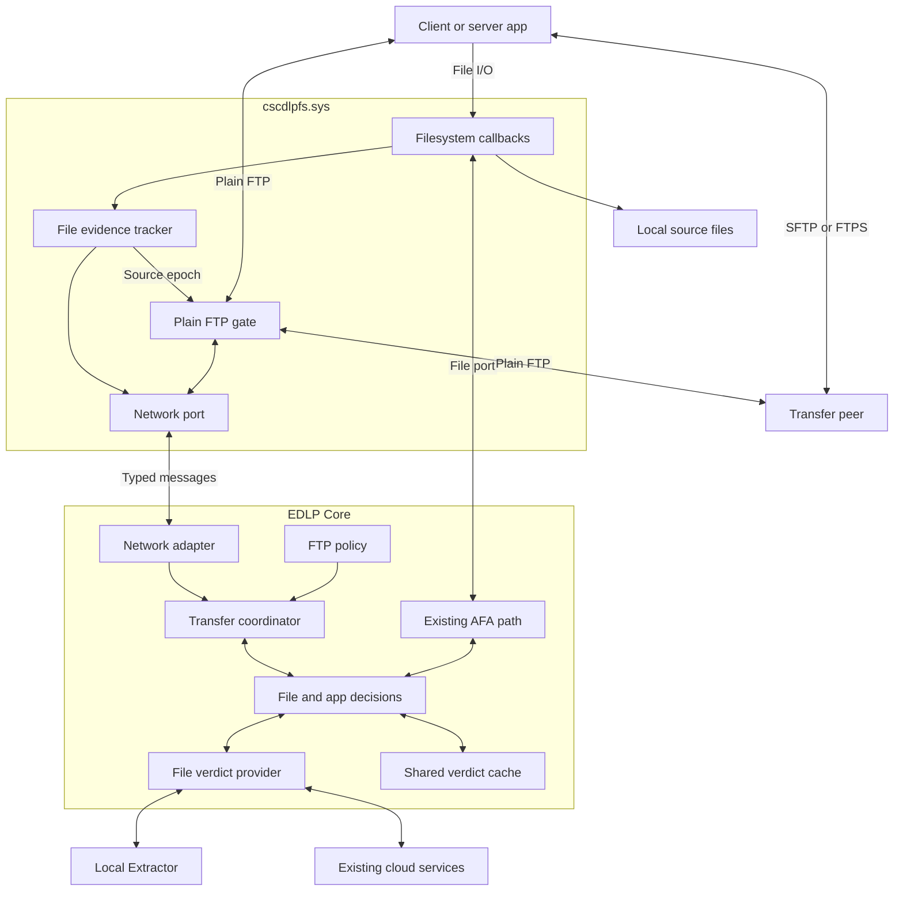
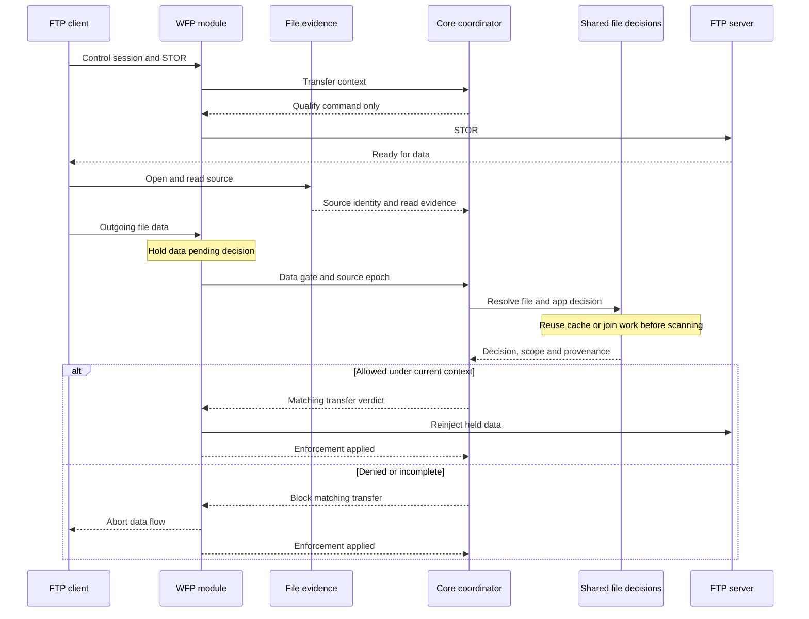
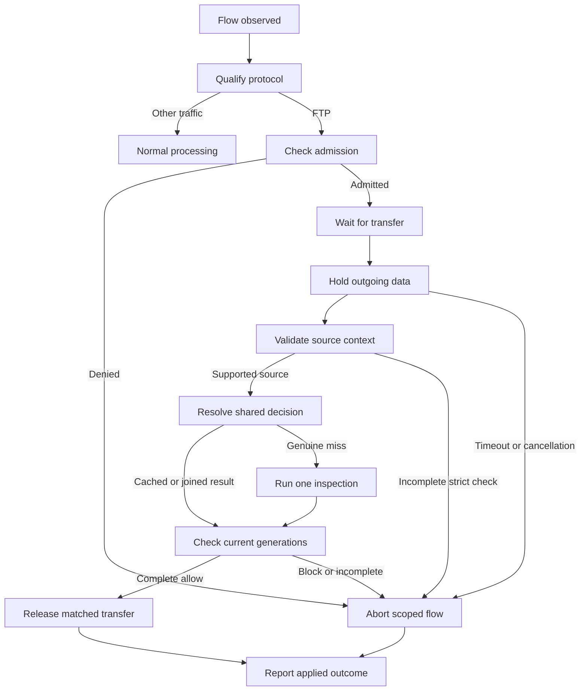

# Endpoint DLP FTP integration: plain FTP gating and encrypted-transfer AFA

| Item | Baseline |
| --- | --- |
| Updated | 2026-11-05 UTC |
| Target repository | `cloudsec-tejas-dlp-agent` |
| Reviewed EDLP branch | `main`, commit `319e673821b597925816bd3afea17794aaa12e48` |
| Reviewed PoC code baseline | `cloudsec-wfp-ftp-guard-poc`, commit `e808454e355c688319fadffe449454476352bfb3` |
| Status | Integration scope and proposed design. This is not an implemented EDLP feature. |
| Intended platform | Windows. Shared channel and reporting changes must remain portable. |
| Planning baseline | Updated FTP proposal and [technical approach](https://github.com/cisco-sbg/cloudsec-tejas-endpoint-dlp-roadmap/blob/antchan2/add-ftp-roadmap-item/docs/planning/active/ftp-exfiltration-protection/technical-approach.md#recommended-approach), reviewed with [roadmap PR 58](https://github.com/cisco-sbg/cloudsec-tejas-endpoint-dlp-roadmap/pull/58). The approach remains provisional. |
| Future verdict backend | Hybrid scanning engine, identified by the project owner as work in progress and not yet available in `main`. Its API/capabilities are not assumed by this document. |

## Reading guide

- Sections 1–3 define the changed scope, requirements and application policy.
- Sections 4–7 describe the driver, shared decisions, plain FTP correlation and encrypted-transfer AFA coverage.
- Sections 8–10 define lifecycle, security and diagnostics.
- Sections 11–13 provide implementation work, acceptance tests and release gates.
- Sections 14–15 identify current source touchpoints and references.

## 1. Direction and scope

Integrate a WFP network module into the existing `cscdlpfs.sys`. Coordinate it
from EDLP Core through a dedicated network communication port. Use the existing
EDLP content-processing and policy infrastructure for file decisions.

Use two enforcement paths:

| Traffic / activity | Inspection trigger | Enforcement point |
| --- | --- | --- |
| Plain FTP | Detect a transfer, correlate it with a local source and resolve that file decision. | WFP holds outgoing file data, then releases or blocks the transfer. |
| SFTP or FTPS through a supported, monitored application | AFA intercepts covered local source-file access before the application can read and encrypt that source. | Existing filesystem enforcement holds or denies the file operation. |

Both paths cover client applications and endpoint-hosted servers. For a client
upload, the local sender is the client. For a remote pull from a local server,
the local sender is the server. The server's file access and service identity
must be qualified independently from client behavior.

AFA membership remains independent of FTP admission. For an application covered
by both features, AFA and FTP must reuse each other's applicable cached file
decisions. Preserve cached denials, monitor outcomes and completed user
justifications. A change of channel alone must not cause another content
qualification, another prompt or a contradictory verdict.

A plain FTP connection can exist before the application opens its source. The
network path must support sources opened after login or the transfer command.
It must validate the source identity even when its decision comes from cache.
The encrypted path does not require WFP to identify SFTP or decrypt TLS/SSH.
AFA can also inspect and block unrelated file access by the monitored app.

### 1.1 Changes to the earlier proposal

| Earlier assumption | Revised scope |
| --- | --- |
| An approved application with active AFA can use FTP. | Each transfer needs a current file decision, reused from the shared AFA/FTP decision or obtained on demand. Admission remains separate. |
| AFA blocks the file open and supplies file policy. | FTP triggers an on-demand scan. WFP holds or aborts outgoing data. Existing AFA continues independently. |
| There is no functional file-history or source-scanning component. | Source evidence is essential. The PoC obtains it from FileIo ETW; the integrated design should obtain it from minifilter callbacks. |
| The PoC's scanner and history are discarded together. | Reuse the evidence, synchronization and source-validation concepts. Replace the `secret` matcher with EDLP policy and content processing. |
| Explorer must be denied because AFA is unsuitable for it. | That rationale is removed. Qualify Explorer's native FTP operations under the new mechanism. |
| An application-level allow lasts for the connection. | Connection admission, source inspection and release of file data are separate decisions. |
| AFA and FTP content verdicts must always remain separate. | Both channels consult and publish the same scoped file/app decision. A valid decision from either channel is honored by the other. |
| WFP-assisted explicit FTPS is part of required transfer-level coverage. | Required SFTP/FTPS protection uses AFA file-access enforcement. Keep the PoC's FTPS network experiments as research, not a launch dependency. |

The updated proposal restores SFTP/FTPS application coverage through AFA. Plain
FTP remains a separate channel, independent of AFA application selection. This
revision retains the additional requirements for bidirectional verdict reuse
and zero pending file-payload release in supported plain FTP blocking cases.
TLS/SSH interception, a local proxy and plaintext API capture are outside the
required implementation. Targeted WinINet interception remains an optional spike.

### 1.2 Scope by transfer and protocol

| Operation | Plain FTP: WFP path | SFTP/FTPS: AFA path |
| --- | --- | --- |
| Local client uploads a local file | Gate the client's outgoing data pending a valid source decision. | Qualify the client's monitored source-file access. Deny that access when the shared file decision blocks it. |
| Remote client pulls a file from a local server | Gate the server's outgoing data; map the requested server path to a trusted local source. | Qualify the server's monitored file access, including its service identity and actual worker process. |
| Local client downloads a remote file | Preserve receiving behavior. Existing local file policy remains independent. | Ordinary AFA may still inspect covered file access. It is not a transfer-direction-aware exception. |
| Local server receives a remote upload | Preserve receiving behavior within existing destination-file policy. | Covered accesses follow configured AFA policy, including effects unrelated to exfiltration. |
| In-memory, transformed, mapped or previously cached source | Require supported source binding or report incomplete correlation. | Existing handles, cached bytes and unobserved/generated content are coverage gaps to qualify. No generic encrypted-transfer guarantee. |
| Explicit and implicit FTPS | No required WFP encrypted-content gate. | Support is application/access-path based; test both TLS modes where offered by the qualified application. |
| SFTP | Do not classify ordinary SSH as proven SFTP. | Include recognized, monitored clients/servers. File inspection does not prove that SFTP is being used. |

An inbound control connection does not make the endpoint a file receiver. In a
server-side `RETR`, the endpoint sends the file. Active-mode data connections
can also have a different establishment direction from the control connection.

### 1.3 What the current PoC establishes

The PoC detects plaintext FTP on arbitrary TCP ports. It recognizes an explicit
TLS upgrade request. It can hold outgoing indications, inspect observed local
source paths, and reinject or block traffic. Real client and server transfers
have been exercised using `ftp.exe`, Explorer, FileZilla, WinSCP and SFTPGo.
Large-file and EOF-sensitive cases are documented in
[TEST_RESULTS.md](cloudsec-wfp-ftp-guard-poc/TEST_RESULTS.md).

Those results validate specific PoC paths. They do not validate EDLP detectors,
cloud-channel mapping, offline evaluation, production coexistence or universal
source attribution. The integrated driver and Core require their own tests.

The PoC has two important boundaries:

1. Process, peer and recent reads select **candidate** sources. They do not prove
   which bytes an application placed on a socket.
2. Unattributed FTPS indications can pass for handshake compatibility. That
   behavior is not a strict content-protection guarantee.

These boundaries remain relevant to the plain FTP design and optional research.
PoC FTPS results do not validate the product's AFA coverage. The new encrypted
path needs its own integrated client/server tests with real EDLP rules.

## 2. Requirements and chosen defaults

### 2.1 Functional requirements

| ID | Requirement |
| --- | --- |
| F01 | Add a distinct FTP channel through configuration, policy, scan requests, incidents, notifications, metrics and status. |
| F02 | Qualify plain FTP on relevant TCP streams on any port. Port 21 is a test case, not the classifier. |
| F03 | Handle client uploads and endpoint-hosted server pulls. Record local sender role separately from connection direction. |
| F04 | Resolve the source decision at a transfer/data gate. Reuse an applicable shared decision before starting an on-demand scan. Login, connection establishment and an unqualified file-open success alone do not constitute a content verdict. |
| F05 | For supported plain FTP blocking cases, hold outgoing file data while the required decision is pending. A denied immutable file with sensitive content at EOF must not have an earlier file-data prefix released under that pending decision. An empty destination entry is a separate permitted outcome. |
| F06 | Inspect the full supported source version when policy requires content inspection. A size exemption, unsupported format, metadata-only request or incomplete extraction must have its own outcome. |
| F07 | Obtain file verdicts through a replaceable provider. Adapt the existing main-branch EDLP pipeline initially; query the hybrid scanning engine when its supported contract becomes available. Keep the PoC keyword matcher only in tests. |
| F08 | Support source opens and reads after the FTP connection and transfer command. Preserve browsing and login. |
| F09 | Qualify control/data relationships for active and passive FTP. Cover IPv4 and IPv6 in integrated acceptance. |
| F10 | Protect SFTP/FTPS through supported AFA client/server applications and qualified file-access paths. No WFP decryption, universal protocol attribution or encrypted-transfer network gate is required. |
| F11 | Do not require AFA membership for FTP protection. When the application is covered by AFA, require bidirectional AFA/FTP file-decision reuse through an explicit shared contract. Keep unrelated Application-channel heuristics out of FTP. |
| F12 | Plain FTP channel protection applies without an FTP allow-list or AFA membership prerequisite. Applications absent from both old lists still receive plain FTP inspection. Separate restricted-app admission is deferred unless explicitly selected as additional scope. |
| F13 | Support monitor and block policies. Distinguish an allowed monitor match from a clean result. |
| F14 | Validate each transfer against its current source/version, shared decision and applicable policy context. Reuse remains possible for the same valid file/app decision. A prior public-file allow does not authorize a different sensitive file. |
| F15 | Define incomplete evidence, source mutation, timeouts, Core loss and cloud loss. No unknown outcome may be reported as inspected and clean. |
| F16 | Report the actual network enforcement outcome separately from the policy verdict. Driver acceptance is not proof of peer receipt or successful FTP completion. |
| F17 | Preserve unrelated traffic and existing filesystem channels. Document and test ordinary file operations that configured AFA rules may inspect or block; encrypted-transfer protection must not be described as transfer-only gating. |
| F18 | Retain disconnected incidents through the existing reporting infrastructure. Full offline detector parity requires the shared Offline Protection capability. |
| F19 | Before a new scan or prompt, AFA checks applicable FTP decisions and FTP checks applicable AFA decisions. Honor valid final allows, denials and completed justifications in both directions. |
| F20 | Coordinate concurrent scans, prompts, retries and late results for the same file/app decision. One authoritative decision and at most one active prompt serve the eligible channel attempts. |
| F21 | Enabling the FTP channel alone does not protect SFTP/FTPS. Surface AFA application monitoring/readiness separately and report file-access enforcement without inventing a confirmed encrypted transfer. |
| F22 | Define FTP-candidate selection and file-tracking activation timing. Preserve bounded earlier evidence where needed; missing/ambiguous correlation never becomes a clean verdict. |
| F23 | Keep AFA/FTP cache reuse, prompt ownership, source identity and enforcement independent of the verdict backend. Hybrid integration must preserve those contracts and report actual backend readiness/completeness. |

### 2.2 Security and reliability requirements

| ID | Requirement |
| --- | --- |
| S01 | Only the genuine, authorized Core process instance may publish network policy and verdicts. A SYSTEM token or installation-directory membership alone is insufficient. |
| S02 | Version and validate every network message. Bind commands to driver boot, Core connection, policy, process, flow, transfer and scan generations. |
| S03 | Obtain source identity from trusted local evidence. Peer-supplied FTP paths must never become unrestricted SYSTEM file-open requests. |
| S04 | Pin resource lifetime across asynchronous work. Duplicate borrowed handles before acknowledgment or release. |
| S05 | Keep blocking IPC, file work and extraction outside WFP classify callbacks and filesystem locks. |
| S06 | Bound tracked flows, source records, pending scans, held bytes, snapshots and diagnostic queues. Reject overload explicitly. |
| S07 | Preserve an enforcement guard across Core loss when blocking policy is active. Dynamic test-filter lifetime is insufficient for this requirement. |
| S08 | Drain network work before shared minifilter resources disappear. Preserve the WFP stream ownership and injection contract. |
| S09 | Qualify KDF, VPN, firewall and EDR coexistence for the supported combinations. Registration alone does not prove interception. |
| S10 | Share eligible AFA/FTP file decisions with explicit file/version, application, policy, expiry and reuse scope. Keep per-transfer network grants separate. Do not remove channel isolation from unrelated cache entries. |
| S11 | Keep credentials, raw commands, file contents, authentication URLs and complete process command lines out of routine diagnostics and shared evidence. |
| S12 | Place Windows implementation code in Windows build paths. Keep shared data records portable and preserve existing numeric channel contracts. |

### 2.3 Defaults for implementation planning

These are selected design defaults. They are not claims about shipped behavior.

| Topic | Default |
| --- | --- |
| Application scope | Plain FTP channel applies independently of app-list membership. Encrypted coverage requires a qualified application enabled in AFA. No mandatory FTP allow list for launch. |
| AFA dependency | No membership prerequisite. When a compatible AFA decision or pending request exists, FTP must reuse or join it. AFA must do the same for FTP. |
| Source evidence | New minifilter read/lifetime observations. No functional TCP/WinINet/FileIo ETW consumer in the product path. |
| Source certainty | Carry `candidate`, `bound` or `unavailable` association separately from scan completeness. A candidate-clear result does not automatically satisfy a strict bound-source policy. |
| Incomplete blocking inspection | Abort the affected transfer with a specific incomplete reason. |
| Monitor fallback | Permit incomplete coverage only under explicit monitor/fallback policy, with an incomplete audit outcome. |
| Interactive override | Deny this attempt and require a fresh client retry after scoped justification. |
| Service/session-0 override | Deny and audit when no supported interactive approver is available. |
| Data denial | Abort the identified data flow. Close its control session only when required by admission, revocation or recovery policy. |
| Encrypted-path denial | AFA denies the covered file operation. Do not promise a protocol-specific disconnect or cancellation of bytes already in application memory. |
| Empty destination | May exist after denial. No remote deletion or cleanup using the user's FTP credentials. |
| Unclassified unrelated TCP | Do not block all TCP solely because it is not yet qualified as FTP. Report the classifier's coverage boundary. |
| SFTP/FTPS enforcement | Existing AFA interception and shared file decisions. WFP-assisted FTPS gating remains optional research and cannot be required for feature readiness. |
| Verdict reuse | Bidirectional AFA/FTP reuse is required from the first integrated version. Validate the shared file/app scope and reuse the final decision before scanning. Network release still requires a fresh transfer-bound command. |
| Verdict backend | Provider boundary now; current main adapter for the interim implementation. Migrate to the hybrid engine after its API and supported capability contract are available. |

## 3. Application policy, AFA and exclusions

### 3.1 Separate three decisions

| Decision | Meaning |
| --- | --- |
| FTP admission | Is this application allowed to use a positively identified FTP session under the active scope? |
| File decision | Is the source identified, and is there a valid shared AFA/FTP decision? Reuse it, join pending work, or evaluate the file once. |
| Network release | Can this specific held transfer be released under the current driver and policy generation? |

Passing admission does not bypass the file decision. A valid cached AFA allow,
including a justified allow, satisfies that decision for its scoped file/app
version. A valid cached AFA deny blocks the FTP attempt. Conversely, AFA honors
a valid FTP file allow or deny before starting another scan or prompt.

An ordinary successful open, app-list membership or an unrelated cached entry
is not such a decision. Missing reads alone do not prove an AFA denial. Neither
channel may replace the other's valid final decision simply because its own
event arrived later. See section 6.4 for applicability and arbitration.

### 3.2 Membership matrix

The updated proposal does not require a separate FTP allow list. The table keeps
the earlier list combinations visible for compatibility analysis. In the launch
scope, legacy FTP membership grants no admission or content exemption. A separate
restricted-app mode is deferred; it is not an implementation dependency.

An optional mandatory FTP deny is shown because it was part of the earlier
design. It applies only if a separate, trusted policy actually requires it.
The updated proposal does not establish a new mandatory exclusion catalogue.

| Mandatory plain-FTP deny | In legacy FTP list | In AFA list | Plain FTP channel behavior | SFTP/FTPS and other AFA file access |
| --- | --- | --- | --- | --- |
| No | No | No | Resolve the local-source decision; scan on a genuine miss. | No encrypted-transfer protection is implied. |
| No | No | Yes | Reuse/join an applicable AFA/FTP decision; otherwise inspect on demand. | AFA gates qualified accesses and also reuses applicable FTP file decisions. |
| No | Yes | No | Same plain FTP inspection. Legacy membership is not a bypass. | AFA coverage is not created by FTP membership. |
| No | Yes | Yes | Reuse the shared decision, including denial or completed justification. | AFA uses the same scoped file decision and prompt owner. |
| Yes | No | No | Deny confirmed plain FTP under the explicit admission policy. | The plain FTP denial does not selectively block encrypted protocols. |
| Yes | No | Yes | Deny confirmed plain FTP. An AFA allow cannot override admission. | Configured AFA remains effective for its file accesses. |
| Yes | Yes | No | Runtime denial wins; reject a forbidden list entry if that optional UI exists. | No new AFA coverage or encrypted-protocol denial is inferred. |
| Yes | Yes | Yes | Runtime denial wins over list membership or a cached file allow. | AFA still resolves file access under its own applicable shared policy. |

Unresolved plain FTP source binding follows the explicit inspection fallback.
Application selection does not certify technical coverage. Maintain compatibility
profiles for supported clients, servers, versions and access paths. AFA must be
enabled and qualified for encrypted paths. Unlisted applications are not claimed
to be protected for SFTP/FTPS merely because the FTP channel is enabled.

### 3.3 Explorer and mandatory exclusions

Explorer's ordinary shell behavior no longer requires a blanket FTP exclusion
merely because AFA is difficult to apply. Its native FTP transfers have a PoC
baseline. They need integrated qualification like other supported paths.

If product policy requires a genuine mandatory FTP deny, distribute its identity,
reason and catalogue version to Core through existing trusted configuration
delivery. Core validates it and publishes the effective restriction to the
network module. Cloud UI and backend validation should reject forbidden
selections. Runtime enforcement must not depend only on the UI refusing input.

A UI limitation and a runtime denial are different contracts. Disabling a UI
selection does not itself tell Core to block an application's FTP traffic.

The actor is the process that owns the FTP flow. **What Explorer launches is
irrelevant to this requirement.** Do not derive FTP permission from the launcher,
parent process or a shell ancestry walk. A client launched by Explorer receives
the same evaluation as the same client launched another way.

## 4. Component design and ownership

### 4.1 Proposed components

New component names below are proposed. They are not existing classes on `main`.

| Component | Owner | Responsibility |
| --- | --- | --- |
| Existing driver entry point and minifilter | `cscdlpfs.sys` | Keep existing filesystem enforcement, contexts, configuration and file port. Coordinate common startup and teardown. |
| `NetFtpModule` | `cscdlpfs.sys` | WFP callouts, protocol/session state, data-flow association, pending traffic, deadlines, injection and abort. |
| `NetFileEvidenceTracker` | `cscdlpfs.sys` | Successful open/read/lifetime evidence, file/process identity, source epochs, loss state and invalidation. It does not run DLP detectors. |
| `NetCommunicationPort` | `cscdlpfs.sys` | Core authentication, network contract, source-evidence events, verdicts, acknowledgments and health. |
| `NetDriverSession` | Existing Core process | Own the product network-port connection and WFP management state. It does not install or unload the product driver on process exit. |
| `NetFtpAdapter` | Existing Core process | Receive typed network events, resolve policy scope, expose status and submit transfer work. |
| `NetTransferCoordinator` | Existing Core process | Own each transfer's evidence, source capabilities, shared file-decision requests, aggregation, deadlines, final network verdict and reporting completion. |
| `NetFtpVerdictRequestBuilder` | Existing Core process | Build backend-neutral requests from validated sources, with FTP context and channel-owned completion. The provider adapter performs backend-specific conversion. |
| File-verdict provider adapter | Existing Core process; shared decision owner is its caller | Isolate verdict acquisition from enforcement. Adapt today's main-branch pipeline; replace that backend with the future hybrid engine once its supported contract is available. |
| `FileAppDecisionCoordinator` | Existing Core process; used by AFA and FTP | Resolve shared cache hits, join existing work, own one prompt/decision revision and route the result to each channel's enforcement callback. |
| Shared file/app decision store | Existing Core process; backed by existing caching utilities | Preserve one scoped AFA/FTP decision, provenance, expiry and justification. Keep compatibility with existing channel cache keys through controlled adapters. |
| Existing `EventHandler`, `EventPool`, `EventTask`, `PolicyConfig` and CloudBroker | Existing Core process | Interim provider reuses current processing. Audit channel branches; keep those details inside the main adapter so the future hybrid backend can replace verdict acquisition. |
| Existing Local Extractor workers | Existing extractor processes | Reuse supported MIME/document extraction and existing isolation. Extraction by itself is not complete offline DLP evaluation. |
| Existing notification and real-time services | Core and User Agent | Reuse supported user notification and justification delivery. Add FTP labels and scope. |
| Installer and service lifecycle | Existing product components | Ship, sign, load, upgrade and remove the matching integrated driver package. |

The diagram shows logical ownership. User-mode work is deferred. It does not
imply that a kernel callback synchronously calls the scanner or cloud service.
The encrypted edge has no FTP content gate. Its local-file protection comes
through the filesystem/AFA path; WFP does not provide decrypted stream content.
The scan pipeline is behind a replaceable provider adapter, described in section 6.6.

### 4.2 Current-branch integration gaps

| Current observation | Required integration work |
| --- | --- |
| `Driver.cpp` already owns `DriverEntry`; `MiniFilter.cpp` owns minifilter registration and unload. | Add a WFP module to that lifecycle. Do not copy the PoC's second `DriverEntry` or independent unload owner. |
| The registered file callbacks cover create, set-information, write and cleanup. There is no `IRP_MJ_READ` registration. | Add a scoped read/lifetime evidence path, including completion and loss handling. Existing AFA open requests are not its replacement. |
| `CommunicationPort` has one active connection slot and uses the existing file contract. | Give the network port its own connection state. Reuse connection-ownership patterns without overwriting the filesystem connection. |
| `ProcessDriverMessage` directly decodes `ScanRequestMessage`. | Add a dedicated network reader and decoder. Keep network frames away from this file decoder. |
| `EventType` has no FTP member. Channel IDs are shared with the backend. | Coordinate the FTP identifier and all serializers. Do not reuse Fax's reserved value or renumber existing channels. |
| `Notification` already has `file_path`, `scan_path`, buffer ownership and `response_callback`. | Reuse these concepts through a network scan entry point. Keep the original source separate from staging and destination metadata. |
| `GetPolicyPath` and `SupportsLocalContentScanning` explicitly enumerate supported channels. | Add the FTP mapping and opt-in deliberately. Adding the enum alone would leave local processing incomplete. |
| Windows Application events have AFA-specific path, dialog and cache behavior. | Keep FTP events/reporting distinct. Add an explicit bidirectional file-decision bridge; do not disguise the whole FTP event as Application. |
| The LRU key includes `EventType`; `kScanOnly` bypasses cache lookup and writes. | Add shared lookup/publication before the channel scan ingress. Merely submitting a scan-only FTP event would miss the required AFA/FTP reuse. |
| AFA already resolves application-specific cache subjects, generations and justification values. | Reuse these utilities in both directions. Extend decision metadata and pending-work arbitration rather than building an independent network-only cache. |
| Local extraction returns content for further policy/cloud processing. | Preserve that distinction. A running extractor does not establish full disconnected policy evaluation. |
| The hybrid scanning engine is work in progress and is not available on the reviewed `main` branch. | Define a provider boundary now. Treat the current pipeline as transitional; do not invent hybrid APIs, include unavailable engine types or claim hybrid readiness. |
| Policy defaults include a 50 MiB size limit and an allow-oversize flag. CloudBroker can send a zero-body request for an oversized source. | Define FTP size/completeness behavior explicitly. Verify backend and extractor limits before claiming large-file full inspection. |
| The current driver port uses a SYSTEM-only DACL and an installation-directory check. | Add the stronger genuine-Core process-instance contract required by S01. The existing check does not prove Core-only access. |

### 4.3 Layer choice and the driverless boundary

Core uses `FwpmEngineOpen0`, `FwpmFilterAdd0` and related management APIs to
configure the provider, sublayer, callouts and filters. These APIs do not expose
arbitrary application stream bytes to a user-mode inspection callback.

| Layer or facility | Role in this design |
| --- | --- |
| ALE authorization | Connection admission and an explicitly designed readiness/resource-failure guard. Use the appropriate authorization layer for a connection decision. |
| `ALE_FLOW_ESTABLISHED_V4/V6` | Obtain flow identity and associate context. This is not the ordinary connection-denial point. |
| `STREAM_V4/V6` | Qualify visible FTP bytes, track protocol state and hold/enforce outgoing data. |
| User-mode FWPM management | Install and manage policy/filter state. It does not replace the custom stream callout. |
| Diagnostic ETW | Optional operational visibility. It neither owns the data gate nor supplies an observe-then-block timing guarantee. |

Static application, address or port restrictions can use built-in WFP filtering.
That is a different contract from recognizing FTP on arbitrary ports and holding
its file data until a source scan completes. This design requires the kernel
callout for that gate. A new proxy or application hook is not assumed.
See [Microsoft callout guidance](https://learn.microsoft.com/en-us/windows-hardware/drivers/network/callout-driver-programming-considerations).

### 4.4 PoC migration map

| PoC element | Integration disposition |
| --- | --- |
| `FtpProbe`, `NetFtpTransferProbe` | Reuse bounded parsing concepts and tests. Strengthen control/data association, fragmentation and concurrency handling. |
| `NetTransferGate` and driver stream queues | Reuse the gating approach. Audit ownership, reinjection, source epochs, capacity and teardown against the product lifecycle. |
| `FileScanner` and `SecretMatcher` | Replace keyword policy with the shared file-verdict provider. Initially adapt main's EDLP scan path; later query the hybrid engine. Preserve source-identity, completeness and mutation checks. |
| `EtwMonitor` and file activity/read caches | Replace functional FileIo ETW with minifilter evidence. Preserve bounded history, loss reporting and evidence-fence concepts. |
| `NetTraceProgress` | Reuse event-driven completion/deadline concepts for the new evidence path. Do not introduce a fixed sleep to wait for an assumed evidence arrival. |
| `NetDriverSession` and console coordination | Adapt connection and event ownership into Core. Remove console-owned driver installation/removal and direct keyword decisions. |
| `common/protocol.hpp` | Use its specific naming as a starting convention. Design a separately versioned, authenticated product contract; do not treat PoC ABI version 3 as the existing EDLP ABI. |
| `ftp-traffic.exe`, `guard-tests.exe` and lab automation | Retain as test tools where useful. They are not deployed feature components or substitutes for real-client acceptance. |

## 5. Source evidence and network enforcement

### 5.1 Source-discovery contract

The integrated tracker replaces the PoC's functional FileIo ETW consumer.
Turning off `EtwMonitor` without that replacement would remove live source
evidence. TCP/WinINet ETW is not needed for classification or blocking.
Existing WPP/ETW-based diagnostics can remain diagnostic facilities.

Candidate selection and tracking activation need an explicit startup contract.
At connection authorization, arbitrary-port TCP metadata does not yet establish
that an application will speak FTP. Define which processes/connections receive
early tracking, when readiness is acknowledged and which bounded prior history
is retained. Do not hold every unrelated connection indefinitely while waiting
for a protocol that has not sent bytes yet.

Starting tracking only after `STOR` can miss earlier opens/reads. Starting it
before a candidate connection is allowed still does not recover bytes already
cached by the application. Keep those gaps visible and test activation races.
This evidence tracking does not enable AFA file blocking for every FTP process.

The tracker should:

1. Record successful file-object creation/open completion and process identity.
2. Observe successful reads and their actual requestor, offset and byte count.
3. Track cleanup, close, file-object reuse and relevant source changes.
4. Distinguish open-owner identity from a different process reading a duplicated handle.
5. Preserve evidence across closed handles for a bounded period.
6. Mark losses and unresolved mappings by process and time/sequence range.
7. Exclude authenticated Core/extractor scan activity from application evidence.

Use existing file/stream contexts where appropriate. Filter Manager does not
provide a second independent context of the same type for each new module.
Extend existing contexts carefully or use a separately owned indexed table.
Preserve existing callback behavior and per-volume teardown.

Pre-read metadata can invalidate a release epoch before new source bytes become
available to the application. Complete-read evidence confirms what was read.
Path resolution and other work that can block belong on suitable workers.
Do not perform synchronous cloud or port waits while holding filesystem locks.

Assign evidence sequence numbers and an explicit transfer fence. Core waits
for the required published records, a declared loss/cancellation or the deadline
using event-driven completion. Keep data held during that wait. Account for
pre-read invalidation and in-flight read completion; an empty queue is not proof
that a source has no pending reads. A fence proves delivery of the defined
records, not source-to-socket provenance. Avoid fixed sleeps or assumptions
about a trace buffer's flush interval.

### 5.2 Evidence is not byte provenance

Keep these properties separate:

| Property | What it establishes |
| --- | --- |
| Process instance | The actor owning the flow or read. PID alone is insufficient. |
| File identity/version | Which local object and version was inspected. A path alone is insufficient. |
| Read evidence | The process read from that object. An open alone is insufficient. |
| Transfer association | Why that object is believed to supply this data transfer. |
| Scan completeness | Which required content and policy checks completed. |
| Enforcement result | Whether the driver accepted and applied the matching decision. |

A minifilter improves evidence quality and timing. It does **not** automatically
prove that socket bytes came from a particular read. An application can read
several files, retain data in memory, transform it or use a helper process.

Carry an association level: `bound`, `candidate` or `unavailable`. A compatibility
profile must state the basis for `bound`, including supported access patterns.
Scanning every recent candidate can be a conservative risk check, but it can
both overblock unrelated reads and miss an old or unobserved source. Do not
promote `candidate` to `bound` because the scan returned clear.

For strict file-content protection, unresolved association is incomplete and
the affected transfer is denied. PoC-equivalent candidate-based operation can
be exposed only with its declared conditional coverage. A universal guarantee
for arbitrary generated or transformed content requires an additional trusted
transfer binding or a different content-interception architecture. It is not
created by this wiring exercise.

### 5.3 Source lifetime and change handling

Use a trusted file capability plus file identity and version information.
Reuse existing prepared section, handle and impersonation utilities when their
contracts fit. Keep their Windows types out of portable wire/data headers.

An object reference prevents deletion of the object structure. It does not
freeze its content. A pathname reopen or snapshot must be checked against the
version that supplied the application read. File replacement, concurrent writes,
mapped access, source disappearance and unsupported version evidence must not
silently reuse a previous allow.

The design must provide source-version binding throughout the release interval.
Possible mechanisms include a validated immutable source/snapshot relationship
or a qualified change-invalidation scheme. A snapshot of unrelated or newer
bytes is not sufficient. This mechanism is an explicit implementation spike
and release gate.

On a new source or invalidated source epoch, hold later outgoing data and
reinspect or abort. A retained plaintext-flow grant must check that epoch.
Do not retain the PoC's ordinary-stream-mode assumption as an unrestricted
permanent allow. Bytes already released under an earlier valid decision cannot
be retracted; report this boundary for mutation cases.

### 5.4 Plain FTP control and data association

Improve the PoC's process/peer heuristic with explicit session state:

- Recognize control exchanges across fragmented and coalesced indications.
- Parse bounded command lines and replies. Redact authentication arguments.
- Track `PORT`, `EPRT`, `PASV` and `EPSV` negotiation, actor and address family.
- Associate data connections with the matching control session and transfer.
- Distinguish `STOR`, `APPE`, `STOU` and `RETR` from directory listings.
- Validate advertised endpoints. FTP bounce, FXP and alternate-peer cases need explicit support or an unsupported result.
- Handle data sockets established before the transfer command.
- Do not classify file payload beginning with `220`, `USER` or other FTP-looking bytes as a new control session.

Command arguments improve correlation, but remain hints:

| Command | Interpretation |
| --- | --- |
| `STOR` | Names the remote destination. It may differ from the client's local source name. |
| `APPE` | Names the remote append target. The sent bytes need not represent an entire local file. |
| `STOU` | Supplies no reliable client source-path hint. Do not require a filename argument. |
| `RETR` | Names a server-side object. Resolve virtual/relative names through trusted server file evidence, not unrestricted SYSTEM path opens. |

Duplicate basenames, renamed uploads and concurrent reads require additional
evidence. Never promote a filename match alone into proven source binding.

Process and peer matching remains a fallback candidate association. Concurrent
control sessions, a shared server process and different passive addresses make
it ambiguous. Expose that fact and apply the selected coverage policy.

### 5.5 Ordinary client upload

Releasing `STOR` lets the client reach the point where it opens and reads the
source. It does not authorize file data. Scanning at `STOR` and waiting for a
future read while withholding that command can deadlock normal clients.

For a local server pull, allow the qualified incoming `RETR` request to reach
the server. Observe its source read. Hold the server's outgoing data while Core
scans. The source actor is the server process, including its service identity.
Here, "scans" includes reuse of a valid shared file decision. The same cache
precedence applies to client/server processes and to AFA requests made while
those applications use SFTP/FTPS. Encrypted paths do not use this WFP data gate.

Releasing a control command may create an empty destination before the client
opens its source. [Broadcom KB160633](https://knowledge.broadcom.com/external/article/160633/known-issue-ftp-blocking-leaves-a-0-bit.html)
describes this timing and deferred source resolution at the first data send.
That is implementation precedent, not proof that name-based correlation covers
all applications. The first data indication must remain held pending the file
decision. Empty destination creation is distinct from releasing file payload.

### 5.6 Stream ownership and failure handling

Keep parsing/classification separate from deferred content decisions. Once a
flow uses an out-of-band stream path, preserve the required ownership model for
that flow. Serialize reinjection and account for queued and in-flight segments.
Preserve ordering, end-of-stream and cancellation. A block aborts the stream;
it must not fabricate a successful FTP reply.
See the asynchronous ownership/completion contract for
[FwpsStreamInjectAsync0](https://learn.microsoft.com/en-us/windows-hardware/drivers/ddi/fwpsk/nf-fwpsk-fwpsstreaminjectasync0).

Use layer-appropriate behavior for partial indications, classification limits
and connection drop. Do not use an incoming-only deferral mechanism as a generic
outgoing backpressure promise. Do not remove stream filters while the WFP
contract still forbids it. See [Microsoft stream inspection](https://learn.microsoft.com/en-us/windows-hardware/drivers/network/stream-inspection).

No scan or cloud wait runs in `classifyFn`. Use bounded worker queues and a
completion/deadline state machine. Treat `FltSendMessage` timeout explicitly;
`STATUS_TIMEOUT` is a success-class status code, not an allow verdict.
See [FltSendMessage](https://learn.microsoft.com/en-us/windows-hardware/drivers/ddi/fltkernel/nf-fltkernel-fltsendmessage).

## 6. Core scanning and channel integration

### 6.1 Interim adapter for the current main-branch scan path

Use the existing `Notification`/`EventHandler`/`EventTask` path as the interim
provider adapter on the reviewed `main` branch. It is not the final dependency
of the network module. The future provider will query the hybrid scanning engine
once its supported API is available; see section 6.6.
The current `response_callback` and `kScanOnly` mode are useful starting points
for cache-miss scans aggregated by a transfer coordinator. They already support
channel-owned completion instead of an ordinary filesystem reply. The shared
decision lookup and pending-work arbitration must run before this ingress;
`kScanOnly` currently bypasses the ordinary verdict cache.

Add an explicit FTP submission entry point. It must cover quick local policy,
normal completion, timeout and post-timeout results. The current `Pal::Handle`
can send a quick response through the ordinary platform path. Do not assume
that attaching a callback alone makes every early return network-safe.
Keep those adapter details outside `NetTransferCoordinator` and the shared
decision owner. Their contract is verdict acquisition, cancellation and completion.

| Scan input | FTP meaning |
| --- | --- |
| `type` | Distinct FTP channel, using a backend-agreed identifier. |
| `file_path` | Validated original local source for policy and reporting. |
| `scan_path` / buffer | The validated bytes or snapshot being inspected. |
| Source identity | Process instance, file ID/version and evidence epoch. |
| Destination context | Peer address/port, local sender role, protocol and known remote path. Unknown fields stay unknown. |
| User context | Actual local requestor/service security context. |
| Response callback | Weakly owned network coordinator and immutable transfer/scan identifiers. |
| Completeness | Complete, partial, exempt, unsupported or failed, separately from verdict. |

Use a portable FTP/network destination record where shared reporting needs one.
Do not represent an FTP destination as `NetworkShareInfo`. That could activate
UNC, retained-delivery or remediation behavior intended for filesystem copies.

### 6.2 Required channel audit

Adding `EventType::Ftp` is only the start. Audit and test:

| Area | Required behavior |
| --- | --- |
| Channel configuration | Cloud configuration, local registration types, enable/failover maps, labels and feature readiness agree. |
| `GetPolicyPath` | Returns the original local source for FTP. Staging paths do not become policy subjects. |
| `SupportsLocalContentScanning` | FTP opts in when the ingress supplies valid content and ownership. |
| Provider request routing | Carry actual FTP/AFA context and agreed shared policy scope. Current CloudBroker requests use the real channel; future hybrid requests use its supported contract. Unknown backend support is a compatibility error. |
| Application ID | Resolve the existing AFA application identity for shared reuse when the app is tracked. Untracked apps still receive FTP protection; failed identity resolution is not an allow. |
| Cross-channel decisions | Both AFA and FTP call the shared lookup and publication path before scan/prompt creation. Neither channel can overwrite a matching final decision with a late duplicate result. |
| `IsInline` and related helpers | Audit their existing printer-specific meaning. Introduce network enforcement behavior explicitly rather than blindly adding FTP to a printer path. |
| Response routing | FTP completions return to their network owner; AFA completions return to their file-response owner. Shared decisions never mix transport message IDs. |
| Recovery/remediation | FTP does not invoke shared-drive deletion, tombstone creation or automatic file restoration. |
| Metrics and UI | Report FTP attempts, matches, incomplete checks and actual enforcement independently from AFA counters. |

### 6.3 Policy exemptions, large files and completeness

The current branch has terminal extension/path policy decisions. It also has
size limits and metadata-only cloud-request behavior. Review these deliberately
for the FTP channel. A configured exemption can be an explicit policy allow,
but it must be labeled as such. It is not a completed clean content scan.

For a rule requiring full content, oversized files, unsupported extraction,
password-protected documents and partial bodies follow the explicit incomplete
policy. The PoC's successful 1 GiB keyword scan does not establish that EDLP's
extractor, cloud request limits or production detectors inspect that size.

Obtain a verdict for every required source before release. Aggregate candidate
results conservatively: a blocking source can deny the attempt; an incomplete
required source prevents a strict allow. Do not label every candidate as the
actual uploaded file in incidents.

### 6.4 Bidirectional AFA/FTP decisions and prompt reuse

#### Lookup and decision order

For an application covered by both features, the file decision belongs to the
file/app combination and its effective policy scope. It is not owned exclusively
by the channel that happened to request it first.

1. Identify the actual application and file/version through trusted evidence.
2. Ask `FileAppDecisionCoordinator` for an applicable final AFA **or FTP** decision.
3. Honor a valid final decision. Skip new file qualification, extraction, content
   scanning and justification for that same decision scope.
4. If evaluation or justification is already pending, join that work. Do not
   start a second scan or display a second prompt.
5. Only on a genuine miss, evaluate once and publish the resulting shared decision.
6. Apply it through each caller's own file-response or network-response path.
   Recheck its revision, validity and the caller's live enforcement context.

AFA must consult the shared path before its quick policy, scan and notification
paths can independently decide the same file. FTP must consult it before the
network scan-only ingress. Cover every write path too, including user responses,
timeouts and late completions. A lookup added only to `NetTransferCoordinator`
would provide one-way reuse and would not satisfy the requirement.

| Shared result from either channel | AFA consumer | FTP consumer |
| --- | --- | --- |
| Final allow | Honor the file decision without another scan/prompt. | Honor the file decision, then check admission and the transfer gate. |
| Final justified allow | Preserve the completed justification and its scope. Do not ask again. | Same treatment. A new FTP scan must not overturn it. |
| Final deny, including a user denial | Deny the covered access without a new qualification or prompt. | Deny the covered transfer without a new qualification or prompt. |
| Final monitor outcome or explicit policy exemption | Preserve its original action and provenance. Do not call it content-clean. | Same treatment. Do not convert monitor to block or an exemption to a completed scan. |
| Pending scan or justification | Join its decision owner and prompt. | Join the same owner; hold data within the network deadline. |
| Expired, invalidated, mismatched or absent decision | Create/join one new shared evaluation. | Same treatment. |
| Network admission denial, peer failure, missing source or queue timeout | Not a reusable file-content verdict. | Enforce/report the network outcome separately. |

An earlier AFA content deny cannot be replaced by a later FTP clean result, and
an earlier FTP content deny cannot be replaced by a later AFA clean result while
that shared decision remains valid. The same rule protects a completed justified
allow from a late duplicate deny. A legitimate later user response or policy
revision advances the authoritative decision revision; arrival order of stale
background callbacks does not.

#### Reuse identity, scope and lifetime

Reuse `ApplicationEventCacheSubjectResolver`, `FileIdentityToken`,
`ProcessIdentityToken`, existing hashes and handle owners. Resolve the real
configured application identity. Never match only a basename, PID or file path.
Preserve specialized subjects where existing application handling requires them.

The shared record needs the file identity/version, application subject, effective
policy/rule generation, decision revision, original channel/event, final/pending
state, action, expiry, one-use status and justification reference. Record explicit
user or destination restrictions where the policy actually defines them.
Channel name alone is not a mismatch. A file/app-scoped verdict does not require
an FTP destination on the earlier AFA event or a live FTP flow on a later AFA open.

The reviewed AFA subject is intentionally device-wide across Windows sessions.
Preserve that established scope in the bridge; do not silently add a user/session
key that defeats reuse. If a particular decision is user-restricted, honor that
restriction. Changing the overall AFA sharing policy is separate product work.
Folder/destination-specific decisions are not interchangeable with general
file/app decisions.

Preserve the original expiry and one-use semantics. A cross-channel hit must not
restart its TTL, copy a one-use allow into an indefinitely reusable entry, or
create another justification. Source mutation, policy changes, application
resolution changes and explicit revocation invalidate the affected shared
decision. A new socket alone does not invalidate an otherwise reusable file
decision. Every network release still receives a fresh process/flow/transfer-
bound grant; a cached file allow is never a permanent socket allow.

The feature contract makes applicable file/app decisions mutually reusable by
AFA and FTP. Configure their common file-policy scope accordingly. Do not rerun
another channel's content rules just to overturn a valid shared result. Truly
different policy scope must be explicit and observable, rather than inferred
from `EventType`. Keep mandatory FTP app denial and network readiness separate
from that file decision. Do not grant FTP admission merely because AFA allowed
the file, or grant file access because a network connection was permitted.

Independent FTP channel selection and AFA application selection do not alone
make a shared verdict invalid. If genuinely different content rules or explicit
destination constraints apply, a decision outside that scope cannot waive them.
Reuse compatible classification work and coordinate prompts, but do not broaden
an earlier justification silently. W01 must define the shared policy scope and
precedence before implementation; a raw cross-channel `Allow` lookup is insufficient.

#### Shared ownership and current-branch seams

Keep existing `EventType` keys for compatibility with unrelated caches. Add a
controlled AFA/FTP adapter to one authoritative shared decision record; do not
globally remove the channel from `CompositeKey`. Both channel readers and writers
must participate. A fresh FTP result becomes available to AFA, and a fresh AFA
result becomes available to FTP, under the declared shared policy contract.
For an AFA-tracked app, an FTP-origin decision must use the shared application
subject from the outset. Keeping it only under an FTP process/peer cache key
would prevent the required reverse lookup.

`CacheValue` already carries verdict, justification, expiry inputs, event ID and
monitor metadata. It does not encode the whole proposed sharing contract. Add
the necessary scope, finality and revision metadata. Reuse application-cache
generation checks and invalidation. Do not treat a temporary deny while a prompt
is pending as the user's final denial.

Serialize lookup, joining pending work and claiming a new prompt under the same
decision owner. Recheck shared state before publishing a scan result or opening
a prompt. Reject a late completion that would overwrite the valid final record.
Consumption of a one-use result must also be coordinated across the channels.
The existing `UserJustificationResponseNotifier` can help deliver completion;
its observers run under a lock, so defer substantial callback work.

The prompt owner may outlive a timed-out FTP attempt. Abort that attempt within
its deadline and preserve a subsequently completed, valid shared decision for
retry. AFA and FTP still own their separate enforcement callbacks. Record the
original decision ID and the reuse event IDs without duplicating the originating
cloud transaction or prompting again.

### 6.5 Monitor, justification and offline operation

Monitor matches may allow data and generate incidents. Preserve that distinction
when either channel reuses the decision. Before showing a block-with-override
prompt, consult and join the shared decision owner. Reuse a valid prior AFA or
FTP justification or denial instead of asking again. On a genuine miss, the
default is to abort this attempt and let the client retry after scoped approval.
Revalidate source, applicable policy and live enforcement identity on the retry.

Do not hold kernel data indefinitely while a user considers a prompt. Do not
reuse USB/network-share automatic delivery to make Core upload a file over FTP.
Core does not obtain or persist the user's FTP credentials for replay.

A service process may have no logged-in user who can approve its action.
Remote FTP authentication does not identify a Windows user or justify prompting
an arbitrary desktop session. Apply the explicit server/device policy; deny and
audit an unsupported interactive override.

Cloud loss is not equivalent to a complete local scan. The current extractor
can produce document content for further cloud processing. Reuse complete
local policy or a valid fully scoped cached result only where supported.
Otherwise apply the FTP incomplete/failover policy and queue an incident using
the existing reporting facilities. Full offline parity is a dependency on the
shared Offline Protection work, not an implied benefit of adding WFP.

### 6.6 Future hybrid scanning engine

The hybrid engine is a work-in-progress dependency and is not available in the
reviewed `main` branch. No API names, local detector coverage or cloud-routing
behavior are established here. The target direction is to query that engine
for file verdicts through the provider boundary.
Core retains the cache/prompt owner and all filesystem/network response routing.
The engine does not connect directly to the new driver network port.

| Layer | Stable responsibility | Backend-specific responsibility |
| --- | --- | --- |
| Shared decision coordinator | Cache applicability, one pending evaluation/prompt, final decision revision and reuse by AFA/FTP. | Select a ready provider; retain its provenance and capability result. |
| Source/transfer coordinators | Trusted source/version, deadlines, cancellation, caller ownership and enforcement acknowledgment. | Supply supported source input without exposing backend implementation types to the driver. |
| Current main adapter | Map provider requests/results to existing shared contracts. | Use today's `Notification`/`EventTask`/policy/content-processing path. |
| Future hybrid adapter | Implement the same lifecycle and error contract. | Query the engine under its agreed API; map its results without inventing verdict semantics. |

Agree the hybrid contract before binding code to it:

- Source identity/version and input ownership: file capability, immutable snapshot
  or supported buffer. A source path alone is not a stable-byte guarantee.
- Application identity, effective policy/rule context, original requesting channel,
  known destination context and shared decision/correlation IDs.
- Final verdict or findings-to-policy responsibility, completeness, supported size
  and format limits, and whether justification is required. Engine output is not
  implicitly a user approval or a proof that data was blocked.
- Asynchronous completion, cancellation, total deadlines, backend readiness and
  local/remote evaluation capabilities. No synchronous engine wait in kernel callbacks.
- Policy/analysis compatibility and invalidation metadata for cache reuse, plus
  reporting/incident ownership. Do not create a second prompt owner inside the adapter.

Plan the migration as a separate work package after the interface is available.
Keep main-branch prototyping compatible with the current provider. Once hybrid
is selected as a required backend, an unavailable or unsupported engine result
must follow explicit incomplete/failover policy. Do not silently reinterpret
legacy processing or successful local extraction as a hybrid verdict.

Changing providers alone must not discard a still-valid user justification when
policy and analysis semantics remain compatible. Invalidate decisions when those
semantics actually change. Test migration, mixed late completions and rollback;
a stale legacy or hybrid result cannot replace a newer authoritative decision.
Disconnected capabilities remain limited to what the active backend actually
supports. The name "hybrid" is not a promise of full offline detector parity.

## 7. SFTP/FTPS coverage through AFA

### 7.1 Required interception and enforcement

Extend and qualify the AFA application list for clients and endpoint-hosted
servers. Reuse existing AFA interception and filesystem responses. Plain FTP
source tracking is not a substitute for enabling the application's AFA policy.

1. The application attempts a covered source-file open/access.
2. The filesystem path identifies the actual monitored application and holds the
   operation under the existing AFA contract.
3. AFA asks the shared file/app decision coordinator. Reuse an applicable FTP/AFA
   decision, join pending work, or query the active verdict provider on a miss.
4. A blocking decision denies the covered operation. An allow/monitor decision
   permits it; preserve completed justification and monitor provenance.
5. The application may then read and encrypt data. Core reports the file-access
   outcome; it does not infer a completed SFTP/FTPS transfer from that access.

For a local-server pull, qualify the service process and its actual file access.
Remote protocol users do not automatically map to Windows users. Existing
server impersonation, worker/helper processes and long-lived handles need tests.
No arbitrary desktop session may approve a session-0 server request.

### 7.2 Coverage and configuration limits

| Item | Required treatment |
| --- | --- |
| Explicit and implicit FTPS | Protect qualified file-access paths through AFA. Neither mode needs a WFP plaintext/decryption API. |
| SFTP | Apply AFA to supported applications. Recognizing SSH does not reliably distinguish SFTP from other SSH use. |
| FTP channel enabled; app not monitored by AFA | Plain FTP protection only. Do not claim SFTP/FTPS coverage or selectively deny all SSH/TLS on that basis. |
| AFA enabled; FTP channel disabled | AFA still governs covered file accesses. It does not need an FTP detection event to act. |
| Unrelated file access | May be inspected or blocked by AFA. Document this impact and qualify normal client/server workflows. |
| Existing handles, cached/mapped bytes or generated content | Qualify explicitly. A newly enabled file-open rule cannot retrospectively remove bytes already held in memory. |
| File changes and later accesses | Apply existing source-version and shared cache invalidation rules. Do not retain stale approval across changed content. |
| Destination/protocol/completion | Report only known context. AFA alone establishes none of these from a file access. |
| TLS/SSH trust | Preserve application certificate/host-key checks. No interception CA, TLS/SSH key collection or weakened validation. |

The protection claim is qualified file-access enforcement before the application
obtains those source bytes. It is not universal prevention of every encrypted
transfer or a protocol-specific disconnect guarantee. Applications that bypass
the monitored access path remain an explicit coverage gap.

### 7.3 WFP upgrade handling and optional research

Plain FTP parsing may observe `AUTH TLS` before encryption. Stop treating later
ciphertext as plaintext FTP commands. Preserve stream ownership/teardown rules,
but do not make speculative FTPS data-flow association or a blanket TLS block
part of the required FTP feature. See [RFC 4217](https://www.rfc-editor.org/rfc/rfc4217).

The PoC's WFP-assisted explicit-FTPS experiments, encrypted-flow correlation and
potential WinINet/plaintext API interception remain optional research. They do
not replace AFA qualification or establish launch protection for unmonitored apps.

## 8. Network contract, lifecycle and resource ownership

### 8.1 Dedicated network protocol

Use a new network contract and decoder, independent of the file-message ABI.
Keep network classes and records specific: `NetDriverSession`, `NetEventKind`
and `Net...` record names, under a network namespace. Avoid another generic
`DriverSession` or `EventKind`.

| Message family | Required content |
| --- | --- |
| Hello/capabilities | Network ABI version, driver boot ID, supported protocol/evidence features and connection generation. |
| Policy snapshot | Policy generation, scope mode, applicable identities/denies, inspection/failover profile, bounds and activation acknowledgment. |
| Flow/session event | Process instance, endpoints, role, protocol state, confidence and control/data relationship. |
| Transfer request | Transfer ID, control/data IDs, command/direction when known, source epoch, evidence fence and deadline. |
| Source evidence | File identity/version, read/lifetime metadata, validated capability and mapping/loss status. |
| Verdict | Transfer/scan/policy/source generations, shared decision ID/revision, decision, completeness, provenance and release scope. |
| Applied/closed outcome | Accepted or rejected command, actual enforcement state, terminal reason and available byte counters. |
| Health/diagnostics | Registration state, readiness, pending resources, trace levels, counters and loss indicators. |

Use bounded lengths and counts. Validate overflow, encoding, enums, alignment,
reserved fields and aggregate message sizes. Do not serialize native pointers,
STL objects or unvalidated file paths as trusted capabilities. A new port still
requires safe parsing and replay protection.

File/source handles need an explicit acknowledgment and ownership contract.
The kernel retains borrowed capabilities until Core duplicates or rejects them.
Core holds its owned copies through asynchronous scanning and cancellation.
Connection loss closes resources safely. A late result cannot revive a retired
flow or authorize a recycled PID.

### 8.2 Plain FTP decision and acknowledgment lifecycle

The coordinator owns the terminal decision. Core timeout, driver timeout,
process exit, policy change and late cloud completion must race through one
idempotent completion path. An `Allow` command requires the matching live
transfer, source epoch and policy generation.
It must also reference the current shared file-decision revision. Invalidating a
shared decision revokes dependent uncommitted grants in both channel adapters.

Use the existing response-callback and acknowledgment infrastructure where it
fits. Defer cloud enforcement acknowledgment until the network outcome is
known. Separate policy allow, driver-applied allow, peer completion and unknown
transport outcome. A TCP close alone does not prove a successful FTP file copy.

### 8.3 Startup, recovery and teardown

| Event | Required behavior |
| --- | --- |
| Driver start | Initialize shared state and file-evidence tracking before declaring network coverage ready. Retain the existing entry point and rollback paths. |
| Core start | Authenticate, negotiate the network contract, establish WFP management state and publish a coherent policy generation. |
| Activation | Report plain FTP active after driver acknowledgment, evidence and verdict-provider readiness. Report encrypted-path coverage separately from qualified AFA app/readiness state. Neither path's healthy status implies the other is ready. |
| Pre-existing connection | Report the coverage boundary. Midstream support requires deliberate implementation and tests. |
| Core disconnect/crash | Cancel pending Core work and prevent stale allows. Preserve the selected kernel guard for identified protected flows. |
| BFE/WFP engine loss | Detect degraded network coverage, restore valid state and report any gap. A dynamic session that disappears with Core is not sufficient for strict recovery. |
| Policy tightening | Revoke affected identified sessions/transfers atomically. Reject older in-flight grants. |
| FTP feature disable | Resolve or abort held network work under the stream contract. Keep independently configured AFA protection active, including its encrypted-application file access. |
| Verdict backend migration | Preserve shared decision ownership, cancel/retire old provider requests safely and reject late stale results. Advertise actual provider readiness and capability limits. |
| Driver unload/upgrade | Stop new network work; resolve held flows; drain injection and IPC callbacks; close the network port; unregister network resources at a legal point; then release shared filter resources. |

Existing `MinifilterUnload` checks only the current file connection. Include
network connections and work in the coordinated lifecycle. Do not allow a
network sender to retain `g_Filter`, a file context or a port after unregister.
Do not turn Core shutdown into the PoC console's install/remove-driver cycle.

### 8.4 Initial engineering budgets

These are provisional implementation limits. Measure and adjust them with
recorded compatibility/load evidence. They are not measured product SLAs.

| Resource | Starting rule |
| --- | --- |
| Pending transfer decision | 30 seconds by default; reviewed configuration with a 120-second hard ceiling. Client/server timeouts remain a compatibility constraint. |
| Pending scans/transfers | 256 globally, with per-process and per-peer fairness. |
| Tracked flow metadata | 4,096 flows, separately bounded from held bytes. |
| Held traffic | Start at 1 MiB per flow and 64 MiB globally. Exhaustion denies the affected protected transfer; it never permits excess data. |
| Recent read history | Start with a 30-second window and explicit per-process/global caps and loss ranges. Expiry cannot certify an old memory source. |
| Source snapshots | Separate bounded user-mode budget. Large sources must not require unbounded nonpaged pool or whole-file RAM allocation. |
| Diagnostic recent history | 1,000 summarized transfer records, bounded by bytes as well as count. |
| Verbose support tracing | Explicit bounded duration, default 10 minutes, automatic return to the prior level. |

The PoC's 64-flow, 16 MiB-per-flow, scanner and driver deadlines are test
parameters. They are not product capacity or cloud-latency targets. Any proposed
budget must pass public large-file tests; a conservative resource failure is
still a compatibility failure for an otherwise supported public transfer.

Flow-context allocation failure needs its own enforcement path. Do not rely
solely on a conditional callout that runs only after context association; a
missing context must not become an invisible bypass. The implementation spike
must choose and test a fallback before claiming strict coverage.

One conservative option is to reject new in-scope TCP connections at the
appropriate ALE authorization point when essential tracking cannot be allocated.
That can affect non-FTP connections during resource failure. Make this
availability tradeoff explicit and report a resource/readiness denial, not a
positive FTP detection. Monitor/fallback policy can instead permit degraded
coverage, with a visible health event. Neither path may report inspected-clean.

## 9. Security and KDF/VPN coexistence

### 9.1 Genuine-Core authentication

The current file port grants SYSTEM access, then checks that the connecting
image is within the installation directory. Preserve these existing controls,
but do not describe them as proof of the exact Core identity.

The new port requires an authenticated Core process-instance binding. The
implementation must validate the actual kernel caller, expected protected image
identity, service/launch authority and lifetime. Reuse existing trusted-identity
utilities where they provide those guarantees. Extend them where they do not.
Publisher trust alone admits more than the Core role; a caller-supplied PID or
path is not an identity proof.

Resolve the concrete kernel-verifiable launch/identity mechanism in the first
security spike. User-mode certificate APIs cannot simply be called in a kernel
connect callback. A signed manifest or trusted launch registration needs its
own authenticated bootstrap and update contract. Core-only capability is a
release requirement; it is not satisfied by copying the PoC's device ACL.

The existing file-port ownership pattern is reusable. Any shared hardening of
that port should be a focused compatibility change, with its own regression
tests. Avoid unrelated service-security refactoring in this feature.

### 9.2 Content and metadata trust

Treat FTP command bytes, peer endpoints and remote paths as untrusted. Use
bounded parsers and validate session association. Never open a local file as
SYSTEM merely because the peer supplied its name. Source handles, identities
and read evidence must come from the trusted local path.

Use the original actor's authorized context or an already validated source
capability. A missing token must not silently broaden access. Preserve the
existing extractor isolation and section-duplication order. Scoped impersonation
must not leak across asynchronous tasks.

Snapshot and evidence stores can expose sensitive names or content. Keep them
private, bounded and short-lived. Default logs use source IDs or redacted paths.
Do not collect TLS keys or FTP credentials. A mandatory app deny and policy
exceptions require trusted, versioned configuration and runtime validation.

### 9.3 KDF, VPN and other WFP providers

A VPN or another callout provider does not automatically prevent EDLP from
registering and inspecting suitable application streams. It also does not
guarantee that every relevant indication reaches EDLP. The actual path, layer,
ordering, redirection and provider behavior matter.

At stream layers, earlier blocking/absorption and reinjection affect what a
later callout sees. Apply the stream-specific action-right rules; an ALE-style
`FWPS_RIGHT_ACTION_WRITE` guard must not suppress stream processing. Inspect
original application traffic at an appropriate layer and avoid confusing VPN
tunnel sockets with the inner FTP session.

Use a product-owned sublayer and well-defined filters. Skip only this module's
own reinjected data as required for loop prevention. Do not exempt all data
injected by other providers. A redirect/proxy can change the apparent process
and destination; preserve origin context or declare the path unsupported.

Compatibility must be qualified with real off-host transfers through supported
full/split tunnels. Local loopback tests do not establish VPN compatibility.
Other-provider denial must be reported as a transport/coexistence outcome, not
an invented EDLP content verdict. See Microsoft's
[filter arbitration](https://learn.microsoft.com/en-us/windows/win32/fwp/filter-arbitration)
and [stream layer guidance](https://learn.microsoft.com/en-us/windows-hardware/drivers/network/stream-inspection).

### 9.4 Threat-model impact

**Assessment: Update required for the implementation.** The current Windows
deployment models the filesystem driver, its Core IPC, extraction and cloud
processing. It does not cover the proposed FTP peer/WFP path, network port and
transfer-evidence state.

| Model touchpoint | Required review/update |
| --- | --- |
| Windows deployment DFD | Add the network module role, FTP peer traffic, source-evidence path and dedicated Core communication. |
| Existing driver IPC inventory, including EP-3.1 | Extend or add direction-appropriate entries according to the actual new transport/boundary. Avoid duplicate rows for ordinary fields inside an existing flow. |
| Assets | Cover source evidence, retained file capabilities/snapshots, shared AFA/FTP decisions, justification scope and per-transfer verdict state. Model sensitive persistence only where implemented. |
| STRIDE | Review remote parser abuse, Core spoofing, forged/replayed grants, source substitution, cross-channel cache poisoning or stale override, prompt races, disclosure, resource exhaustion and coexistence bypass. |
| Existing mitigations | Recheck port identity and cache claims against code. Do not carry forward a stronger guarantee than the implementation provides. |
| Future hybrid backend | Review its actual process placement, source capabilities, evaluation routes and trust boundaries when its contract is available. Do not assume the existing extractor/cloud model covers a different deployment. |

This document updates the integration design only. Formal model artifacts remain
unchanged here. The implementation PR must carry its impact assessment and the
applicable model changes and owner review under the repository's threat-model
workflow.

## 10. Debugging and supportability

### 10.1 Debug and Release surfaces

| Surface | Required information |
| --- | --- |
| Protection health | Driver/Core/ABI versions, policy generation, WFP registration, evidence readiness, active verdict backend/capabilities and separate plain FTP versus AFA app coverage. |
| Transfer history | Actor/process instance, local sender role, endpoints, control/data/transfer IDs, source association and decision reason. |
| Core logs | Evidence fence, source/version checks, shared decision ID/revision, original/reusing channel, cache age/expiry, prompt owner, scan completeness, latency and final command acknowledgment. |
| Driver WPP/counters | Parser state, queued/in-flight bytes, timeouts, drops, reinjection completion, flow/source epochs and loss counters. |
| User incident | Plain FTP: flow/source context and actual network enforcement. AFA: actual file-access outcome and known application. Do not label an AFA-only event as a confirmed SFTP/FTPS transfer. |
| Support bundle | Sanitized versions, configuration summaries, bounded histories and selected logs. Collection works with a normal Release build. |

Proposed commands should fit existing CLI/support infrastructure: FTP status,
recent transfers, effective app scope, counters and a temporary trace level.
Do not introduce an unprotected administrator backdoor or new public control
device for diagnostics.

### 10.2 Correlation and reason codes

Record driver boot ID, Core epoch, policy generation, process start identity,
flow/session/transfer ID, source epoch, scan ID and applied-decision sequence.
Use monotonic deadlines and UTC display timestamps. These IDs must join driver,
Core and incident records without exposing credentials.

Keep reasons distinct: `app-admission-denied`, `content-block`, `monitor-match`,
`policy-exemption`, `source-unbound`, `source-missing`, `source-mutated`,
`evidence-lost`, `scan-partial`, `scan-timeout`, `cloud-unavailable`,
`core-disconnected`, `queue-limit`, `stale-verdict`, `peer-reset` and
`other-provider-block`. Exact enum spelling can follow repository conventions.
Also distinguish `shared-decision-reused`, `shared-decision-pending` and the
specific reason reuse was inapplicable. Log justification presence/reference,
never its free-text contents.

At normal verbosity, emit one concise detection/decision record per attempt and
an applied/terminal record. Keep the intercepted app's executable, PID and role
visible. Rate-limit repeated inspection chatter and expose suppression counts.
Verbose tracing must not change policy, deadlines or authentication.

### 10.3 Troubleshooting guide

| Symptom | Check first |
| --- | --- |
| No FTP event | Channel activation, callout/filter presence, new versus pre-existing connection, actual actor and protocol evidence. |
| Login works; transfer is denied | Data-flow association, read callback/evidence mapping, source availability, policy result and completeness. |
| Public large file is denied | Size/extractor/cloud body limits, total decision deadline, source lease/version and resource caps. |
| Sensitive file appears allowed | Distinguish a control-only or handshake allow from a file-data allow; inspect source confidence, policy generation and peer evidence. |
| Plain FTP works but SFTP/FTPS fails | AFA app matching, actual file-open denial, cached decision/prompt scope, service identity, application certificate/host-key errors and peer logs. No required WFP FTPS data gate exists. |
| Encrypted traffic succeeds despite FTP block policy | Check AFA monitoring and qualified access paths. FTP channel selection alone does not protect SFTP/FTPS. |
| An unrelated source causes a block | Candidate versus bound attribution, concurrent reads/flows and compatibility profile. |
| A reused decision appears unexpected | Original channel/event, resolved application subject, file version, effective sharing scope, expiry and decision revision. AFA's existing device-wide scope must remain visible. |
| The same file/app prompts twice | Both channel ingress paths, shared pending owner, cache adapters, user-response publication and policy/version mismatch reason. |
| Verdict provider unavailable or changed behavior | Selected current/hybrid adapter, readiness, capability/size limits, policy/analysis compatibility, cancellation and explicit fallback reason. |
| Verdict sent but no transfer completes | Applied acknowledgment, reinjection/FIN state, peer timeout and other-provider behavior. |
| Empty destination remains | Distinguish file creation/control exchange from file-data delivery. Do not infer content leakage from the entry alone. |
| Problem only under VPN | Inner/outer flow attribution, proxy/redirect context, provider order and actual off-host route. |

Use matching symbols, user/kernel dumps and targeted debugger/verifier work in
the lab when ordinary Release diagnostics are insufficient. Keep verifier and
fault injection off customer systems unless an approved diagnostic procedure
requires them. Make trace-loss and history gaps explicit.

## 11. Implementation work and milestones

### 11.1 Work packages

| ID | Deliverable | Main touchpoints | Completion condition |
| --- | --- | --- | --- |
| W01 | FTP channel and shared decision contract | Common event types, configuration, policy/backend and UI/reporting owners | FTP ID, independent AFA selections, failover, completeness, destination semantics and compatible shared AFA/FTP policy scope. No mandatory FTP allow-list dependency. |
| W02 | Source-binding/security spikes | Driver evidence, Core source capabilities, identity utilities | Concrete source-version/release contract and genuine-Core authentication mechanism, with adversarial tests. |
| W03 | WFP module inside the current driver | `Driver.cpp`, `MiniFilter.cpp`, driver CMake targets, new Windows network sources | Existing entry point preserved; legal registration/rollback/teardown and bounded ownership. |
| W04 | Dedicated network port and session | New network contract and port; `NetDriverSession` | Typed/versioned messages, independent connection state, authenticated peer and stale-command rejection. |
| W05 | Minifilter file evidence | Create/read/lifetime paths and existing contexts | Successful read evidence, source epochs and explicit completeness/loss reporting without AFA dependency. |
| W06 | Core transfer coordinator and verdict-provider boundary | Windows PAL adapter, shared decision owner and current `Notification`/`EventTask` adapter | On-demand queries on cache misses; bounded cancellation/completion; no backend types in the driver or wrong-channel response. Current main remains buildable. |
| W07 | Protocol/session association | FTP probes, transfer gate and new session map | Correct ordinary active/passive client/server behavior and conservative unsupported outcomes. |
| W08 | AFA coverage for SFTP/FTPS clients and servers | Existing AFA application catalogue, matching, file callbacks, configuration and reporting | Supported client uploads/server pulls, explicit/implicit FTPS and SFTP access paths; ordinary file-access impact and cache/memory gaps documented. No WFP encrypted-content gate dependency. |
| W09 | Bidirectional cache and prompt coordination | AFA ingress/cache subject resolver, FTP adapter, existing caching, notification and acknowledgment paths | Both channels reuse the other's applicable allows, denials and justifications; one pending evaluation/prompt; stale-write protection; separate enforcement and cloud acknowledgment. |
| W10 | Health and diagnostics | ProtectionHealth, Metrics, CLI, SupportTool and WPP | Useful Debug/Release diagnosis, bounded traces and sanitized support collection. |
| W11 | Packaging and regression | Driver package, installer, Core composition and Windows CMake | Matching signed driver/Core are actually deployed; existing channels and shared builds pass. |
| W12 | Integrated qualification | Unit/integration/live tests and security-model review | Acceptance and release gates below are met for the declared profile. |
| W13 | Future hybrid-engine adapter | Provider boundary, hybrid feature branch/API and shared decisions | Implement after the WIP API/capabilities are available. Qualify verdict semantics, cancellation, offline behavior, cache compatibility, migration and rollback. Not an existing capability of `main`. |

### 11.2 Suggested sequence

1. Agree the protocol split, shared policy/verdict contract and W02's critical spikes. Define the provider boundary without depending on unavailable hybrid APIs.
2. Add driver module/port lifecycle with networking disabled by default.
3. Add read evidence, bidirectional decision reuse and the Core callback bridge. Test cancellation, prompt races and failures first.
4. Qualify plaintext client uploads and local-server pulls with real EDLP rules.
5. Add protocol concurrency, mutation, large-file and overload qualification.
6. Qualify AFA clients/servers for SFTP/FTPS and their ordinary non-transfer access. This can proceed in parallel with the plain FTP work.
7. Complete diagnostics, packaging, coexistence, offline dependencies and regression.
8. When available, bind the hybrid engine through W13 and rerun shared decision, cancellation, policy, offline and live enforcement acceptance for that backend.

Do not ship strict coverage by first copying the PoC compatibility allowances
and promising to fix source binding later. Conditional coverage can have a
separate preview profile if product policy explicitly permits it.

### 11.3 Build and code hygiene

Follow the EDLP repository's `docs/build.md` and configured Windows build workflow.
Invoke `build-mono.bat` from the build-workspace root in a non-elevated development
prompt. Verify the driver's own CMake/package path, signature and deployed hash.
Editing source while deploying a previous driver package does not validate the
integration.

Add kernel WFP linkage to the current driver target using its WDK conventions.
Add user-mode WFP management dependencies only to Windows targets. Keep new
portable records free of WinAPI types. Preserve existing numeric values and
file-message layout unless an independently reviewed compatibility change is
required.

Keep the current provider adapter buildable on `main`. Place future engine
dependencies behind their actual availability/build contract. Shared provider
records stay portable; Windows source capabilities belong in Windows adapters.
Do not add placeholder includes, guessed engine APIs or unconditional links to
an unpublished feature.

Reuse existing string conversions, hash/identity types, handle owners, connection
references and synchronization utilities. Prefer `.hpp`/`.cpp` for new C++ files,
private class helpers and small testable units. Keep changes to existing paths
surgical. Aim for cognitive complexity at or below 25 and full coverage of new
testable logic. Report kernel paths that coverage tooling cannot measure.

## 12. Acceptance environment and test plan

### 12.1 Evidence and setup

Use an isolated Windows test environment for live integration testing and a
separate development environment for source, builds and non-live checks. Use
SFTPGo, the signed integrated driver and matching Core. Keep account credentials
outside exported evidence. Record exact code revisions, binary hashes,
Windows/client/server versions, policy generations and coverage modes.

Every allow requires full expected receiver length/hash and a matching applied
decision. Every deny requires the intended rule or explicitly expected failure,
the matching actor/transfer and independent receiver observations. A client
error or a console line alone is insufficient.

For supported plain FTP blocking cases with an immutable sensitive source, test
zero file-payload delivery before the decision. Use independent peer counters,
capture or an instrumented receiver. Preserve this stronger requirement; the
proposal's "minimize exposure" language does not silently relax it.

For encrypted-path AFA cases, prove that the covered source access was held and
denied before those bytes became available through that access. Independently
check receiver file payload, separating TLS/SSH setup bytes from file content.
Existing cached/previously read data is a separate negative-coverage case, not
a basis for claiming universal zero encrypted payload. File absence alone does
not prove that no bytes or empty entry ever existed.

Record empty, absent, partial and pre-existing destinations separately. For
denied append/overwrite cases, compare the pre-existing destination with its
baseline; its total length need not be zero. Preserve it. Server send counters
can include locally queued bytes and are not proof of peer delivery.

Keep detailed test findings and evidence in the existing testing document and
timestamped sanitized results. Do not add test findings to README.md or create
another historical-results document.

### 12.2 Configuration, applications and AFA

| ID | Case | Expected result |
| --- | --- | --- |
| CFG01 | Exercise every row of section 3.2, including optional admission denial only when explicitly configured. | Plain FTP inspection is independent of legacy list membership. AFA coverage and shared reuse follow the table; no new restricted-app mode is required for launch. |
| CFG02 | App in neither list under all-applications scope. | Confirmed FTP transfer is inspected; list absence is not a bypass. |
| CFG03 | FTP-selected app without AFA, and with AFA disabled/unavailable. | FTP behavior depends on network/evidence/scanner readiness, not AFA readiness. |
| CFG04 | Existing AFA deny before an attempted transfer. | AFA remains effective; no invented FTP content verdict or duplicated incident. |
| CFG05 | Where optional admission policy exists, inject a forbidden entry through old/direct configuration despite UI restrictions. | Core rejects the forbidden entry; configured runtime denial wins. This test does not create a new launch allow-list requirement. |
| CFG06 | Explorer performs native FTP upload. | Qualified on-demand behavior; no blanket AFA-based exclusion. |
| CFG07 | Same FTP client launched by Explorer, command prompt and another launcher. | Same actor-based FTP result; no launcher permission dependency. |
| CFG08 | Unknown, renamed, updated or helper-process application. | Accurate identity and compatibility outcome; no basename-only authorization. |
| CFG09 | FTP disabled/enabled, AFA app disabled/enabled, monitor/block and incomplete fallback. | Independent readiness/enforcement. Unrelated operations follow ordinary AFA policy where configured; FTP alone does not promise encrypted coverage. |

### 12.3 Plain FTP and sender roles

| ID | Case | Expected result |
| --- | --- | --- |
| FTP01 | Real `ftp.exe`, Explorer, FileZilla and WinSCP client uploads to SFTPGo. | Public files complete with exact hashes; sensitive sources are blocked under their intended rules. |
| FTP02 | Remote/simulated-remote pulls from protected local SFTPGo. | Server process/source attribution and outgoing data gating. |
| FTP03 | Ports 21 and 49237, active/passive, IPv4/IPv6. | Port-independent qualification and correct control/data direction. |
| FTP04 | Public, sensitive filename and sensitive content at EOF; 1 MiB, 100 MiB and 1 GiB. | Full inspection within the supported size profile; zero denied file payload before verdict. |
| FTP05 | Existing login followed by a new source open/read. | No dependency on an earlier AFA/file-open allow; command/data ordering does not deadlock. |
| FTP06 | Browse/list, client download and server receive-upload. | Normal operation; no false local-source exfiltration verdict. |
| FTP07 | Fragmented/coalesced commands, long lines, binary file data beginning with FTP-looking text. | Correct bounded parsing; payload is not reclassified as control. |
| FTP08 | HTTP, SMTP, SSH, arbitrary TLS and random TCP negative controls with AFA effects isolated. | No fabricated FTP classification or unrelated-protocol network block from the FTP feature. |
| FTP09 | Public then sensitive file on one control session, reused/resumed data paths and retries. | A previous allow never authorizes the later source/version. Unsupported modes are explicit. |
| FTP10 | Two clients, multiple control sessions, concurrent queued transfers and a shared server process. | Correct association or explicit incomplete outcome; no cross-flow grant. |
| FTP11 | PASV/EPSV/PORT/EPRT address mismatch, FXP and FTP bounce. | Validated association; unsupported cases do not bind an unrelated data connection. |
| FTP12 | Denied STOR/APPE/overwrite with absent, empty and existing destination. | Expected no-content outcome; existing content preserved; no remote delete/replay. |

### 12.4 Evidence, file identity and mutation

| ID | Case | Expected result |
| --- | --- | --- |
| SRC01 | Open/read/close before the inspection request. | Retained evidence and a valid source capability, or a declared incomplete result. |
| SRC02 | Metadata-only opens, failed opens and zero-byte/failed reads. | No false source-read certification. |
| SRC03 | Duplicate handle to another process; helper performs the actual read or send. | Correct process instance or unsupported association; no implicit parent trust. |
| SRC04 | Source read before connect, older than history, or supplied entirely from memory. | Coverage boundary is explicit. An unrelated recent public read does not certify the missing source. |
| SRC05 | Unrelated secret file and public upload in the same process. | Bound/candidate distinction is visible. Conservative risk blocks are not falsely reported as proven payload matches. |
| SRC06 | Source mutation, rename, replacement and deletion between read, scan and release. | Stale allow rejected; retained version/byte relationship validated. |
| SRC07 | Active writer or mapped modification after an allow. | Epoch invalidation/abort follows the documented contract; already released safe bytes are not described as retractable. |
| SRC08 | Evidence-map/history overflow, event loss, unresolved mapping and source-fence timeout. | Bounded use and explicit incomplete behavior; no silent cache substitution. |
| SRC09 | Core/extractor reads the source during scanning. | No recursive source/scan loop or new application permission. |
| SRC10 | User, protected, inaccessible, network-backed or reparse-point source. | Authorized source access and declared support; no arbitrary SYSTEM reopen. |

### 12.5 SFTP/FTPS through AFA

| ID | Case | Expected result |
| --- | --- | --- |
| ENC01 | Qualified AFA FileZilla/WinSCP clients perform SFTP and explicit/implicit FTPS uploads. | The actual monitored source access is held; the shared decision permits or denies it. No WFP encrypted-content verdict is required. |
| ENC02 | Protected local SFTPGo serves remote pulls under qualified AFA rules. | Correct server/worker identity and source access. A blocking file decision denies the covered read/open; no invented remote Windows user. |
| ENC03 | Public and EOF-sensitive 1 MiB/100 MiB/1 GiB sources within the selected provider's support limits. | Public copies complete with exact hashes. Full supported source inspection and denied-access timing are proven; oversize/incomplete outcomes stay explicit. |
| ENC04 | Open source before AFA activation; reuse existing handles, mapped/cached bytes or generated content. | Required negative coverage test. Report the gap; do not claim retrospective removal of bytes or universal encrypted-transfer prevention. |
| ENC05 | Directory browsing, local editing, logs, configuration and other non-transfer access by a monitored app. | Document intended AFA inspection/blocking and usability impact. No fabricated encrypted-transfer incident. |
| ENC06 | Helper/worker reads or sends; duplicated handles and service impersonation. | Actual actor/access path is qualified or reported unsupported. No launcher-based permission. |
| ENC07 | FTP enabled with AFA disabled/unlisted; then FTP disabled with AFA enabled. | First: no implied SFTP/FTPS protection. Second: AFA file-access enforcement still works without a network FTP event. |
| ENC08 | TLS certificate errors, SSH host-key errors, peer resets and public completion. | Application trust checks stay intact. Separate transport failure from AFA denial; verify receiver content. |
| ENC09 | `AUTH TLS` upgrade, arbitrary TLS and ordinary SSH under FTP-only policy. | No plaintext parsing of ciphertext, blanket encrypted-protocol block or claim that SSH proves SFTP. |
| ENC10 | Cached AFA/FTP allow, denial and completed justification while using an encrypted-capable app. | Reuse under the shared policy scope; no second qualification/prompt merely because an access precedes encryption. |

### 12.6 EDLP policy, UI, reporting and cache

| ID | Case | Expected result |
| --- | --- | --- |
| POL01 | Actual EDLP content rules, labels, document formats and archives on a genuine shared-cache miss. | Supported detectors run once through the intended policy path; the raw PoC matcher is absent from production policy. |
| POL02 | Extension/path exemption, metadata-only rule, partial extraction and file over the configured size limit. | Explicit exemption/completeness behavior; no unscanned content-clear claim. |
| POL03 | Backend lacks FTP support or returns an unknown/malformed channel decision. | Compatibility/incomplete failure; no fallback to Application policy. |
| POL04 | Cloud unavailable, local complete result, local partial result and later reconnection. | Correct fallback and retained incident; no claimed full offline parity from extraction alone. |
| POL05 | Monitor match, block and block-with-override. | Correct action, UI and audit; bounded retry-based justification. |
| POL06 | Service/session-0 server and multiple remote users. | Correct local service/device policy; no arbitrary desktop approval or invented remote Windows identity. |
| POL07 | Same file across users, processes, destinations, rules and policy generations. | Reuse follows the declared shared scope, including existing device-wide AFA subjects. No permission crosses an actual policy, identity, version or explicit destination restriction. |
| POL08 | Policy changes or actor/flow exits while scans are pending. | Late result rejected; every transfer has at most one terminal enforcement outcome. |
| POL09 | Quick local policy, normal, timeout and post-timeout callback paths. | All FTP results go to the network owner; no filesystem reply or premature cloud enforcement ACK. |
| POL10 | Driver accepts allow but peer fails; other provider blocks; cancellation races with cloud completion. | Accurate policy/applied/transport distinctions and idempotent reporting. |

### 12.7 Shared AFA/FTP cache and prompt acceptance

Run the following cases in **both directions**: AFA creates the decision and FTP
consumes it; FTP creates the decision and AFA consumes it. Use an application
covered by both features. Include client uploads and protected-server pulls;
include AFA accesses by qualified SFTP/FTPS clients and servers. Those accesses
need no encrypted network gate. Count provider queries, actual content processing
and user prompts, rather than inferring reuse from a fast response.

| ID | Case | Expected result |
| --- | --- | --- |
| REUSE01 | Valid final allow for the same file/version and configured app. | The second channel honors it. Zero new file-qualification scans and zero new prompts. Each channel retains its own enforcement acknowledgment. |
| REUSE02 | Final allow after a user supplied justification. | The second channel honors that approval and retains its provenance/scope. It neither scans to overturn it nor asks for the justification again. |
| REUSE03 | Final content deny or completed user denial. | The second channel denies its covered operation without another scan or prompt. A later channel-specific clean result cannot overwrite the shared denial. |
| REUSE04 | Cached monitor or explicit exemption. | Preserve the original allow/action and provenance. No new prompt; no claim of a complete clean scan. |
| REUSE05 | A scan is pending when the other channel asks for the same decision. | Both join one evaluation. At most one prompt exists; both receive the matching final revision. |
| REUSE06 | A justification prompt is already visible; FTP reaches its deadline first. | No second prompt. FTP aborts within its deadline; a valid final answer remains reusable on retry. Interim pending-deny is not mistaken for final user denial. |
| REUSE07 | A duplicate background scan returns an opposite result after a valid final denial or justified allow was committed. | The late result is rejected. Neither channel overwrites the authoritative final record. |
| REUSE08 | File changes, TTL expires, policy/rule generation changes, app membership changes or an approval is revoked. | Inapplicable decisions are invalidated. One new evaluation is shared where needed. An unchanged valid decision is not rejected merely because the channel changed. |
| REUSE09 | Same pathname with different file content/identity, executable lookalike or PID reuse. | No false shared hit. Real application/file identity and policy scope remain authoritative. |
| REUSE10 | Same app/file in another process or Windows session. | Follow the existing device-wide AFA subject where applicable. Respect any explicit user-restricted decision without inventing a blanket new session key. |
| REUSE11 | A one-use decision is requested concurrently by both channels. | Atomic consumption follows its defined scope. Cross-channel copying neither renews expiry nor creates additional uses. |
| REUSE12 | FTP app-admission deny, peer reset, source failure or scan timeout; separately, a permitted TCP connection. | These transport/admission outcomes do not become an AFA file-content deny or allow. |
| REUSE13 | A cached content allow exists but the FTP source/flow relationship is unavailable. | No renewed content scan merely to override the cache. The separate source-binding gate still reports incomplete coverage and applies its configured action. |
| REUSE14 | An AFA quick path, FTP scan-only request or user-response cache write races the shared lookup. | All readers/writers use the coordinator. No bypass through channel-specific early returns or scan-only cache suppression. |
| REUSE15 | Both channels report actions from one shared decision. | Distinct attempt IDs point to the original decision/prompt. No duplicate cloud transaction ACK, fabricated second scan or justification text in logs. |
| REUSE16 | The existing cache has folder-specific or otherwise explicitly restricted decisions. | Reuse only within that actual scope. Channel difference alone is not a restriction or justification for prompting again. |

### 12.8 Security, lifecycle, coexistence and regression

| ID | Case | Expected result |
| --- | --- | --- |
| SYS01 | Ordinary user, unrelated SYSTEM process, wrong signed product binary and install-directory lookalike connect to the network port. | Unauthorized peers rejected; genuine Core accepted for its process lifetime. |
| SYS02 | Truncated/oversized messages, invalid enums/counts, stale epochs, duplicate commands and PID/flow reuse. | Safe rejection; no stale grant, corruption or information disclosure. |
| SYS03 | Cold boot, enable/disable, Core crash/restart, BFE loss, upgrade/rollback and pre-existing flows. | Documented guard/readiness behavior and visible coverage boundaries. |
| SYS04 | Stop/unload with queued data, injection callbacks, scans, source handles and file-port work. | Correct drain order; filesystem behavior preserved; no deadlock/leak/use-after-free. |
| SYS05 | Flow-context allocation failure; flow, snapshot, source, queue and held-byte caps; slow cloud and large public files. | No missing-context bypass. Bounded behavior, explicit failure and fair control-path responsiveness. Verify the declared impact on non-FTP traffic. Supported public transfers meet recorded compatibility targets. |
| SYS06 | KDF/VPN installed, tunnel disconnected/connected, full/split tunnel, reconnect and redirects. | Real off-host compatibility for the recorded versions/configurations. Loopback alone is insufficient. |
| SYS07 | Another provider permits, blocks, holds or reinjects data at relevant layers. | Correct layer/action-right behavior and no universal ordering assumption. |
| SYS08 | Driver verifier/fault injection, long soak and parallel workloads. | No verifier findings, resource growth, data corruption or teardown failure. |
| SYS09 | Existing AFA, USB, network-share, clipboard, print and portable-device operations. | No regression or network frame delivered to the existing file decoder. |
| SYS10 | Windows and applicable shared-code builds/tests. | Windows networking code does not leak WinAPI dependencies into other platforms. |
| SYS11 | Release status/history/trace collection during allow, block and incomplete attempts. | Useful app details, correlated reasons, explicit loss and automatic trace expiry. |
| SYS12 | Support bundles and screenshots during authenticated transfers. | No credentials, raw authentication arguments, file content or irrelevant support-script names. |

Use unit tests for parsers, serialization, scope matrices, source/version state,
policy/epoch handling, aggregation and callback routing. Aim for full coverage
of new testable logic. Use real driver/Core tests for authenticated ports and
ownership. Use real peer transfers, fault injection and soak tests for the
properties that unit coverage cannot establish.

### 12.9 Future hybrid-engine migration acceptance

Run these when the WIP engine and its supported API are available. Until then,
validate the provider boundary/current adapter and keep hybrid readiness false.
Do not record a simulated provider test as live hybrid-engine qualification.

| ID | Case | Expected result |
| --- | --- | --- |
| HYB01 | Build and exercise the interim main adapter without hybrid sources/libraries. | No unavailable API dependency; ordinary cancellation/completion and shared decision contracts remain testable. |
| HYB02 | Query the actual hybrid engine for allow, deny, monitor, incomplete, unsupported and error results. | Correct policy/finality mapping and enforcement. No partial analysis or metadata-only result reported as a completed clean scan. |
| HYB03 | Run all bidirectional reuse/prompt cases with each supported provider. | No redundant query or prompt on a valid shared hit; original justified decisions retain compatible scope and expiry. |
| HYB04 | Change policy/analysis semantics during pending work; return late legacy and hybrid results. | Incompatible decisions invalidate; stale callbacks cannot overwrite the current shared revision. A backend name change alone does not discard a compatible approval. |
| HYB05 | Engine unavailable, slow, cancelled or not capable of the input size/format. | Bounded explicit incomplete/failover behavior; no silent clean allow or undeclared legacy substitution. |
| HYB06 | Migrate/rollback with active AFA and FTP attempts, source capabilities and a pending prompt. | Safe ownership/drain; no duplicate prompt, leaked source or cross-channel response. |
| HYB07 | Cloud loss, supported local evaluation, partial local evaluation and reconnect. | Actual backend capabilities govern policy; retain incidents and distinguish complete, partial and fallback outcomes. |
| HYB08 | Real plain FTP and encrypted-app AFA tests with large files and EOF-sensitive rules. | Correct live enforcement and receiver observations for the selected backend. Previous keyword/legacy tests do not prove hybrid behavior. |

## 13. Release gates and unresolved engineering work

The integration is ready for release only when these gates are satisfied for
its declared profile:

1. FTP channel identity, configuration and reporting are supported end to end.
2. Genuine-Core authentication and the new network ABI are implemented and tested.
3. The source-binding/version contract is demonstrated. Candidate evidence is
   never presented as an unconditional complete content guarantee.
4. Minifilter evidence replaces the PoC's functional ETW dependency, with explicit
   loss/expiry behavior and no broad AFA gating.
5. Plain FTP client uploads and server pulls pass real EDLP policy tests,
   including large files and sensitive content at EOF.
6. AFA-supported SFTP/FTPS client/server paths pass file-access, receiver and
   ordinary-workflow tests. FTP channel status alone does not imply encrypted
   coverage; unsupported paths remain visible without a blanket SSH/TLS block.
7. Source mutation, concurrent flows, late verdicts and cache/justification scope
   meet the documented release contract.
   Bidirectional AFA/FTP reuse and the one-prompt acceptance cases pass; a valid
   cached denial or justification is not overwritten by the other channel.
8. Timeout, Core/BFE failure, overload and teardown remain bounded and observable.
9. Actual signed package deployment, coexistence and existing-channel regressions pass.
10. Debug/Release diagnostics, sanitized evidence and the formal security-model
    work match the implemented behavior.
11. The selected verdict backend passes its provider/readiness contract. Hybrid
    deployment additionally requires W13 and the actual engine acceptance cases.
    Its WIP status does not establish availability or offline parity on `main`.

The principal engineering gaps are plain FTP source binding, stable versions,
AFA client/server coverage, shared policy/cache semantics and verdict-provider
integration/completeness. Hybrid API/capability work is an explicit future dependency.
The current branch does not already provide these as an FTP integration API.
They must be implemented and qualified. A successful standalone PoC does not
close them automatically.

## 14. Verified source touchpoints

Source paths are relative to the EDLP repository root, unless marked PoC;
those paths are relative to the PoC repository root. The build-wrapper path is
relative to the configured build-workspace root. Line numbers identify the
reviewed baseline and can move in later revisions.

| Source | Observation / integration relevance |
| --- | --- |
| `src/windows/FileSystemDriver/src/Driver.cpp:15` | Existing `DriverEntry`, initialization and failure cleanup. |
| `src/windows/FileSystemDriver/src/MiniFilter.cpp:47` | Existing unload path and connection check. |
| `src/windows/FileSystemDriver/src/MiniFilter.cpp:1495` | Current callback registration; no read callback. |
| `src/windows/FileSystemDriver/src/MinifilterUtils.cpp:99` | AFA's existing-open selection is not a general read-evidence path. |
| `src/windows/FileSystemDriver/src/CommunicationPort.cpp:267` | Current connection admission uses the image's installation directory. |
| `src/windows/FileSystemDriver/src/CommunicationPort.cpp:446` | Restricted descriptor construction with SYSTEM access. |
| `src/windows/FileSystemDriver/src/ClientConnection.*` | Referenced client/process/port lifetime pattern. |
| `src/windows/FileSystemDriver/src/PreparedSection.*`, `PreparedImpersonationToken.*` | Existing capability-preparation concepts to assess for reuse. |
| `src/windows/FileSystemDriver/src/CMakeLists.txt:166` | Current driver target and kernel linkage. |
| `src/Pal/src/windows/platform_specific_support.cpp:623` | File-message reader directly decodes `ScanRequestMessage`. |
| `src/Pal/include/message_structures.hpp:82` | Notification source, scan data, identity, ownership and callback fields. |
| `src/Pal/include/message_structures.hpp:471` | `GetPolicyPath` channel mapping. |
| `src/Pal/include/message_structures.hpp:499` | Explicit local-content-scanning channel opt-in. |
| `src/Pal/src/pal.cpp:171` | Ingress and quick local-policy response routing. |
| `src/Pal/src/event_handler.cpp:385` | Event-task construction and callback/timeout completion routing. |
| `src/EventPool/src/event_task.cpp:728` | Existing local/content/cloud verdict orchestration. |
| `src/EventPool/src/windows/event_task.cpp:371` | Windows-specific Application behavior that FTP must not inherit. |
| `src/Common/include/message_structures.hpp:155` | Shared `EventType` values; FTP is absent. |
| `src/Policy/include/policy_config.hpp:26` | Default size limit and policy state. |
| `src/Policy/src/policy_config.cpp:240` | Terminal path/extension policy. |
| `src/CloudBroker/src/cb_utils.cpp:553` | Oversized source can become a zero-body cloud request. |
| `src/Caching/src/lru_cache_wrapper.cpp:34` | Existing transfer cache key helper; new FTP scope still needs auditing. |
| `src/AppBlocking/src/windows/application_event_cache_subject_resolver.cpp:22` | Existing application/path subject and intentional device-wide sharing; folder subjects add a destination. |
| `src/EventPool/src/windows/event_task.cpp:82` | Application resolution and existing cache-subject construction; expose a controlled reuse seam for both channels. |
| `src/EventPool/src/event_task.cpp:353` | Ordinary cache reads and `kScanOnly` bypass; shared lookup must precede scan-only ingress. |
| `src/EventPool/src/event_task.cpp:414` | Cached verdict application and cloud-transaction acknowledgment distinction. |
| `src/Caching/include/lru_cache_data_types.hpp:39` | `CacheValue` preserves verdict, justification, TTL, event and monitor metadata. |
| `src/Caching/include/lru_cache_wrapper.hpp:73` | Application-cache generation, guarded publication and invalidation patterns. |
| `src/Caching/include/verdict_cache_ttl.hpp:10` | Existing Application TTL behavior; reuse must not extend an original decision's expiry. |
| `src/Caching/include/user_justification_response_notifier.hpp:20` | Existing in-process user-response notification; callbacks run under its mutex. |
| `src/Common/include/file_identity_token.hpp`, `process_identity_token.hpp` | Existing reusable identity representations. |
| `src/Core/src/windows/components.cpp:75` | Windows Core ownership/composition and existing services. |
| `docs/prodsec/threat-model/edlp-threat-model.md:201` and `edlp-threat-model-td.json` | Current Windows deployment and driver/Core trust boundary. |
| PoC `driver/driver.cpp`, `common/protocol.hpp`, `common/ftp_probe.hpp` | WFP mechanism, version-3 network records and bounded recognition concepts. |
| PoC `console/main.cpp`, `console/etw_monitor.*`, `console/file_scanner.*` | Current coordination, functional FileIo evidence and source-inspection boundaries. |

Existing identity, conversion, hashing, handles and callback helpers should be
reviewed before introducing another utility. None of these source references
asserts that a production FTP adapter already exists.

## 15. References

- [Current PoC design and limits](cloudsec-wfp-ftp-guard-poc/README.md).
- [Current live-transfer evidence and reproduction](cloudsec-wfp-ftp-guard-poc/TEST_RESULTS.md).
- [Updated FTP technical approach](https://github.com/cisco-sbg/cloudsec-tejas-endpoint-dlp-roadmap/blob/antchan2/add-ftp-roadmap-item/docs/planning/active/ftp-exfiltration-protection/technical-approach.md#recommended-approach) and [roadmap PR 58](https://github.com/cisco-sbg/cloudsec-tejas-endpoint-dlp-roadmap/pull/58): provisional plain FTP/WFP and encrypted-application/AFA split.
- [Broadcom KB160633](https://knowledge.broadcom.com/external/article/160633/known-issue-ftp-blocking-leaves-a-0-bit.html): deferred source resolution and empty destination creation; precedent with correlation limitations, not a universal coverage guarantee.
- [Microsoft WFP callout guidance](https://learn.microsoft.com/en-us/windows-hardware/drivers/network/callout-driver-programming-considerations): callback execution and filtering-layer responsibilities.
- [Microsoft stream inspection](https://learn.microsoft.com/en-us/windows-hardware/drivers/network/stream-inspection): stream ownership, injection, teardown and coexistence contracts.
- [Microsoft FwpsStreamInjectAsync0](https://learn.microsoft.com/en-us/windows-hardware/drivers/ddi/fwpsk/nf-fwpsk-fwpsstreaminjectasync0): asynchronous stream injection and completion ownership.
- [Microsoft filter arbitration](https://learn.microsoft.com/en-us/windows/win32/fwp/filter-arbitration): interaction between providers and sublayers.
- [Microsoft FltSendMessage](https://learn.microsoft.com/en-us/windows-hardware/drivers/ddi/fltkernel/nf-fltkernel-fltsendmessage): communication lifetime and timeout semantics.
- [RFC 959](https://www.rfc-editor.org/rfc/rfc959): FTP control and data protocol.
- [RFC 2428](https://www.rfc-editor.org/rfc/rfc2428): extended FTP address/port negotiation.
- [RFC 4217](https://www.rfc-editor.org/rfc/rfc4217): FTP secured with TLS.

The updated proposal defines the protocol/enforcement split. The additional
requirements retain bidirectional cached decision reuse, coordinated prompts,
local-server pulls and zero pending payload release for supported plain FTP
blocking. The planned hybrid verdict engine is a separate WIP dependency, not
an available feature inferred from the current main-branch scan path.
